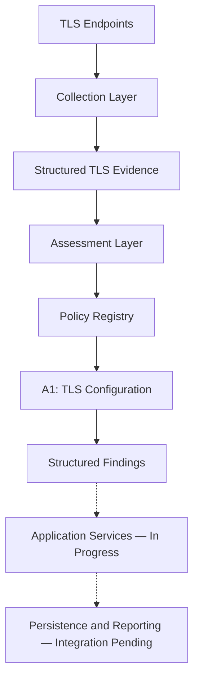

# TLS Cryptographic Inventory & PQC Risk Assessment

A Python-based security engineering project for collecting TLS cryptographic evidence, evaluating selected configuration properties, and supporting post-quantum cryptography (PQC) migration planning.

The project separates TLS evidence collection from policy-based assessment to support explainable findings, structured results, and future cryptographic inventory development.

**Status:** Active development
**Language:** Python 3.10+
**Focus:** TLS, cryptographic inventory, PQC migration, and security assessment

---

## Overview

The transition to post-quantum cryptography requires organizations to understand their existing cryptographic dependencies and identify systems that may need further investigation.

This project explores how TLS observations can support that process through structured evidence collection and explicit assessment rules.

The main objectives are to:

* Collect observable TLS configuration and certificate-related information.
* Evaluate selected TLS properties using documented assessment policies.
* Produce explainable classifications based on available evidence.
* Represent missing or insufficient evidence explicitly.
* Establish a modular foundation for broader cryptographic inventory and PQC migration analysis.

The project is evolving toward a clearer separation between collection, assessment, application orchestration, and reporting.

## Current Implementation Status

The repository has an installable Python package and a command-line interface. Application workflow integration remains in progress.

| Component                                           | Current status        |
| --------------------------------------------------- | --------------------- |
| Python package and setuptools configuration         | Implemented           |
| Command-line argument parsing                       | Implemented           |
| Assessment policy registry                          | Implemented           |
| TLS endpoint scanning                               | Implemented           |
| Certificate metadata extraction                     | Implemented           |
| TLS configuration assessment (A1)                   | Implemented           |
| Key-establishment observation                       | Partially implemented |
| Application services and workflow orchestration     | In progress           |
| End-to-end scan, assessment, and reporting workflow | Not yet connected     |
| Broader PQC migration assessment                    | Planned               |

The CLI exposes `scan`, `assess`, `report`, `run`, and `policies`. Currently, `policies` is connected to application functionality; the other commands still require their corresponding services.

## Architecture

The package separates collection and assessment responsibilities.



### Collection

The collection layer observes TLS endpoint configurations and extracts certificate-related metadata.

Responsibilities include:

* TLS endpoint scanning.
* Certificate metadata extraction.
* Key-establishment observations.
* Structured scan results and collection status.

### Assessment

The assessment layer defines the policy interface, assessment models, registry, and orchestration logic.

The currently registered policy is **A1 — TLS Configuration Assessment**, which evaluates four dimensions:

| Rule | Assessment dimension             |
| ---- | -------------------------------- |
| A1.1 | Negotiated TLS protocol version  |
| A1.2 | Negotiated cipher suite          |
| A1.3 | Certificate public-key algorithm |
| A1.4 | Certificate signature algorithm  |

The assessment model distinguishes policy execution status from finding classification. A successfully executed policy can still produce an `unknown` finding when the available evidence is insufficient.

### Application and Reporting

Application services will coordinate collection, assessment, persistence, and report generation.

These services are not yet fully connected to the CLI. Existing components should be integrated and verified before the end-to-end workflow is considered complete.

## Project Structure

The current package layout is:

```text
cryptographic-inventory-pqc-risk-assessment/
├── config/
│   └── domains.txt
├── docs/
│   ├── architecture.md
│   ├── assessment-methodology.md
│   └── data-model.md
├── src/
│   └── pqc_inventory/
│       ├── __init__.py
│       ├── __main__.py
│       ├── cli.py
│       ├── assessment/
│       │   ├── __init__.py
│       │   ├── interfaces.py
│       │   ├── models.py
│       │   ├── orchestrator.py
│       │   ├── policy_setup.py
│       │   ├── registry.py
│       │   └── policies/
│       │       ├── __init__.py
│       │       ├── a1_classifiers.py
│       │       └── a1_tls_configuration.py
│       ├── collection/
│       │   ├── __init__.py
│       │   ├── certificate_parser.py
│       │   ├── domain_loader.py
│       │   ├── key_establishment.py
│       │   ├── models.py
│       │   ├── scan_results.py
│       │   ├── tls_scanner.py
│       │   └── tls_utils.py
│       └── utils/
│           ├── __init__.py
│           └── logger.py
├── templates/
│   └── tls_pqc_report.md.j2
├── tests/
│   ├── assessment/
│   └── collection/
├── pyproject.toml
├── requirements.txt
├── README.md
└── LICENSE
```

This tree highlights the main tracked components. Additional configuration and development files may exist in the repository.

## Getting Started

### Requirements

* Python 3.10 or later.
* pip.
* OpenSSL for key-establishment collection operations that invoke `openssl s_client`.

### Installation

Clone the repository:

```bash
git clone https://github.com/git-loa/cryptographic-inventory-pqc-risk-assessment.git
cd cryptographic-inventory-pqc-risk-assessment
```

Create and activate a virtual environment.

**Windows PowerShell**

```powershell
python -m venv venv
.\venv\Scripts\Activate.ps1
```

**Linux/macOS**

```bash
python3 -m venv venv
source venv/bin/activate
```

Install the package in editable mode, including development dependencies:

```bash
python -m pip install -e ".[dev]"
```

Editable installation makes the package available to Python while allowing source changes to take effect without reinstalling the project.

## Command-Line Interface

The application can be invoked through its Python module or installed console command.

### Display help

```bash
python -m pqc_inventory --help
```

Alternatively:

```bash
pqc-assessment --help
```

### Display the version

```bash
pqc-assessment --version
```

Expected output:

```text
pqc-assessment 0.1.0
```

### List registered assessment policies

```bash
pqc-assessment policies
```

This command displays the policies registered by the application's default policy configuration.

### Planned workflow commands

The CLI also defines the following commands:

* `scan` — collect TLS evidence.
* `assess` — evaluate saved evidence using assessment policies.
* `report` — generate a report from assessment results.
* `run` — coordinate the complete workflow.

**These four commands are not yet connected to their application services.** Their argument definitions are present, but invoking them currently raises `NotImplementedError`.

They are documented here to describe the CLI structure, not as currently working workflows.

## Assessment Methodology

The project uses explicit assessment classifications rather than treating a single numerical score as a definitive measure of PQC readiness.

### Finding classifications

| Classification           | Meaning                                                                 |
| ------------------------ | ----------------------------------------------------------------------- |
| `acceptable`             | Meets the project's current rule for the specific assessment dimension. |
| `acceptable_with_review` | Requires additional review or migration consideration.                  |
| `unacceptable`           | Does not meet the project's current rule.                               |
| `unknown`                | Available evidence or implemented rules do not support a conclusion.    |

These classifications are specific to the project's policies. They are not universal security ratings.

### Policy execution statuses

| Status         | Meaning                                   |
| -------------- | ----------------------------------------- |
| `completed`    | The policy completed execution.           |
| `partial`      | The policy produced only partial results. |
| `not_assessed` | The assessment was not performed.         |
| `failed`       | Policy execution failed.                  |

Execution status and finding classification represent different concepts. A failed assessment does not automatically mean that an endpoint is cryptographically unacceptable.

### Assessment coverage

**A1 — TLS Configuration Assessment** evaluates:

* Negotiated TLS protocol version.
* Negotiated cipher suite.
* Certificate public-key algorithm.
* Certificate signature algorithm.

**A2 — Key-Establishment Exposure** has partial supporting collection and recognition functionality. Its evidence comes from a separate OpenSSL handshake, which may not represent the negotiation observed during the primary scan.

Additional assessment areas, including broader evidence quality, contextual risk, migration feasibility, and recommendations, remain under development.

For detailed rules and known limitations, see [`docs/assessment-methodology.md`](docs/assessment-methodology.md).

## Development

### Running the tests

The repository retains its test suite for verifying collection and assessment behavior.

Run all tests from the repository root:

```bash
pytest -q
```

Run assessment tests only:

```bash
pytest tests/assessment/ -q
```

Run collection tests only:

```bash
pytest tests/collection/ -q
```

### Development principles

Development focuses on:

* Keeping collection separate from assessment decisions.
* Making findings explainable and traceable to evidence.
* Representing missing or incomplete evidence explicitly.
* Keeping policy execution status separate from finding classification.
* Reusing existing components where appropriate.
* Removing obsolete implementations only after replacements are verified.

## Roadmap

The next development milestones are:

* [x] Establish the `src/pqc_inventory` package structure.
* [x] Configure setuptools packaging and the console entry point.
* [x] Verify module execution and policy listing.
* [ ] Connect the CLI to application services.
* [ ] Implement and integrate the scan workflow.
* [ ] Implement assessment execution and result persistence.
* [ ] Integrate Markdown report generation.
* [ ] Connect the complete scan-to-assessment-to-report workflow.
* [ ] Reconcile legacy scoring and reporting components with the policy-based architecture.
* [ ] Expand and validate key-establishment assessment.
* [ ] Introduce additional assessment policies with documented evidence requirements.
* [ ] Explore structured cryptographic inventory and CycloneDX CBOM integration.

Roadmap items describe intended work and should not be interpreted as implemented capabilities.

## Security Considerations and Limitations

This project is an evolving engineering and research project, not a comprehensive security auditing or PQC readiness platform.

Important limitations include:

* TLS observations do not represent every cryptographic dependency in an organization.
* Certificate metadata extraction does not establish certificate trust or hostname validity.
* A certificate's public-key algorithm, certificate signature algorithm, cipher suite, and key-establishment group describe different properties.
* Key-establishment observations from a separate handshake may not represent the original connection.
* Assessment coverage is limited to implemented rules and collected evidence.
* Existing numerical scoring must not be interpreted as a definitive PQC readiness rating.
* The project has not been presented as independently security-audited or production-certified.

Use assessment findings to support further investigation, not as a substitute for a comprehensive cryptographic inventory or formal migration assessment.

Only scan systems you own or have explicit authorization to assess.

## References

The project's assessment methodology draws on relevant TLS and cryptographic standards, including:

* [RFC 9325 — Recommendations for Secure Use of TLS and DTLS](https://www.rfc-editor.org/rfc/rfc9325)
* [RFC 9881 — Use of ML-DSA in X.509 Public Key Infrastructure](https://www.rfc-editor.org/rfc/rfc9881)

These standards inform parts of the methodology; the implemented rules may be narrower than the standards themselves.

## License

See [`LICENSE`](LICENSE) for the project's licensing terms.
