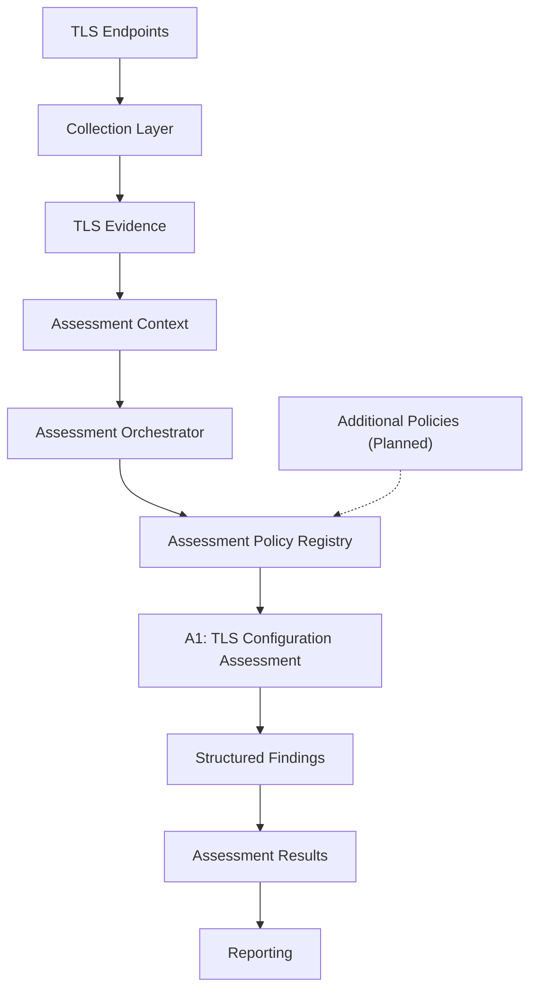

# TLS Cryptographic Inventory & PQC Risk Assessment

A Python-based security engineering project for collecting TLS cryptographic evidence, assessing selected TLS configuration properties, and supporting post-quantum cryptography (PQC) migration planning.

The project combines TLS endpoint scanning, structured evidence collection, policy-based assessment, and reporting.

**Status:** Active development
**Language:** Python
**Focus:** TLS, cryptographic inventory, PQC migration, and security assessment

## Overview

Organizations preparing for post-quantum cryptography need to understand their cryptographic dependencies and identify systems requiring further investigation.

This project collects observable TLS configuration and certificate-related information and evaluates selected properties against explicit assessment rules.

Its objectives are to:

* Collect and structure TLS cryptographic evidence.
* Evaluate selected TLS configuration properties using assessment policies.
* Produce explainable findings with supporting evidence and limitations.
* Establish a modular foundation for additional cryptographic assessments.

## Current Capabilities

### TLS Scanning and Evidence Collection

The scanning components collect TLS endpoint information, including:

* Negotiated TLS protocol version and cipher suite.
* Certificate-related information.
* Public-key and certificate signature algorithm observations.
* Key-establishment information where supported.
* Scan status and evidence-collection metadata.

Available observations depend on the endpoint, scanning method, and underlying tools.

### Policy-Based Assessment

The `src/assessment/` package provides an assessment policy interface, registry, orchestrator, and structured assessment models.

The currently registered policy is **A1 — TLS Configuration Assessment**, which evaluates four dimensions:

| Rule | Assessment dimension            |
| ---- | ------------------------------- |
| A1.1 | TLS protocol version            |
| A1.2 | Cipher suite                    |
| A1.3 | Public-key algorithm            |
| A1.4 | Certificate signature algorithm |

Assessment findings include classifications, rationales, and references to supporting evidence.

The repository also contains existing scoring and reporting components that are being reconciled with the policy-based architecture.

## Architecture

The intended architecture separates evidence collection from assessment decisions and reporting.



### Main Components

* **Collection — `src/collection/`:** Collects TLS evidence and represents observations using structured data models.
* **Assessment — `src/assessment/`:** Defines assessment interfaces, policies, the registry, and orchestration logic.
* **Scanning and reporting — `src/scanner/`:** Contains scanning, scoring, data-handling, and reporting modules.
* **Pipeline — `src/pipeline.py`:** Coordinates the existing command-line workflow and is planned for refactoring.

The complete scanning-to-assessment-to-reporting workflow is still under development. The diagram represents the intended architecture, not a guarantee that every stage is already integrated.

## Getting Started

### Requirements

* Python.
* Dependencies declared in the repository.
* OpenSSL for key-establishment collection operations that use `openssl s_client`.

### Installation

Clone the repository:

```bash
git clone https://github.com/git-loa/cryptographic-inventory-pqc-risk-assessment.git
cd cryptographic-inventory-pqc-risk-assessment
```

Create and activate a virtual environment.

**Windows PowerShell:**

```powershell
python -m venv .venv
.\.venv\Scripts\Activate.ps1
```

**Linux/macOS:**

```bash
python3 -m venv .venv
source .venv/bin/activate
```

Install the project's dependencies according to its dependency manifest.

### Run the Existing Pipeline

Display the available command-line options:

```bash
python -m src.pipeline --help
```

Run the existing pipeline against configured domains:

```bash
python -m src.pipeline --all --domains config/domains.txt
```

The current pipeline uses a flag-based interface. A redesigned CLI and application workflow are planned.

Only scan systems you own or are authorized to assess.

## Assessment Methodology

The assessment model distinguishes finding classifications from policy execution statuses.

**Finding classifications:**

* `acceptable`
* `acceptable_with_review`
* `unacceptable`
* `unknown`

**Policy execution statuses:**

* `completed`
* `partial`
* `not_assessed`
* `failed`

These concepts represent different aspects of an assessment. A policy may complete successfully but produce an `unknown` finding when evidence is insufficient. Similarly, a policy execution failure does not automatically mean that the endpoint is cryptographically unacceptable.

The assessment approach emphasizes explicit rules, explainable findings, and transparent evidence limitations. Existing numerical scores should be interpreted according to their implemented methodology, not as definitive PQC readiness ratings.

## Testing

The repository includes tests for assessment policies, orchestration, registry behavior, TLS scanning, certificate parsing, and key-establishment collection.

Run the test suite from the repository root:

```bash
pytest
```

Run assessment tests separately:

```bash
pytest tests/assessment/
```

## Limitations

This project is under active development and is not a comprehensive security auditing or PQC readiness platform.

* Current policy-based assessment coverage is limited to selected TLS configuration properties.
* Available evidence depends on scanning capabilities and endpoint behavior.
* Key-establishment observations collected through a separate handshake may not represent the original connection.
* Existing scoring and reporting components are being reconciled with the policy-based assessment architecture.
* Comprehensive PQC migration planning requires broader information about cryptographic dependencies, data sensitivity, protocols, and operational constraints.

Missing evidence should not automatically be interpreted as evidence of an insecure configuration.

## Roadmap

* [ ] Refactor the pipeline and introduce a clearer CLI.
* [ ] Separate scanning, assessment, and reporting workflows.
* [ ] Standardize evidence and assessment-result persistence.
* [ ] Strengthen A1 integration and end-to-end testing.
* [ ] Complete and validate A2 assessment rules, including key-establishment evidence.
* [ ] Introduce additional assessment policies.
* [ ] Retire obsolete components after their replacements are verified.

## Disclaimer

This project is intended for educational, research, and engineering development purposes. Its results are not a certification of security, a comprehensive cryptographic inventory, or a definitive determination of post-quantum readiness.
