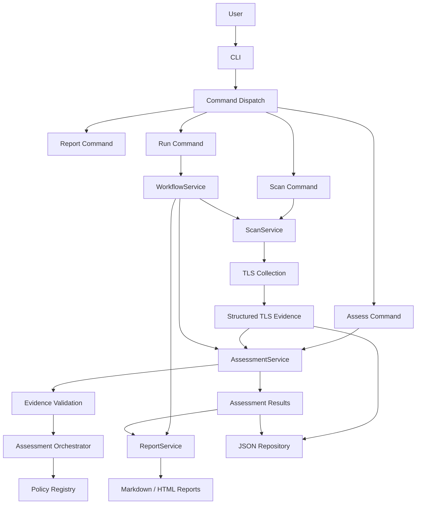

# TLS Cryptographic Inventory & PQC Risk Assessment

A Python security engineering project for collecting TLS cryptographic evidence and assessing selected configuration properties to support post-quantum cryptography (PQC) migration planning.

**Status:** Active development
**Python:** 3.10+
**Focus:** TLS, cryptographic inventory, assessment policies, and PQC migration

## Overview

Preparing for post-quantum cryptography requires understanding existing cryptographic configurations and identifying systems that need further investigation.

This project provides structured TLS evidence collection, explainable policy-based assessment, JSON persistence, and report generation.

Current capabilities include:

- TLS endpoint scanning and certificate metadata extraction.
- Structured evidence with collection status and diagnostic information.
- Policy-based assessment using an extensible policy interface.
- Evidence validation and assessment orchestration.
- JSON persistence for scan evidence and assessment results.
- Markdown and HTML assessment reports.
- End-to-end workflow orchestration.
- Configurable workspace directories and default output locations.

The architecture separates evidence collection, assessment decisions, application orchestration, and reporting.

## Current Status

| Component | Status |
|---|---|
| Python package and CLI entry point | Implemented |
| TLS collection and certificate parsing | Implemented |
| Evidence validation | Implemented |
| Assessment framework and policy registry | Implemented |
| A1 — TLS Configuration Quality | Implemented |
| Key-establishment evidence collection | Partially implemented |
| ScanService | Implemented and connected |
| AssessmentService | Implemented and connected |
| ReportService | Implemented and connected |
| WorkflowService | Implemented and connected |
| Workspace configuration | Implemented |
| Default output path management | Implemented |
| Markdown report generation | Implemented |
| HTML report generation | Implemented |
| Additional assessment policies | Planned |
| Broader PQC migration assessment | Planned |

The CLI provides five commands: `policies`, `scan`, `assess`, `report`, and `run`.

The `run` command coordinates TLS collection, assessment, and report generation through the application workflow service.

## Architecture



The diagram illustrates the application components and their relationships. Individual commands can execute independently, while `run` coordinates the complete workflow.

## Assessment Methodology

The implemented policy, **A1 — TLS Configuration Quality**, evaluates four dimensions:

| Rule | Dimension |
|---|---|
| A1.1 | Negotiated TLS version |
| A1.2 | Negotiated cipher suite |
| A1.3 | Certificate public-key algorithm |
| A1.4 | Certificate signature algorithm |

Findings use four classifications:

- `acceptable`
- `acceptable_with_review`
- `unacceptable`
- `unknown`

Classifications are project-specific and depend on implemented rules and available evidence.

The project does not currently provide a comprehensive PQC risk score.

Key-establishment observations are collected through a separate OpenSSL handshake. They may not represent the negotiation observed during the primary scan.

For detailed rules and limitations, see [`docs/assessment-methodology.md`](docs/assessment-methodology.md).

## Getting Started

### Requirements

- Python 3.10 or later
- pip
- OpenSSL for key-establishment collection operations

### Installation

Clone the repository:

```bash
git clone https://github.com/git-loa/cryptographic-inventory-pqc-risk-assessment.git
cd cryptographic-inventory-pqc-risk-assessment
```

Create and activate a virtual environment.

**Windows PowerShell**

```powershell
python -m venv venv
.\venv\Scripts\Activate.ps1
```

**Linux/macOS**

```bash
python3 -m venv venv
source venv/bin/activate
```

Install the package with development dependencies:

```bash
python -m pip install -e ".[dev]"
```

## CLI Usage

Display help:

```bash
pqc-assessment --help
```

Display the version:

```bash
pqc-assessment --version
```

### List registered policies

```bash
pqc-assessment policies
```

### Collect TLS evidence

Scan one or more targets:

```bash
pqc-assessment scan --targets example.com example.org
```

Alternatively, provide a target file:

```bash
pqc-assessment scan --targets-file config/domains.txt
```

Specify a custom output location:

```bash
pqc-assessment scan --targets example.com --output evidence.json
```

### Assess collected evidence

Execute a selected policy:

```bash
pqc-assessment assess --input pqc-assessment/evidence/tls_scans.json --policies A1
```

Execute all registered policies without interactive confirmation:

```bash
pqc-assessment assess --input pqc-assessment/evidence/tls_scans.json --yes
```

Specify a custom assessment output:

```bash
pqc-assessment assess --input evidence.json --policies A1 --output assessment.json
```

### Generate assessment reports

Generate a Markdown report:

```bash
pqc-assessment report --input pqc-assessment/assessments/assessment_runs.json
```

Generate an HTML report:

```bash
pqc-assessment report --input pqc-assessment/assessments/assessment_runs.json --format html
```

Generate all supported report formats:

```bash
pqc-assessment report --input pqc-assessment/assessments/assessment_runs.json --all-formats
```

### Execute the complete workflow

The `run` command coordinates collection, assessment, persistence, and reporting.

```bash
pqc-assessment run --targets example.com --policies A1
```

Generate both Markdown and HTML reports:

```bash
pqc-assessment run --targets example.com --policies A1 --all-formats
```

Custom output destinations can be supplied using:

- `--evidence-output`
- `--assessment-output`
- `--output`
- `--output-dir`

Use `--yes` to skip interactive policy confirmation when executing all registered policies.

### Workspace Configuration

The application initializes its workspace automatically when running `scan`, `assess`, `report`, or `run`.

By default, the workspace is created under:

```text
pqc-assessment/
├── config/
│   ├── config.yaml
│   └── policies.yaml
├── evidence/
├── assessments/
├── reports/
└── logs/
```

The `config.yaml` file allows users to customize workspace directory names.

Example:

```yaml
workspace:
  directories:
    evidence: "evidence"
    assessments: "assessments"
    reports: "reports"
    logs: "logs"
```

Default output destinations are:

| Artifact | Default location |
|---|---|
| TLS evidence | `evidence/tls_scans.json` |
| Assessment results | `assessments/assessment_runs.json` |
| Markdown report | `reports/assessment_report.md` |
| HTML report | `reports/assessment_report.html` |

Existing configuration files are preserved during workspace initialization.

The `policies.yaml` template is installed as configuration scaffolding. Runtime loading of user-defined YAML policies is not yet implemented; policies are currently registered programmatically.

## Development and Testing

Run the complete test suite:

```bash
pytest -q
```

Run pre-commit checks:

```bash
pre-commit run --all-files
```

Run assessment tests:

```bash
pytest tests/assessment/ -q
```

Run collection tests:

```bash
pytest tests/collection/ -q
```

The project uses Black, Flake8, Pylint, Pytest, and Pre-commit to maintain code quality and test coverage.

## Documentation

- [`docs/architecture.md`](docs/architecture.md) — System components and application workflows.
- [`docs/data-model.md`](docs/data-model.md) — Evidence and assessment data structures.
- [`docs/assessment-methodology.md`](docs/assessment-methodology.md) — Classification rules and assessment limitations.

## Limitations and Responsible Use

This project is an evolving security engineering project, not a comprehensive security audit or production-certified PQC readiness platform.

- TLS observations do not reveal every cryptographic dependency within an organization.
- Certificate metadata extraction does not establish certificate trust or hostname validity.
- Findings are limited to collected evidence and implemented assessment rules.
- Key-establishment observations from a separate handshake may differ from the primary scan.
- Additional assessment policies and broader migration analysis remain under development.

Use findings to support further investigation rather than as a substitute for a complete cryptographic inventory and migration assessment.

Only scan systems you own or have explicit authorization to assess.

## References

- RFC 9325 — Recommendations for Secure Use of TLS and DTLS.
- RFC 9881 — Use of ML-DSA in X.509 Public Key Infrastructure.

These standards inform parts of the assessment methodology; the implemented rules may be narrower than the standards.

## License

See [`LICENSE`](LICENSE) for licensing terms.
