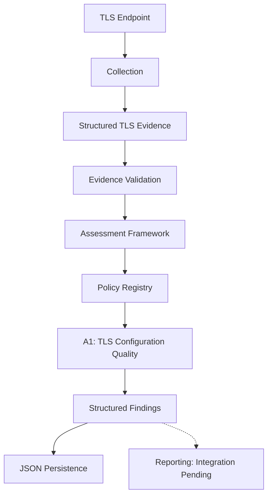

# TLS Cryptographic Inventory & PQC Risk Assessment

A Python security engineering project for collecting TLS cryptographic evidence and assessing selected configuration properties to support post-quantum cryptography (PQC) migration planning.

**Status:** Active development
**Python:** 3.10+
**Focus:** TLS, cryptographic inventory, assessment policies, and PQC migration

## Overview

Preparing for post-quantum cryptography requires understanding existing cryptographic configurations and identifying systems that need further investigation.

This project explores that process through structured TLS evidence collection and explainable, rule-based assessment.

Current capabilities include:

* TLS endpoint scanning and certificate metadata extraction.
* Structured evidence with collection status and diagnostic information.
* Policy-based assessment of selected TLS configuration properties.
* JSON persistence for scan evidence and assessment results.
* Initial support for observing TLS key-establishment groups.

The project is designed to separate evidence collection from assessment decisions.

## Current Status

| Component                                | Status                                   |
| ---------------------------------------- | ---------------------------------------- |
| Python package and CLI entry point       | Implemented                              |
| TLS collection and certificate parsing   | Implemented                              |
| Assessment framework and policy registry | Implemented                              |
| A1 — TLS Configuration Quality           | Implemented                              |
| Key-establishment evidence collection    | Partially implemented                    |
| Application services                     | Implemented; CLI integration in progress |
| End-to-end CLI workflow                  | Not yet connected                        |
| Markdown report generation               | Not yet integrated                       |
| Broader PQC migration assessment         | Planned                                  |

The CLI currently connects the `policies` command to the policy registry. The `scan`, `assess`, `report`, and `run` commands are defined but not yet connected to their application services.

## Architecture



The architecture separates four responsibilities:

* **Collection:** Observes TLS configuration and extracts certificate metadata.
* **Assessment:** Evaluates supplied evidence against explicit policy rules.
* **Application:** Coordinates collection, validation, assessment, and persistence.
* **Reporting:** Planned integration for presenting assessment results.

## Assessment Methodology

The implemented policy, **A1 — TLS Configuration Quality**, evaluates four dimensions:

| Rule | Dimension                        |
| ---- | -------------------------------- |
| A1.1 | Negotiated TLS version           |
| A1.2 | Negotiated cipher suite          |
| A1.3 | Certificate public-key algorithm |
| A1.4 | Certificate signature algorithm  |

Findings use four classifications:

* `acceptable`
* `acceptable_with_review`
* `unacceptable`
* `unknown`

Classifications are project-specific and depend on implemented rules and available evidence. The project does not currently provide a comprehensive PQC risk score.

Key-establishment observations are collected through a separate OpenSSL handshake and may not represent the negotiation observed during the primary scan.

For detailed rules and limitations, see [`docs/assessment-methodology.md`](docs/assessment-methodology.md).

## Getting Started

### Requirements

* Python 3.10 or later
* pip
* OpenSSL for key-establishment collection operations

### Installation

Clone the repository:

```bash
git clone https://github.com/git-loa/cryptographic-inventory-pqc-risk-assessment.git
cd cryptographic-inventory-pqc-risk-assessment
```

Create and activate a virtual environment.

**Windows PowerShell**

```powershell
python -m venv venv
.\venv\Scripts\Activate.ps1
```

**Linux/macOS**

```bash
python3 -m venv venv
source venv/bin/activate
```

Install the package with development dependencies:

```bash
python -m pip install -e ".[dev]"
```

### CLI Usage

Display help:

```bash
pqc-assessment --help
```

Display the version:

```bash
pqc-assessment --version
```

List registered assessment policies:

```bash
pqc-assessment policies
```

The CLI can also be invoked as a Python module:

```bash
python -m pqc_inventory --help
```

**Note:** Only the `policies` command is currently connected to application functionality. The other workflow commands remain under development.

## Development and Testing

Run the complete test suite:

```bash
pytest -q
```

Run assessment tests:

```bash
pytest tests/assessment/ -q
```

Run collection tests:

```bash
pytest tests/collection/ -q
```

Development priorities include completing CLI integration, validating the end-to-end workflow, integrating reporting, and expanding assessment coverage.

## Documentation

* [`docs/architecture.md`](docs/architecture.md) — System components and workflow.
* [`docs/data-model.md`](docs/data-model.md) — Evidence and assessment data structures.
* [`docs/assessment-methodology.md`](docs/assessment-methodology.md) — Classification rules and assessment limitations.

## Limitations and Responsible Use

This project is an evolving security engineering project, not a comprehensive security audit or production-certified PQC readiness platform.

* TLS observations do not reveal every cryptographic dependency within an organization.
* Certificate metadata extraction does not establish certificate trust or hostname validity.
* Findings are limited to collected evidence and implemented assessment rules.
* Key-establishment observations from a separate handshake may differ from the primary scan.
* The project does not currently provide a comprehensive migration-priority assessment.

Use findings to support further investigation rather than as a substitute for a complete cryptographic inventory and migration assessment.

Only scan systems you own or have explicit authorization to assess.

## References

* RFC 9325 — Recommendations for Secure Use of TLS and DTLS.
* RFC 9881 — Use of ML-DSA in X.509 Public Key Infrastructure.

These standards inform parts of the assessment methodology; the implemented rules may be narrower than the standards.

## License

See [`LICENSE`](LICENSE) for licensing terms.
