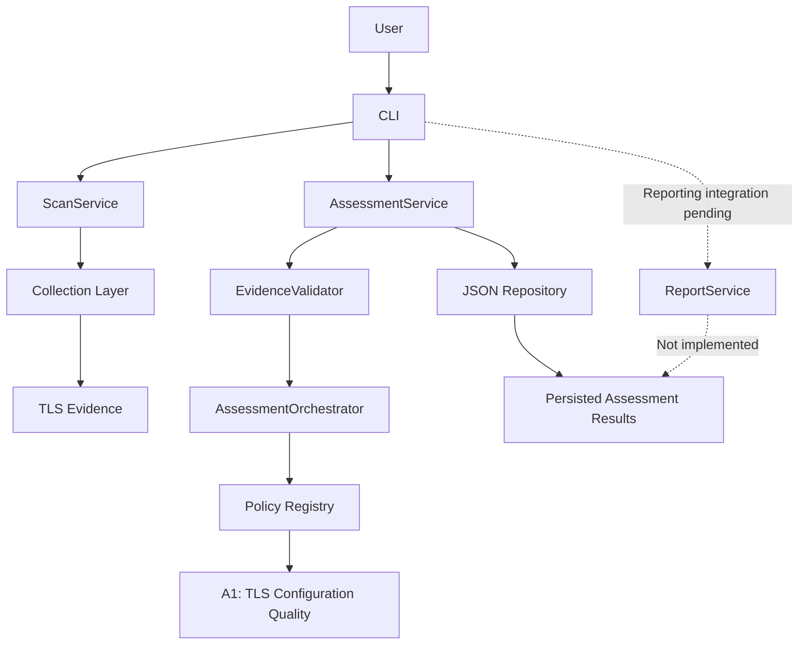
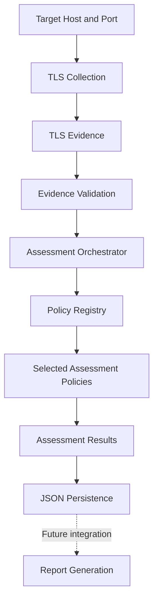
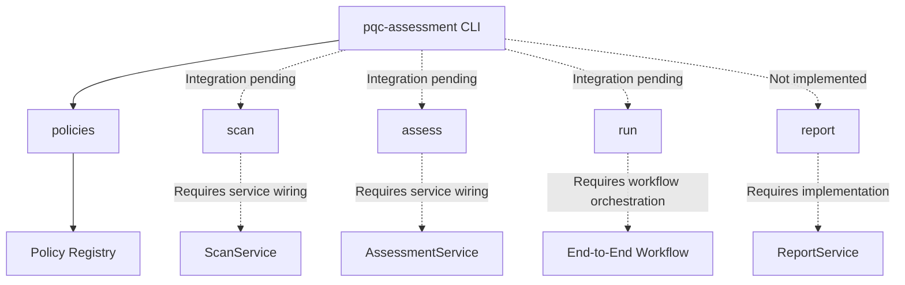

# Architecture

## 1. Purpose and Scope

The **Cryptographic Inventory and PQC Risk Assessment** project collects TLS configuration evidence and evaluates it against explicit assessment policies.

The system is designed to separate evidence collection, assessment logic, and data persistence. This separation supports independent testing, maintainability, and the future addition of assessment policies.

The architecture describes the current implementation, including components that exist but are not yet connected to the command-line interface.

## 2. System Architecture

The application is organized into five main areas:

* **CLI:** Defines commands and provides the application entry point.
* **Application services:** Coordinate scanning, evidence validation, assessment, and reporting workflows.
* **Collection:** Collects TLS evidence and extracts relevant connection and certificate information.
* **Assessment:** Applies registered policies to validated evidence and produces assessment results.
* **Storage:** Loads and saves evidence or assessment data in JSON format.

### Architecture overview



The diagram shows the architectural relationships, not a fully connected execution pipeline. The collection and assessment services exist, but the CLI has not yet been wired to those services. Reporting is not implemented.

## 3. Processing and Assessment Flow

The intended workflow begins with TLS evidence collection. The evidence is then validated and evaluated by the selected assessment policies.

Each policy evaluates specific properties of the evidence and produces results according to its defined classification rules.

### Intended workflow



This diagram represents the intended end-to-end workflow. Individual components are implemented to different degrees, and the complete workflow is not yet available through the CLI.

The `AssessmentService` supports assessment of evidence and file-based assessment. The `ScanService` supports individual and multiple-target scanning. Connecting these services through the CLI remains outstanding.

## 4. Assessment Design

The assessment subsystem separates policy definitions from the orchestration of assessments.

Its principal components are:

* **`AssessmentPolicy`:** Defines the interface that assessment policies implement.
* **`PolicyRegistry`:** Registers and provides access to available policies.
* **`AssessmentOrchestrator`:** Coordinates policy execution against assessment context.
* **`AssessmentContext`:** Supplies the domain, TLS evidence, and methodology version required for assessment.
* **`AssessmentService`:** Validates input evidence and coordinates assessment through the assessment subsystem.

### Implemented policy

**A1 — TLS Configuration Quality** evaluates TLS configuration using explicit, evidence-based classification rules.

Its scope includes:

* Negotiated TLS version.
* Negotiated cipher suite.
* Certificate public-key algorithm.
* Certificate signature algorithm.

The policy interface and A1 implementation exist in the codebase. Additional policies should be introduced only when their requirements, classification rules, evidence needs, and tests are defined.

The presence of collection functionality related to key establishment does not, by itself, mean that a corresponding assessment policy has been implemented.

Detailed classification rules belong in [`assessment-methodology.md`](assessment-methodology.md), rather than in this architecture document.

## 5. Data and Persistence

The collection layer produces structured TLS evidence. The assessment subsystem uses that evidence to generate assessment results.

The data models define the structures exchanged between components. Their detailed fields and relationships are documented separately in [`data-model.md`](data-model.md).

The storage layer provides JSON loading and saving through `json_repository.py`. The assessment service can use this repository to load evidence and persist assessment runs.

Current persistence should not be interpreted as a complete reporting or long-term data-management solution. A broader reporting workflow and any additional storage requirements remain future work.

## 6. Implementation Status

The project is under active development. The following table distinguishes existing components from outstanding integration.

| Component                                    | Current status                       |
| -------------------------------------------- | ------------------------------------ |
| TLS collection                               | Implemented                          |
| Collection data models and parsing utilities | Implemented                          |
| Evidence validation                          | Implemented                          |
| Assessment policy interface                  | Implemented                          |
| Policy registry and orchestration            | Implemented                          |
| A1 — TLS Configuration Quality               | Implemented                          |
| JSON persistence                             | Implemented                          |
| Scan service                                 | Implemented; CLI integration pending |
| Assessment service                           | Implemented; CLI integration pending |
| CLI policy listing                           | Connected                            |
| CLI scan command                             | Not connected                        |
| CLI assess command                           | Not connected                        |
| CLI report command                           | Not implemented                      |
| CLI run command                              | Not connected                        |
| Report service                               | Not implemented                      |
| Additional assessment policies               | Future work                          |

### CLI integration status



The CLI currently supports listing registered policies. The other commands are defined in the parser but are not yet connected to working command handlers.

This status should be updated whenever functionality is implemented or integration changes.

## 7. Package Structure and Design Principles

The main application package is `src/pqc_inventory/`.

```text
src/pqc_inventory/
├── __main__.py
├── cli.py
├── application/
│   ├── assessment_service.py
│   ├── evidence_validator.py
│   ├── report_service.py
│   └── scan_service.py
├── assessment/
│   ├── interfaces.py
│   ├── models.py
│   ├── orchestrator.py
│   ├── policy_setup.py
│   ├── registry.py
│   └── policies/
├── collection/
│   ├── certificate_parser.py
│   ├── domain_loader.py
│   ├── key_establishment.py
│   ├── models.py
│   ├── scan_results.py
│   ├── tls_scanner.py
│   └── tls_utils.py
├── storage/
│   └── json_repository.py
└── utils/
    └── logger.py
```

The structure follows these principles:

1. **Separation of responsibilities:** Collection, assessment, orchestration, and persistence have distinct roles.
2. **Explicit assessment rules:** Policies classify evidence using documented criteria rather than hidden assumptions.
3. **Testability:** Components can be tested independently and integrated incrementally.
4. **Extensibility:** Additional policies can follow the existing policy interface.
5. **Evidence-based results:** Assessments should be traceable to the evidence and methodology used.
6. **Incremental integration:** CLI commands should be connected to application services as their workflows become ready.

The architecture will evolve as CLI integration, reporting, and additional assessment policies are implemented. Documentation should reflect verified behavior rather than intended functionality.
