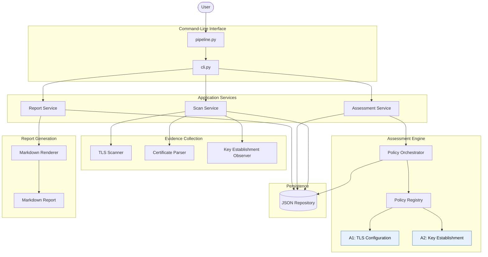
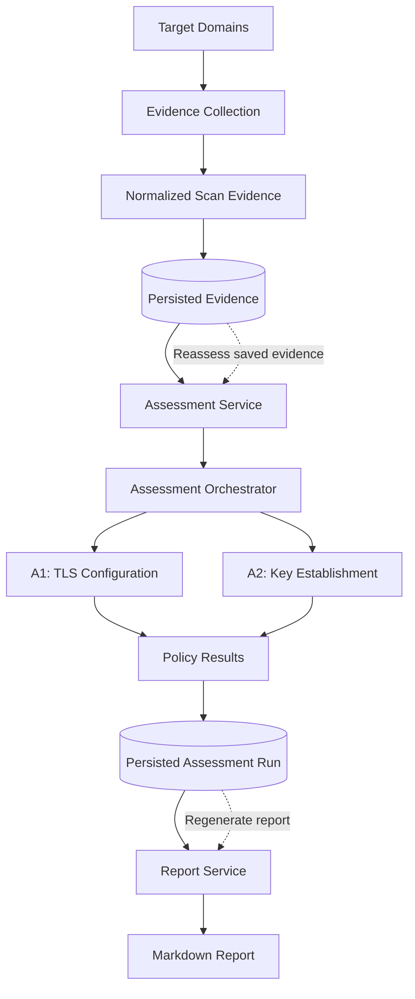
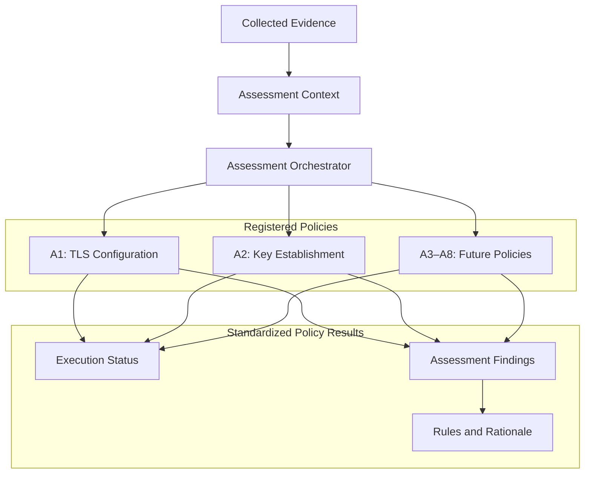
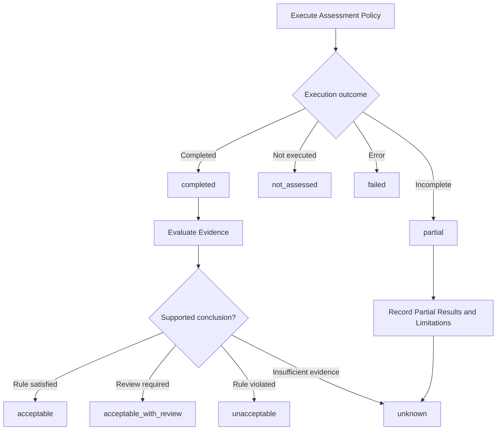

# System Architecture

## 1. Purpose

The Cryptographic Inventory and PQC Risk Assessment project collects TLS cryptographic evidence and evaluates it against documented assessment policies.

The architecture separates five responsibilities:

* **Collection:** Observe TLS configurations and certificate properties.
* **Assessment:** Apply documented rules to collected evidence.
* **Storage:** Persist evidence and assessment results.
* **Application:** Coordinate scanning, assessment, and reporting.
* **Reporting:** Present findings, supporting evidence, and limitations.

This separation supports independent testing, explainable assessments, and reassessment without unnecessary network rescanning.

> **Status:** This document describes the target architecture. The existing repository will be migrated incrementally.

## 2. System Architecture



### Component responsibilities

| Component               | Responsibility                                   |
| ----------------------- | ------------------------------------------------ |
| `pipeline.py`           | Application entry point and command dispatch     |
| `cli.py`                | Command-line arguments and terminal presentation |
| `scan_service.py`       | Coordinates evidence collection                  |
| `assessment_service.py` | Coordinates policy execution                     |
| `report_service.py`     | Coordinates report generation                    |
| `tls_scanner.py`        | Collects TLS endpoint observations               |
| `certificate_parser.py` | Extracts certificate properties                  |
| `key_establishment.py`  | Collects key-establishment observations          |
| `interfaces.py`         | Defines the assessment policy contract           |
| `registry.py`           | Maintains available assessment policies          |
| `orchestrator.py`       | Coordinates policy execution                     |
| `json_repository.py`    | Loads and persists structured data               |
| `markdown.py`           | Renders assessment results into Markdown         |

The CLI must not contain scanning algorithms or assessment rules. The report renderer must not make independent security decisions.

## 3. Data Flow



The workflow has three independently executable operations:

1. **Scan:** Collect and persist evidence.
2. **Assess:** Apply policies to available evidence and persist results.
3. **Report:** Render saved assessment results.

This design allows users to reassess evidence after policy changes without automatically repeating network scans.

If new rules require evidence that was never collected, the assessment must report that limitation.

## 4. Assessment Policy Architecture

Assessment policies implement a shared contract and produce standardized results.



Each policy is responsible for evaluating its defined assessment dimensions.

The orchestrator is responsible for invoking policies and collecting results. It should not duplicate the internal rules of individual policies.

### Policy contract

The proposed interface is:

```python
from typing import Protocol


class AssessmentPolicy(Protocol):
    @property
    def policy_id(self) -> str:
        ...

    @property
    def policy_version(self) -> str:
        ...

    def assess(self, context: "AssessmentContext") -> "PolicyResult":
        ...
```

`AssessmentContext` provides the evidence and applicable configuration.

`PolicyResult` contains the execution status, findings, and limitations.

This interface is a design proposal; it has not yet been established as the repository's implemented contract.

## 5. Assessment Status and Classification

Policy execution status and finding classification are independent concepts.



**Execution status** describes whether the assessment ran successfully.

**Classification** describes what the evidence supports.

A completed policy may produce an `unknown` finding. A failed policy must not automatically produce an `unacceptable` finding.

The methodology document defines the actual classification criteria.

## 6. Storage and Reporting

The initial persistence implementation will use JSON.

The storage layer will manage:

* Scan evidence.
* Assessment runs.
* Schema validation.
* Supported schema versions.
* Loading and saving results.

The reporting layer will render saved assessment results without repeating assessment logic.

Reports should include:

* Assessment scope and scan coverage.
* Successful scans and failures.
* Findings grouped by policy.
* Classifications and supporting rationale.
* Evidence provenance where available.
* Unknown findings and missing evidence.
* Policy and methodology versions.
* Assessment limitations.

No unexplained aggregate score should replace individual findings.

## 7. Target Repository Structure

```text
cryptographic-inventory-pqc-risk-assessment/
├── config/
│   ├── domains.txt
│   └── assessment.toml
├── docs/
│   ├── architecture.md
│   ├── assessment-methodology.md
│   ├── data-model.md
│   └── decisions/
├── src/
│   ├── pipeline.py
│   ├── cli.py
│   ├── application/
│   │   ├── scan_service.py
│   │   ├── assessment_service.py
│   │   └── report_service.py
│   ├── scanner/
│   │   ├── tls_scanner.py
│   │   ├── certificate_parser.py
│   │   └── key_establishment.py
│   ├── assessment/
│   │   ├── models.py
│   │   ├── interfaces.py
│   │   ├── registry.py
│   │   ├── orchestrator.py
│   │   └── policies/
│   │       ├── a1_tls_configuration.py
│   │       ├── a2_key_establishment.py
│   │       └── ...
│   ├── storage/
│   │   └── json_repository.py
│   ├── reporting/
│   │   ├── markdown.py
│   │   └── templates/
│   └── utils/
├── tests/
│   ├── unit/
│   ├── integration/
│   ├── contract/
│   └── fuzz/
├── reports/
├── data/
├── pyproject.toml
└── README.md
```

This is the target structure, not a claim that all these paths already exist.

## 8. Migration Plan

Implementation will proceed incrementally:

1. Finalize the architecture and data-model contracts.
2. Introduce shared assessment models and the policy interface.
3. Migrate A1 and its tests.
4. Define and integrate A2.
5. Standardize evidence and assessment persistence.
6. Align reporting with the shared result model.
7. Replace the legacy CLI workflow.
8. Remove obsolete scoring code and update documentation.
9. Introduce additional policies when their methodologies and evidence requirements are defined.

Each phase should be independently testable.

Moving files alone does not complete the migration. The implementation, data contracts, and tests must agree with the architecture.
