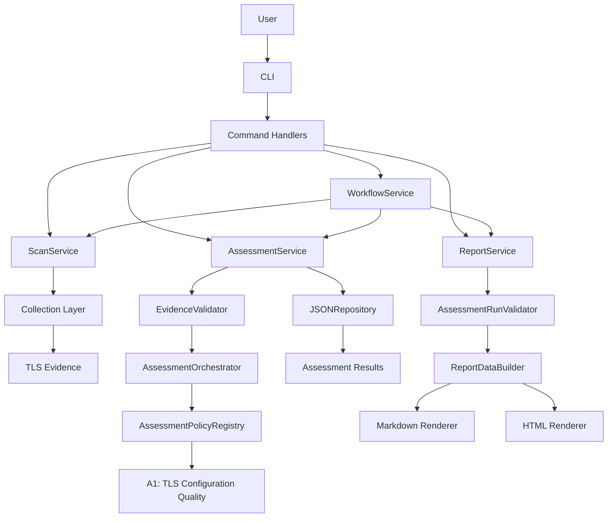
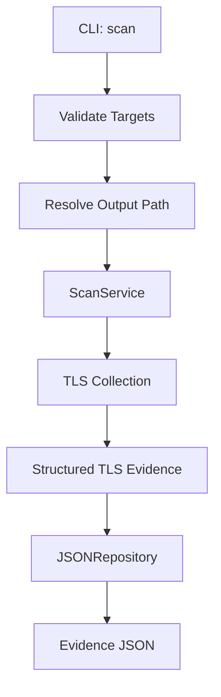
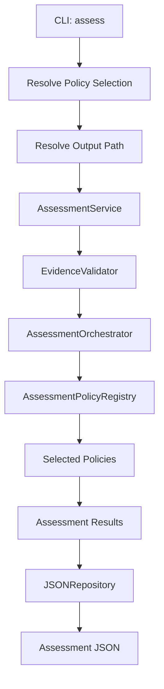
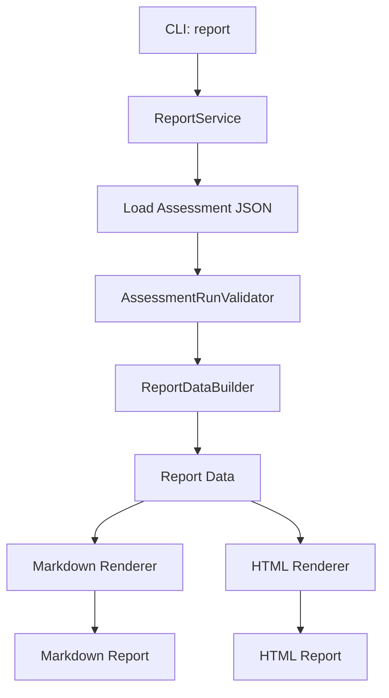
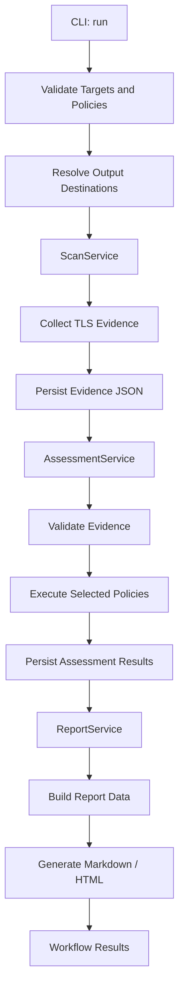

# Architecture

## 1. Purpose and Scope

The **Cryptographic Inventory and PQC Risk Assessment** project collects TLS configuration evidence and evaluates it against explicit assessment policies.

The architecture separates evidence collection, assessment logic, application orchestration, reporting, and persistence.

This separation supports independent testing, maintainability, and the future addition of assessment policies.

The application provides individual CLI commands for collection, assessment, and report generation, as well as a unified workflow command.

## 2. System Architecture

The application is organized into six main areas:

- **CLI:** Defines commands, parses arguments, initializes the workspace, and dispatches operations.
- **Application services:** Coordinate collection, validation, assessment, and reporting workflows.
- **Collection:** Collects TLS evidence and extracts connection and certificate information.
- **Assessment:** Applies registered policies to validated evidence and produces structured findings.
- **Reporting:** Transforms validated assessment results into Markdown and HTML reports.
- **Storage:** Loads and saves evidence and assessment results in JSON format.

### Architecture overview



The components can be invoked independently through their respective commands. `WorkflowService` coordinates the complete collection, assessment, and reporting process.

## 3. CLI and Application Integration

The command-line interface is implemented in `src/pqc_inventory/cli.py`.

It provides five commands:

| Command | Responsibility | Application integration |
|---|---|---|
| `policies` | List registered assessment policies | Policy registry |
| `scan` | Collect TLS endpoint evidence | ScanService |
| `assess` | Evaluate previously collected evidence | AssessmentService |
| `report` | Generate reports from saved assessment results | ReportService |
| `run` | Execute the complete workflow | WorkflowService |

### Command execution

The CLI uses a command-handler mapping to dispatch parsed arguments to the appropriate command implementation.

Workspace-dependent commands initialize the application workspace before execution.

The `policies` command does not require workspace initialization because it currently lists the built-in registered policies.

### Individual command workflows

**Scan**



The scan command validates targets, resolves the output destination, collects TLS evidence, and persists the results.

**Assessment**



The assessment command loads previously collected evidence, validates its structure, executes selected policies, and persists assessment runs.

**Reporting**



The report command loads and validates assessment results before generating the requested report format.

Markdown and HTML are the currently supported output formats.

## 4. Complete Workflow

The `WorkflowService` coordinates the individual application services.

It accepts a `WorkflowRequest` containing:

- TLS targets and connection port.
- Selected assessment policy identifiers.
- Evidence and assessment output paths.
- Report destination and format.
- Report author and organization metadata.

### Workflow execution



The workflow executes these stages in order:

1. Collect TLS evidence from the requested targets.
2. Persist collected evidence.
3. Validate evidence and execute selected assessment policies.
4. Persist assessment results.
5. Generate the requested report formats.
6. Return a structured `WorkflowResult` containing scan results, assessment runs, and generated report paths.

The workflow reuses application services rather than duplicating collection, assessment, or reporting logic.

## 5. Assessment Design

The assessment subsystem separates policy definitions from policy execution.

Its principal components are:

- **`AssessmentPolicy`:** Defines the interface implemented by assessment policies.
- **`PolicyMetadata`:** Describes policy identity, scope, rules, and references.
- **`PolicyRule`:** Describes an individual assessment rule and its supporting references.
- **`AssessmentPolicyRegistry`:** Registers and retrieves policies by identifier.
- **`AssessmentOrchestrator`:** Coordinates policy execution against an assessment context.
- **`AssessmentContext`:** Supplies the target, TLS evidence, and methodology version.
- **`AssessmentService`:** Validates evidence, selects policies, and coordinates assessment.

### Implemented policy

**A1 — TLS Configuration Quality** evaluates four dimensions:

- Negotiated TLS version.
- Negotiated cipher suite.
- Certificate public-key algorithm.
- Certificate signature algorithm.

The policy produces structured findings containing classifications, rationales, rule identifiers, and evidence references.

The existing policy interface and registry provide the foundation for additional policies.

Only A1 is currently registered in the default registry.

Key-establishment evidence collection does not, by itself, constitute a separate key-establishment assessment policy.

## 6. Reporting Design

The reporting subsystem separates report preparation from document rendering.

Its principal components are:

- **`AssessmentRunValidator`:** Validates persisted assessment-run structures.
- **`ReportDataBuilder`:** Aggregates assessment results and prepares report data.
- **`ReportService`:** Coordinates report generation and persistence.
- **`MarkdownReportRenderer`:** Generates Markdown reports.
- **`HTMLReportRenderer`:** Generates HTML reports.

The report data contains report metadata, assessment summaries, policy metadata, findings, and embedded TLS evidence.

Policy metadata is captured during assessment execution and preserved in the assessment results.

This provides a basis for historical traceability of policy descriptions, rules, and references.

The report service supports individual report generation and batch generation across registered formats.

## 7. Workspace Configuration and Output Management

Workspace initialization is implemented in `config/`.

The default workspace is created under:

```text
pqc-assessment/
├── config/
│   ├── config.yaml
│   └── policies.yaml
├── evidence/
├── assessments/
├── reports/
└── logs/
```

The workspace provides separate destinations for configuration, collected evidence, assessment results, reports, and application logs.

### Configuration

`config.yaml` defines workspace directory names.

The configuration loader parses YAML, while Pydantic models validate the workspace configuration.

Directory names are validated to prevent unsafe filesystem paths and invalid directory names.

Default configuration templates are installed without overwriting existing user configuration files.

The `policies.yaml` file is currently installed as a configuration template. Runtime loading of user-defined YAML policies is not yet implemented.

### Default outputs

| Artifact | Default destination |
|---|---|
| TLS evidence | `evidence/tls_scans.json` |
| Assessment results | `assessments/assessment_runs.json` |
| Markdown report | `reports/assessment_report.md` |
| HTML report | `reports/assessment_report.html` |

CLI commands can override these destinations through their respective output arguments.

## 8. Data and Persistence

The collection layer produces structured `TLSScanResult` evidence.

The assessment subsystem consumes validated evidence and produces `AssessmentRun` records.

Each assessment run preserves:

- Assessment run identification and timestamp.
- Target and original TLS evidence.
- Methodology version.
- Policy metadata snapshots.
- Policy execution status.
- Assessment findings and limitations.

The storage layer provides JSON persistence through `JSONRepository`.

The report service validates persisted assessment runs before preparing report data.

Detailed structures and relationships are documented in [`data-model.md`](data-model.md).

## 9. Implementation Status

| Component | Current status |
|---|---|
| TLS collection and certificate parsing | Implemented |
| Collection data models and diagnostics | Implemented |
| Evidence validation | Implemented |
| Assessment policy interface | Implemented |
| Policy registry and orchestration | Implemented |
| A1 — TLS Configuration Quality | Implemented |
| JSON persistence | Implemented |
| ScanService | Implemented |
| AssessmentService | Implemented |
| ReportService | Implemented |
| WorkflowService | Implemented |
| CLI command registration and dispatch | Implemented |
| CLI scan command | Connected |
| CLI assess command | Connected |
| CLI report command | Connected |
| CLI run command | Connected |
| Workspace configuration | Implemented |
| Default output path management | Implemented |
| Markdown reporting | Implemented |
| HTML reporting | Implemented |
| YAML-based custom policy loading | Not implemented |
| Additional assessment policies | Planned |
| Broader PQC migration assessment | Planned |

The components above reflect the current implementation. Future changes should update this table as functionality evolves.

## 10. Package Structure

The main application package is `src/pqc_inventory/`.

```text
src/pqc_inventory/
├── __init__.py
├── __main__.py
├── cli.py
├── application/
│   ├── assessment_run_validator.py
│   ├── assessment_service.py
│   ├── evidence_validator.py
│   ├── report_data.py
│   ├── report_request.py
│   ├── report_service.py
│   ├── scan_service.py
│   ├── workflow_request.py
│   └── workflow_service.py
├── assessment/
│   ├── interfaces.py
│   ├── models.py
│   ├── orchestrator.py
│   ├── policy_setup.py
│   ├── registry.py
│   └── policies/
├── collection/
│   ├── certificate_parser.py
│   ├── domain_loader.py
│   ├── key_establishment.py
│   ├── models.py
│   ├── target_loader.py
│   ├── tls_scanner.py
│   └── tls_utils.py
├── commands/
│   ├── assess.py
│   ├── common.py
│   ├── policies.py
│   ├── report.py
│   ├── run.py
│   └── scan.py
├── config/
│   ├── bootstrap.py
│   ├── loader.py
│   ├── models.py
│   ├── paths.py
│   └── workspace.py
├── reporting/
│   ├── html_renderer.py
│   ├── interfaces.py
│   └── markdown_renderer.py
├── storage/
│   ├── json_repository.py
│   └── path_safety.py
├── templates/
│   ├── config/
│   └── reports/
└── utils/
    └── logger.py
```

Tests are organized separately under `tests/`, with dedicated areas for application services, assessment, CLI commands, collection, configuration, and reporting.

## 11. Design Principles

The architecture follows these principles:

1. **Separation of responsibilities:** Collection, assessment, reporting, and persistence have distinct roles.
2. **Evidence-based assessment:** Policies evaluate supplied evidence rather than performing network scans.
3. **Explicit assessment rules:** Classifications use documented criteria instead of hidden assumptions.
4. **Traceability:** Findings retain links to their rules and supporting evidence.
5. **Testability:** Components can be tested independently and through application workflows.
6. **Extensibility:** Additional policies can implement the existing assessment interface.
7. **Controlled configuration:** Workspace settings are validated before filesystem operations.
8. **Reusable orchestration:** The CLI delegates application logic to services.

## 12. Limitations and Future Development

The project remains under active development.

Current limitations include:

- TLS observations do not enumerate every cryptographic dependency within an organization.
- Certificate metadata extraction does not establish complete certificate trust or hostname validity.
- Key-establishment observations use a separate handshake and may differ from the primary scan.
- Only A1 is currently implemented in the default assessment registry.
- User-defined YAML policy execution is not yet supported.
- Comprehensive PQC readiness and migration prioritization remain future capabilities.

Future development will focus on formalizing the assessment methodology, establishing standards traceability, expanding policy coverage, and improving cryptographic inventory capabilities.
