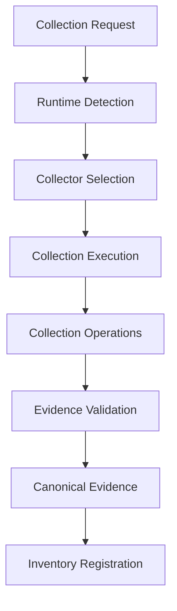
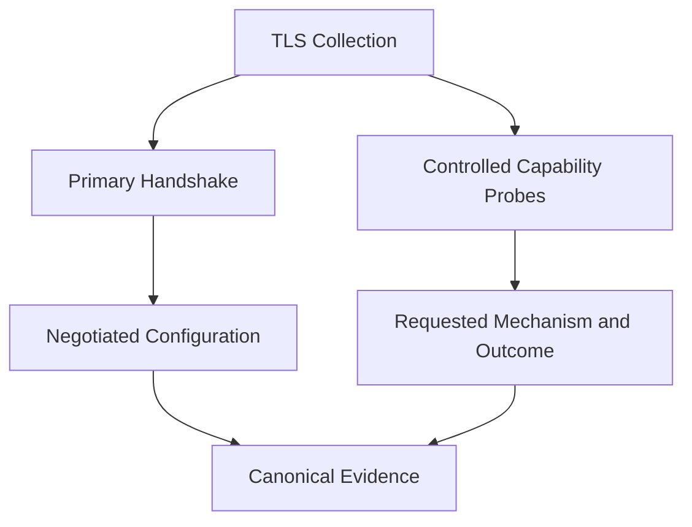

# Collection Requirements Specification

**Project:** Cryptographic Inventory, Security Assurance and Modernization Framework

**Version:** 0.1.0

**Status:** Proposed

## 1. Purpose

This document defines the functional and technical requirements for discovering cryptographic assets and collecting supporting evidence.

It establishes common requirements for collectors while allowing individual collection modules to use different protocols, libraries and platform interfaces.

## 2. Collection Architecture

Collection modules discover assets and produce canonical evidence through defined domain contracts.

Each collection execution must record its collector identity, version, runtime, timestamps, outcome and diagnostics.

Collection and assessment are independent operations.

## 3. Collector Responsibilities

The framework will support the following collection categories.

| Collector | Discovery responsibility | Initial evidence |
|---|---|---|
| TLS | Discover network endpoints and negotiated configurations | Protocol, cipher suite, key-establishment group |
| Certificates | Inspect X.509 certificates and chains | Subject, issuer, validity, algorithms, public-key metadata |
| Key establishment | Examine negotiated and demonstrable key-establishment capabilities | Classical and hybrid mechanisms |
| Software | Discover cryptographic libraries and dependencies | Component identity, version, vendor and dependencies |
| System | Discover installed cryptographic components and configurations | System configuration and component metadata |
| Randomness | Discover RNG, DRBG and entropy-source implementations | Implementation identity, configuration and available assurance evidence |

Each collector must define its supported environments, collection methods and evidence limitations.

A collector must not make security assessment decisions.

## 4. Common Collection Requirements

Every collector must:

1. Identify the collection target or subject.
2. Record collector identity and version.
3. Record the runtime performing collection.
4. Record operation timestamps and outcomes.
5. Produce structured, validated evidence.
6. Preserve evidence provenance.
7. Report diagnostics and collection limitations.
8. Distinguish unavailable information from negative observations.
9. Avoid collecting private keys or other secret material by default.
10. Support reproducible testing.

Collection results must use the canonical evidence model defined in `evidence-model.md`.

## 5. TLS Collection Requirements

The TLS collector must identify endpoints and collect information from individual connections.

Principal observations include:

- Target hostname or IP address and port.
- Resolved endpoint address.
- Negotiated TLS version.
- Negotiated cipher suite.
- Negotiated key-establishment group, where observable.
- Peer certificate reference.
- Certificate verification result.
- Client configuration and runtime provenance.

### Handshake observations and capability probes

These must remain separate.

All negotiated properties must originate from the same identified handshake.

Capability probes must record the requested protocol or group, client configuration, outcome and diagnostic information.

A failed probe caused by an unsupported client capability must not be interpreted as proof that the server lacks the tested capability.

## 6. Certificate Collection Requirements

The certificate collector must support inspection of certificates obtained from TLS endpoints, certificate files and supported certificate stores.

It should collect:

- Subject and issuer.
- Subject Alternative Names.
- Serial number and fingerprints.
- Validity period.
- Public-key algorithm and parameters.
- Certificate signature algorithm.
- Extension metadata.
- Certificate-chain information, where available.
- Trust and hostname verification results from the applicable validation process.

Certificate parsing, certificate-chain validation and trust determination are distinct operations.

Possession of a certificate does not establish that it is trusted or correctly deployed.

## 7. Software and System Discovery

Software discovery should identify cryptographic components and their dependencies through supported package managers, application manifests and system interfaces.

System discovery should identify relevant cryptographic configuration and installed components.

Collection must distinguish:

- Installed components.
- Declared dependencies.
- Loaded libraries.
- Observed runtime implementations.
- Vendor-reported capabilities.

An installed library does not necessarily establish that an application uses it.

## 8. Randomness and Entropy Discovery

Randomness collection must distinguish the following concepts:

| Concept | Collection objective |
|---|---|
| Entropy source | Identify source implementation and available assurance information |
| DRBG | Identify construction, implementation and configuration |
| RBG construction | Identify how entropy sources and DRBG mechanisms are combined |
| Health testing | Establish available health-test configuration and evidence |
| Validation | Record applicable assurance or validation references |

Identifying a DRBG does not establish entropy-source quality.

A configuration inspection does not establish successful entropy validation.

The framework must distinguish discovered configurations, vendor declarations, laboratory measurements and formal validation evidence.

## 9. Evidence Quality and Collection Outcomes

Collection operations must record outcomes independently of evidence classification.

Initial outcomes include:

- `succeeded`
- `partial`
- `rejected_by_remote`
- `inconclusive`
- `unsupported_by_client`
- `timed_out`
- `failed`
- `not_attempted`

An operation may produce evidence only for information actually obtained.

Missing information must not be represented as a fabricated observation.

Where possible, evidence should identify:

- Source and collection method.
- Subject.
- Observation timestamp.
- Runtime.
- Relevant configuration.
- Validation or corroboration status.
- Known limitations.

## 10. Collection Security and Safety

Collectors must:

- Validate targets and collection parameters.
- Apply connection and execution timeouts.
- Limit resource consumption.
- Avoid unauthorized access and intrusive testing.
- Protect credentials and sensitive information.
- Avoid storing private keys and secret material.
- Record collection diagnostics without exposing secrets.
- Respect applicable organizational access boundaries.

Active capability probing must be controlled, documented and authorized.

## 11. Implementation Priorities

Collection capabilities will be introduced incrementally.

| Phase | Collection capability |
|---|---|
| 1 | TLS handshake and endpoint discovery |
| 2 | Certificate inspection and verification evidence |
| 3 | Key-establishment capability probing |
| 4 | Software and cryptographic dependency discovery |
| 5 | System cryptographic configuration |
| 6 | Randomness and entropy-source discovery |
| 7 | HSM, KMS and external cryptographic services |

Each collector must have unit, integration and contract tests appropriate to its responsibilities.

## 12. Acceptance Criteria

A collector is acceptable when it:

1. Implements the defined collection interface.
2. Produces validated evidence.
3. Preserves provenance and runtime information.
4. Reports failures and limitations accurately.
5. Distinguishes observations from declarations and derived information.
6. Does not make unsupported security claims.
7. Passes its collection and contract tests.

**Guiding principle:** Collect what can be established, preserve how it was established, and explicitly report what remains unknown.
