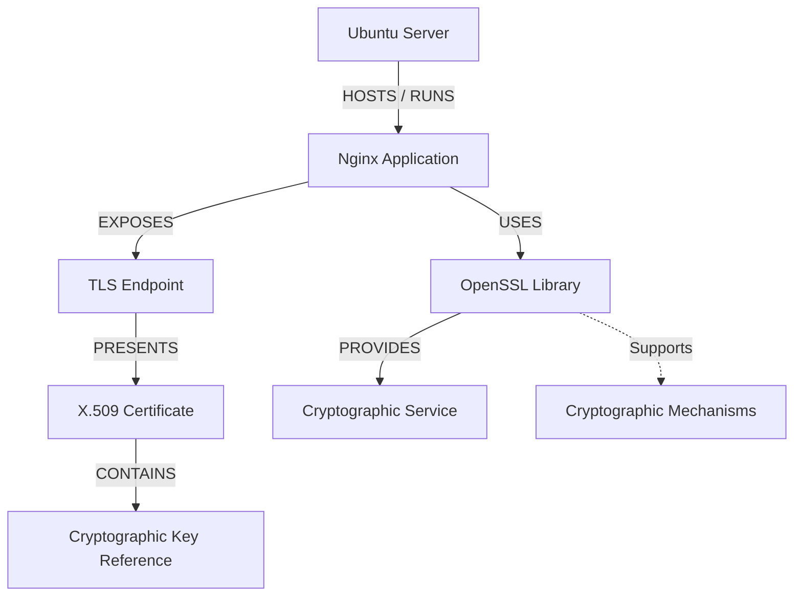

# Cryptographic Asset Taxonomy

**Project:** Cryptographic Inventory, Security Assurance and Modernization Framework

**Version:** 0.1.0

**Status:** Proposed

## 1. Purpose

This document defines what the framework considers a cryptographic asset and how those assets are classified.

The taxonomy provides a consistent foundation for asset discovery, inventory management, security assessment and Cryptographic Bill of Materials (CBOM) generation.

## 2. What Is an Asset?

An asset is an identifiable system, application, service, software component or cryptographic object that provides, uses, stores, processes or depends on cryptographic functionality.

Examples include an Ubuntu server, an Nginx application, an OpenSSL library, an X.509 certificate and a hardware security module (HSM).

Every asset receives a unique internal UUID. External identifiers, such as hostnames and certificate fingerprints, help identify assets but do not replace their internal identities.

## 3. Asset Categories

The framework defines nine primary asset categories.

| Asset category | Examples |
|---|---|
| Computing system | Servers, workstations, virtual machines |
| Application | Web applications, APIs, databases |
| Network service | TLS, SSH and VPN endpoints |
| Software component | OpenSSL and other cryptographic libraries |
| Certificate | X.509 certificates and CA certificates |
| Cryptographic key reference | Public keys, key identifiers and HSM key references |
| Cryptographic module | Software cryptographic modules, hardware modules and HSMs |
| Randomness component | DRBG implementations and entropy sources |
| Cryptographic service | Cloud KMS, signing and encryption services |

An asset has one primary classification but may participate in several relationships.

## 4. Cryptographic Mechanisms

Cryptographic mechanisms are different from organizational assets.

They describe the algorithms, protocols and parameter sets used by assets.

Examples include:

| Category | Examples |
|---|---|
| Key establishment | RSA, ECDH, ML-KEM |
| Digital signatures | RSA-PSS, ECDSA, ML-DSA, SLH-DSA |
| Symmetric encryption | AES-GCM, ChaCha20-Poly1305 |
| Hash functions | SHA-256, SHA-384, SHA-3 |
| Hybrid mechanisms | X25519MLKEM768 |
| Random bit generation | Approved DRBG constructions |

For example, OpenSSL is a software component asset, while RSA and AES-GCM are cryptographic mechanisms.

A software component may support several mechanisms. Actual mechanism usage must be established through supporting evidence rather than assumed from implementation capability.

## 5. Asset Relationships

Assets are connected through directed relationships.

The framework supports nine relationship types:

| Relationship | Meaning |
|---|---|
| HOSTS | Provides a deployment environment for another asset. |
| RUNS | Executes an application. |
| EXPOSES | Makes a network service available. |
| PRESENTS | Presents a certificate during communication. |
| USES | Directly uses another asset. |
| PROVIDES | Provides a cryptographic service. |
| DEPENDS_ON | Requires another asset to operate. |
| MANAGED_BY | Is operationally managed by another asset. |
| CONTAINS | Contains another asset as a component. |

Example:

The relationship compatibility rules determine which asset categories may be connected. Supporting evidence establishes whether a particular relationship actually exists.

## 6. Asset Discovery and Identity

Assets may be discovered through:

- Network inspection.
- Certificate inspection.
- Software and dependency discovery.
- Operating system inspection.
- Cloud, KMS and HSM interfaces.
- Organizational declarations.

Discovery results must retain their source and supporting evidence.

When a collector discovers an asset, identity resolution determines whether it corresponds to an existing inventory record.

Resolution considers identifiers, asset classification and discovery evidence.

Uncertain matches require review rather than automatic merging.

For example, two TLS endpoints using the same hostname but different ports may represent distinct assets. They may nevertheless reference the same certificate asset.

A renewed certificate with different certificate data is represented as a separate certificate asset.

## 7. Initial Discovery Scope

The initial implementation prioritizes:

1. TLS network services and endpoints.
2. X.509 certificates and public-key information.
3. Cryptographic software components and libraries.
4. Observed cryptographic mechanisms.
5. Relationships between applications, services, certificates and software components.

Broader discovery of HSMs, randomness infrastructure and cloud cryptographic services will be introduced through additional collectors.

## 8. External Inventory Formats

The taxonomy defines the framework's internal asset classifications.

CycloneDX provides an external format for representing supported components, dependencies and cryptographic information.

A dedicated mapping layer translates internal assets and their relationships into appropriate CBOM representations.

Not every internal domain object needs a separate CycloneDX component.

**Guiding principle:** Inventory what organizations deploy, use and depend upon. Represent cryptographic mechanisms as information associated with those assets, not as independent organizational assets.
