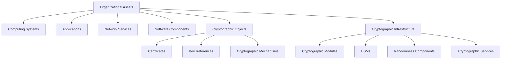
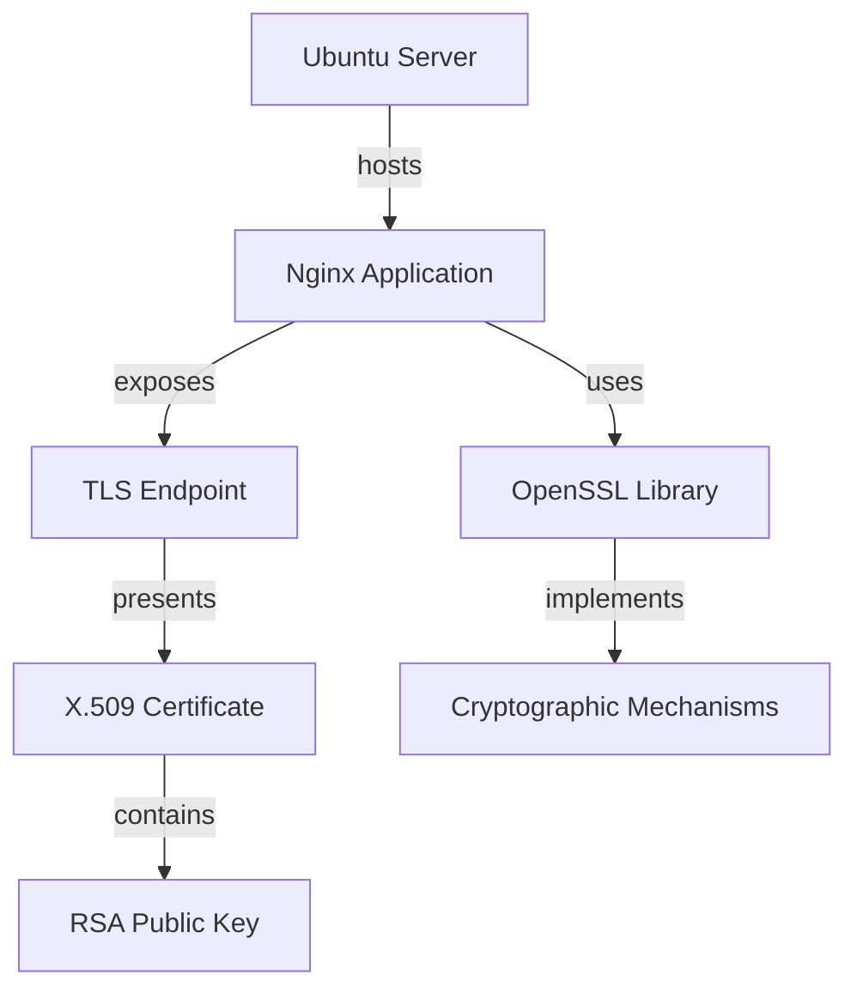

# Cryptographic Asset Taxonomy

**Project:** Cryptographic Inventory, Security Assurance and Modernization Framework

**Version:** 0.1.0

**Status:** Proposed

## 1. Purpose

This document defines the asset categories that the framework intends to discover, identify and inventory.

The taxonomy establishes a common classification system for collection modules, inventory management, CBOM generation and security assessment.

## 2. Asset Classification

The framework distinguishes organizational assets from cryptographic objects and components associated with them.

## 3. Asset Categories

| Category | Examples | Discovery sources |
|---|---|---|
| Computing systems | Servers, workstations, virtual machines | System inspection, network discovery |
| Applications | Web applications, APIs, databases | Configuration and application discovery |
| Network services | TLS, SSH, VPN endpoints | Network scanning and service inspection |
| Software components | OpenSSL, cryptographic libraries, application dependencies | Package managers, dependency manifests |
| Certificates | X.509 certificates, CA certificates | Certificate stores, TLS endpoints, PKI |
| Cryptographic key references | Public keys, key identifiers, HSM key references | Certificates, KMS and HSM interfaces |
| Cryptographic modules | Software modules, validated hardware modules | Library and module inspection |
| Randomness components | DRBG implementations, entropy sources | Configuration inspection and vendor interfaces |
| Cryptographic services | Cloud KMS, signing and encryption services | Cloud APIs and service inventories |

Categories are not mutually exclusive. An asset may participate in several relationships while retaining one primary classification.

## 4. Cryptographic Mechanisms

Algorithms, protocols, cipher suites and parameter sets require separate representation from the assets implementing or using them.

Examples include:

| Mechanism category | Examples |
|---|---|
| Key establishment | RSA key transport, ECDH, ML-KEM |
| Digital signatures | RSA-PSS, ECDSA, ML-DSA, SLH-DSA |
| Symmetric encryption | AES-GCM, ChaCha20-Poly1305 |
| Hash functions | SHA-256, SHA-384, SHA-3 |
| Hybrid mechanisms | X25519MLKEM768 |
| Random bit generation | Approved DRBG constructions |

A mechanism should normally be represented as a typed specification or evidence associated with an asset.

An independently deployed implementation may be inventoried as a software component or cryptographic module.

This distinction prevents algorithms from being incorrectly counted as deployed organizational assets.

## 5. Asset Relationships

Cryptographic inventory requires relationships between assets, not merely a flat component list.

Relationships should identify their source, target, type and supporting evidence.

They enable dependency analysis and help identify assets affected by cryptographic replacement.

## 6. Asset Identity and Classification

Every discovered asset receives a stable internal UUID.

External identifiers remain separate and may include:

- Hostnames and IP addresses.
- Certificate fingerprints.
- Package identifiers.
- Vendor and product identifiers.
- Cloud resource identifiers.
- Hardware identifiers.

Asset resolution must account for changing identifiers to avoid unnecessary duplication.

Uncertain identity matches must be recorded rather than automatically merged.

## 7. Discovery and Evidence Requirements

Asset discovery may use different sources:

| Discovery method | Typical information |
|---|---|
| Network inspection | Endpoints and negotiated configurations |
| Certificate inspection | Certificates, issuers and public-key metadata |
| Software discovery | Libraries, versions and dependencies |
| System inspection | Cryptographic configuration and installed components |
| Vendor interfaces | HSM, KMS and module information |
| Organizational declarations | Ownership, purpose and information sensitivity |

Every discovered asset should retain its discovery source and supporting evidence.

The framework must distinguish observed assets from declared or inferred assets.

Unavailable discovery methods must not be interpreted as proof that an asset does not exist.

## 8. Initial Implementation Scope

The initial implementation will prioritize:

1. TLS network endpoints.
2. X.509 certificates.
3. Certificate public-key metadata.
4. Cryptographic libraries and software components.
5. Observed key-establishment mechanisms.
6. Asset relationships between services, certificates and implementations.

HSMs, enterprise randomness sources, cloud cryptographic services and broader system discovery will be introduced through subsequent collectors.

## 9. Relationship to CycloneDX

The taxonomy defines the framework's internal asset classifications.

CycloneDX provides an external representation for supported cryptographic components, dependencies and relationships.

A dedicated mapping layer will translate internal assets into appropriate CBOM representations.

Not every internal domain object must map directly to a CycloneDX component.

**Guiding principle:** Inventory what organizations deploy, use and depend upon; represent cryptographic mechanisms as properties and relationships of those assets rather than confusing mechanisms with deployed assets.
