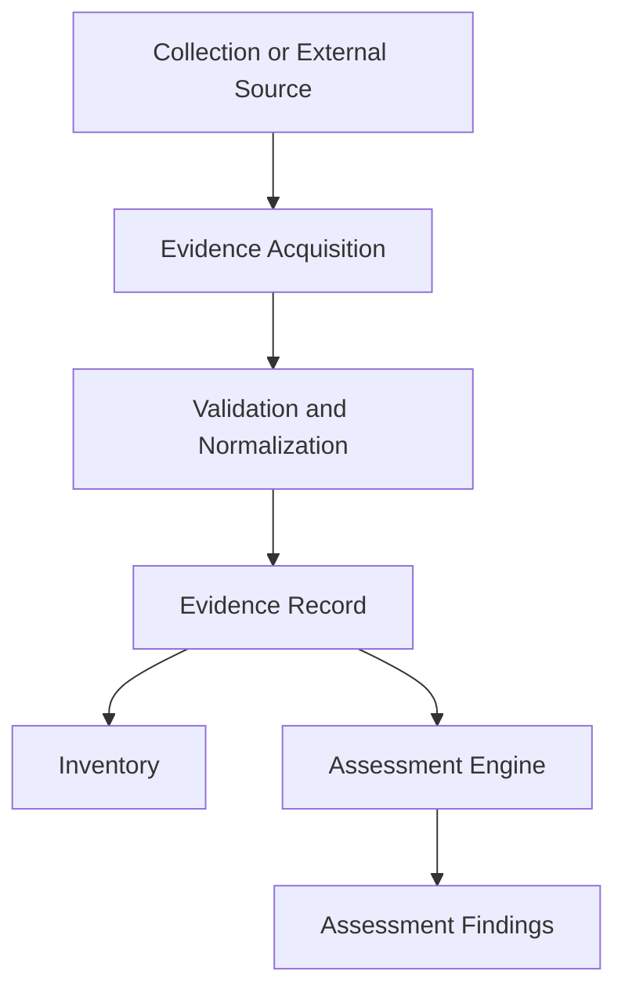
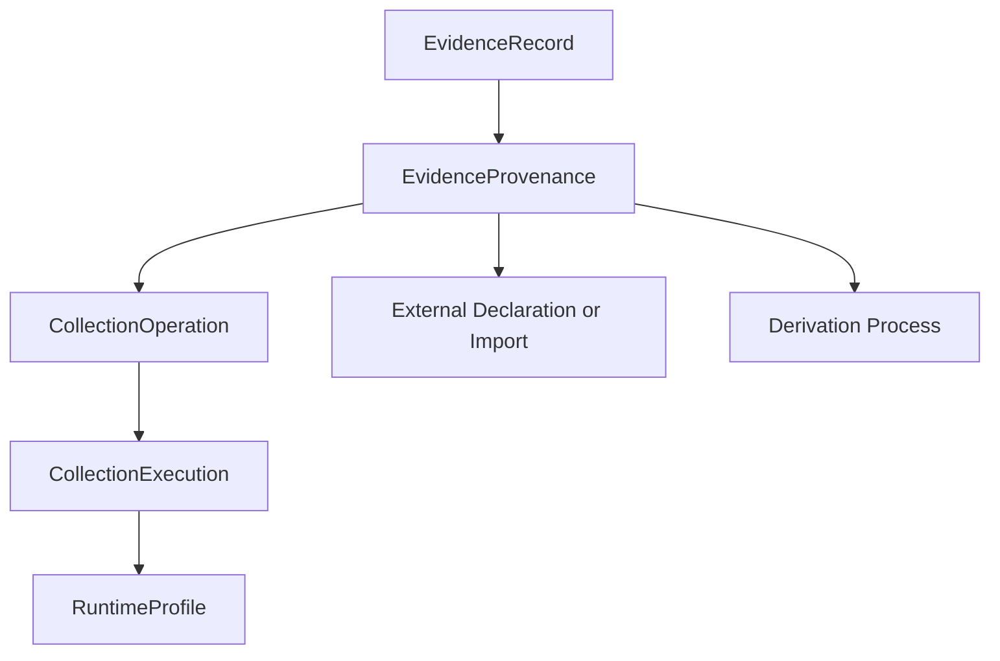
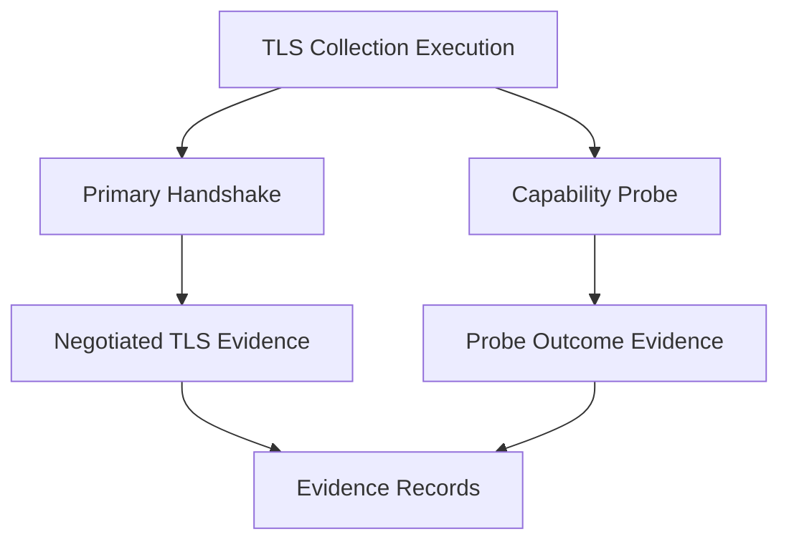

# Evidence Model Specification

**Project:** Cryptographic Inventory, Security Assurance and Modernization Framework

**Version:** 0.1.0

**Status:** Proposed

## 1. Purpose

This document defines how the framework represents, validates, stores and references cryptographic evidence.

The evidence model provides a common contract between collection modules, inventory management and assessment policies.

It must accommodate observations from different technologies without depending on individual collector implementations.

## 2. Evidence Architecture

Evidence follows a common lifecycle:

Evidence records preserve the information obtained and its provenance. Assessment policies interpret that information independently.

## 3. Evidence Record

`EvidenceRecord` represents one identifiable piece of information.

Its principal attributes are:

| Attribute | Responsibility |
|---|---|
| `evidence_id` | Stable evidence identifier |
| `subject` | Asset or other subject described |
| `evidence_type` | Nature of the evidence |
| `property` | Property being described |
| `value` | Typed evidence payload |
| `provenance` | Origin and collection history |
| `observed_at` | Observation or declaration timestamp |
| `lifecycle_status` | Current, superseded or withdrawn |
| `schema_version` | Version of the evidence contract |
| `limitations` | Known evidence limitations |

An evidence record must describe a specific property or identifiable observation rather than becoming an unrestricted collection of unrelated information.

## 4. Evidence Types

The framework distinguishes four evidence types:

| Type | Description | Example |
|---|---|---|
| `observed` | Directly observed behaviour or configuration | TLS 1.3 negotiated |
| `capability` | Demonstrated capability | Endpoint accepts a specific key-establishment group |
| `declared` | Information supplied by an organization or vendor | Vendor declares ML-KEM support |
| `derived` | Information produced through documented analysis | An RSA key identified as quantum-vulnerable |

Evidence type describes the nature of the information, not its reliability or collection outcome.

## 5. Subject and Evidence Value

### SubjectReference

Identifies what the evidence describes.

Possible subjects include:

- An individual asset.
- An organization.
- A runtime environment.
- A collection activity.

Evidence must not be forced to reference an asset when its actual subject is broader.

### EvidenceValue

Represents a validated, semantically typed payload.

Examples include:

- TLS handshake observations.
- Certificate metadata.
- Cryptographic algorithm parameters.
- Software component information.
- Randomness configuration.
- HSM or KMS metadata.

Property-specific value models should be preferred over arbitrary dictionaries.

## 6. Provenance

`EvidenceProvenance` records where evidence originated and how it was obtained.

It may include:

- Source type and identifier.
- Collection operation reference.
- Collection method.
- External document or system reference.
- Derivation information.
- Observation timestamp.

Collected evidence obtains its runtime information through the collection execution chain. Runtime identifiers should not be redundantly maintained in every evidence record.

Declared and imported evidence may have no internal collection operation.

Derived evidence must identify its originating evidence and transformation methodology.

## 7. Collection Outcomes and Evidence Lifecycle

Collection outcomes and evidence lifecycle are independent concepts.

### Collection outcomes

Recorded by `CollectionOperation`:

| Outcome | Meaning |
|---|---|
| `succeeded` | Operation completed successfully |
| `partial` | Some requested information was obtained |
| `rejected_by_remote` | Remote system explicitly rejected the operation |
| `inconclusive` | Result did not establish the intended conclusion |
| `unsupported_by_client` | Local collector could not perform the operation |
| `timed_out` | Operation exceeded its permitted duration |
| `failed` | Operation failed |
| `not_attempted` | Operation was not executed |

### Evidence lifecycle

Recorded by `EvidenceRecord`:

| Status | Meaning |
|---|---|
| `current` | Current accepted evidence record |
| `superseded` | Replaced by a later record |
| `withdrawn` | Withdrawn because it should no longer be relied upon |

A failed operation must not create an artificial evidence observation.

A partial operation may produce evidence for information successfully obtained.

## 8. Evidence Quality and Validation

Evidence validation must consider:

- Structural validity.
- Semantic correctness.
- Source authenticity.
- Provenance completeness.
- Observation recency.
- Corroboration, where applicable.
- Known collection limitations.

Evidence quality must not be determined solely by collection success.

The framework should avoid a universal confidence score until a defensible quality and confidence methodology has been established.

Validation results and diagnostics must remain distinguishable from the original observation.

## 9. Handshake and Probe Evidence

TLS evidence requires particular care.

A `TLSHandshakeObservation` represents one actual negotiated connection.

A `TLSCapabilityProbeResult` represents a separate controlled experiment.

They must retain independent operation identifiers and provenance.

Negotiated protocol, cipher suite and key-establishment group must describe the same identified handshake.

An unsuccessful probe caused by client limitations must not establish that the server lacks the tested capability.

## 10. Immutability and Historical Integrity

Finalized evidence records must be immutable.

A subsequent observation creates a new record rather than overwriting previous evidence.

The framework must support:

- Historical evidence retrieval.
- Supersession relationships.
- Evidence schema versioning.
- Traceable derived evidence.
- Reproducible assessment inputs.

Python `frozen=True` alone does not guarantee deep immutability. Nested evidence payloads must also use immutable or controlled value structures.

## 11. Sensitive Information

Evidence collection must follow data minimization.

The framework must not store private keys, passwords, secret seeds or other sensitive cryptographic material as ordinary inventory evidence.

Public certificates, public keys, fingerprints and configuration metadata may be collected when relevant.

Sensitive evidence must have explicit access and retention controls.

## 12. Interoperability

The canonical evidence model is independent of external serialization formats.

Dedicated adapters will translate evidence into:

- Native versioned JSON records.
- Assessment evidence references.
- CycloneDX CBOM representations.
- External inventory interfaces.

CycloneDX mappings must preserve supported relationships and evidence metadata.

Information that cannot be represented externally must not be silently discarded.

## 13. Acceptance Criteria

An evidence implementation must:

1. Identify its subject and property.
2. Preserve its typed value.
3. Record its origin and provenance.
4. Distinguish evidence type from collection outcome.
5. Preserve observation timestamps.
6. Support immutable historical records.
7. Identify its schema version.
8. Expose known limitations.
9. Protect sensitive information.
10. Support traceability from assessment findings to original evidence.

**Guiding principle:** Evidence must preserve what was established, how it was established, when it was established and what limitations apply.
