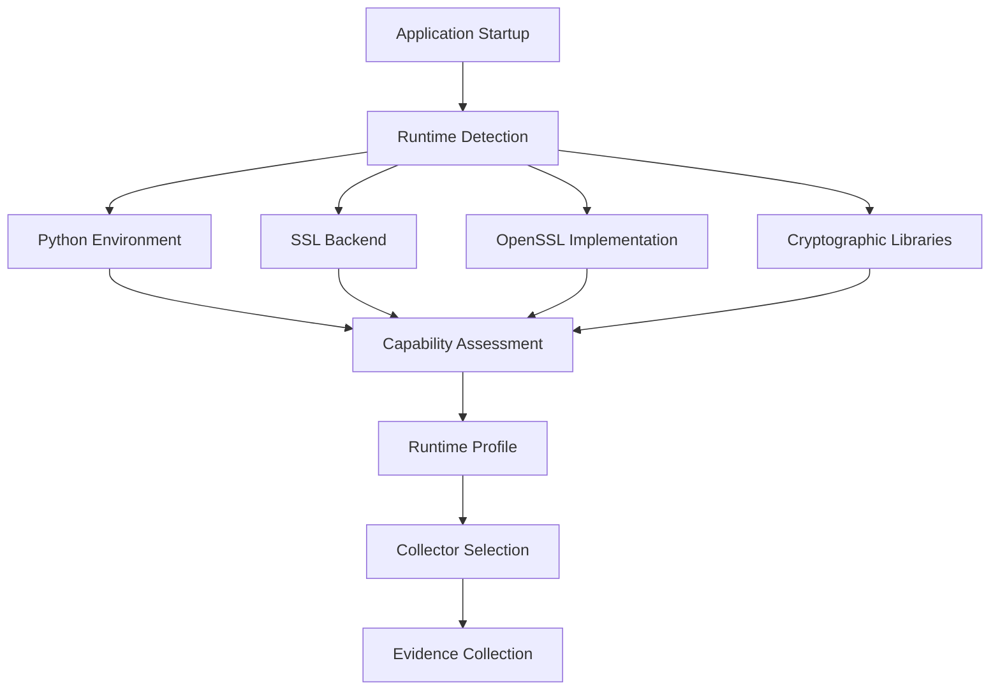
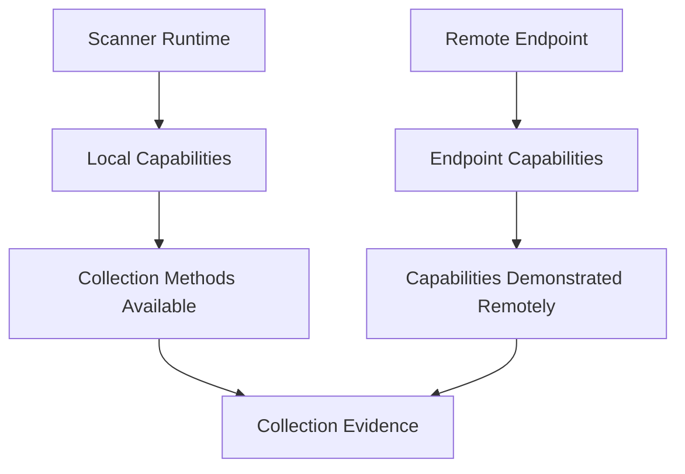
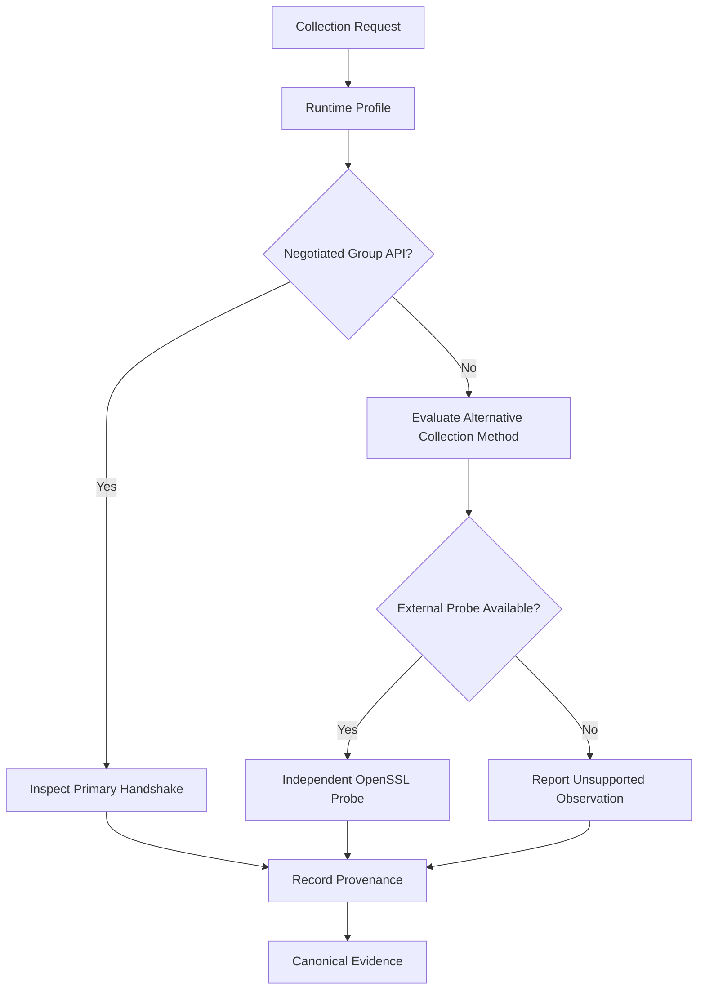

# Runtime Capabilities Specification

**Project:** Cryptographic Inventory, Security Assurance and Modernization Framework

**Version:** 0.1.0

**Status:** Proposed

## 1. Purpose

This document defines how the framework identifies its execution environment and discovers capabilities affecting cryptographic evidence collection.

The objective is to make collection adaptable to different operating systems, Python versions, OpenSSL implementations and cryptographic libraries.

## 2. Runtime Architecture

Runtime detection occurs before collection operations are selected.



The runtime profile describes the collector environment, not the remote target.

## 3. Runtime Profile

`RuntimeProfile` records the environment performing collection.

| Information | Examples |
|---|---|
| Operating system | Ubuntu, Windows, Kali Linux |
| Architecture | x86_64, ARM64 |
| Python implementation | CPython |
| Python version | 3.12.0, 3.15.2 |
| SSL backend | Python SSL module |
| OpenSSL version | 3.0.11, 3.5.9 |
| External tools | OpenSSL executable and version |
| Cryptographic libraries | Library names and versions |

The framework must distinguish the OpenSSL library linked to Python from an independently installed OpenSSL executable.

These may have different versions and capabilities.

## 4. Capability Detection

The framework must detect capabilities directly rather than infer them exclusively from version numbers.

Important capabilities include:

| Capability | Purpose |
|---|---|
| TLS protocol support | Identify locally available TLS versions |
| Negotiated group inspection | Retrieve the group selected during a handshake |
| Group configuration | Configure permitted key-establishment groups |
| Supported group discovery | Identify locally available groups |
| Certificate inspection | Extract peer certificate information |
| Certificate validation | Perform supported certificate verification |
| Signature algorithm inspection | Identify available or negotiated signature information |
| External OpenSSL probing | Perform independent controlled TLS probes |

Detection should distinguish:

- Available.
- Unavailable.
- Unsupported by backend.
- Not tested.
- Detection failed.

## 5. Python and OpenSSL Compatibility

Python's SSL API and its underlying OpenSSL implementation jointly determine available functionality.

Examples from the relevant Python APIs:

| Capability | Python API | Backend requirement |
|---|---|---|
| Inspect negotiated group | `SSLSocket.group()` | OpenSSL 3.2+ |
| Configure multiple groups | `SSLContext.set_groups()` | API and backend support |
| Enumerate available groups | `SSLContext.get_groups()` | OpenSSL 3.5+ |
| Configure TLS 1.3 cipher suites | `SSLContext.set_ciphersuites()` | API and backend support |

The availability of a method does not independently establish that every requested cryptographic mechanism is supported.

Actual capability checks and controlled tests remain necessary.

## 6. Laboratory Observations

Our initial experiments demonstrate why runtime capability detection is necessary.

| Environment | Python | OpenSSL | Negotiated group inspection |
|---|---|---|---|
| Windows environment 1 | 3.12.0 | 3.0.11 | Standard API unavailable |
| Windows environment 2 | 3.15.2 | 3.5.9 | Available |

Using Python 3.15.2, we successfully observed:

```text
TLS version: TLSv1.3
Cipher suite: TLS_AES_256_GCM_SHA384
Key establishment: X25519MLKEM768
```

Python 3.15 also provides APIs for configuring and enumerating TLS key-establishment groups.

OpenSSL 3.5 introduced support for ML-KEM and hybrid TLS groups, including X25519MLKEM768.

These observations are laboratory results, not universal guarantees for every build or deployment.

## 7. Runtime and Remote Capabilities

An important architectural distinction is the difference between local and remote capabilities.



For example:

- A Python runtime may be unable to inspect negotiated groups through its standard SSL API.
- An external OpenSSL executable may independently support group inspection.
- A remote endpoint may support hybrid key establishment even when the scanner cannot observe it through its primary connection.

These situations must remain distinguishable.

An unsuccessful client operation must not be interpreted as proof that the server lacks the capability.

## 8. Collector Adaptation

Collectors should select collection methods according to detected capabilities.



The preferred method is to collect negotiated TLS properties from the primary handshake.

Independent probes may supplement collection but must retain separate operation identifiers, runtime information and provenance.

Collectors must report missing capabilities and limitations explicitly.

## 9. Runtime Snapshot and Change Detection

Runtime profiles should be captured at collection execution time.

The framework should identify meaningful changes in:

- Python version.
- OpenSSL version.
- Cryptographic library versions.
- Available SSL APIs.
- Available cryptographic groups.
- Collection methods.

A changed runtime capability profile may require additional collection or reassessment.

Historical runtime profiles must remain available for reproducibility.

## 10. Implementation Requirements

The runtime subsystem must:

1. Identify the operating system and architecture.
2. Record the Python implementation and version.
3. Identify the SSL backend linked to Python.
4. Identify independently installed cryptographic tools.
5. Detect available APIs and capabilities.
6. Distinguish local and remote capabilities.
7. Record detection outcomes and limitations.
8. Produce immutable runtime snapshots.
9. Support Python 3.12 and 3.15.2.
10. Avoid relying exclusively on version comparisons.

**Guiding principle:** Detect what the runtime can actually do, record the environment that performed collection, and never confuse local capability with remote capability.
