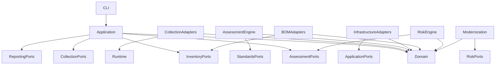

# Architecture Dependency and Migration Strategy

**Project:** Cryptographic Inventory, Security Assurance and Modernization Framework

**Version:** 0.1.0

**Status:** Proposed

## 1. Purpose

This document defines the dependency boundaries, interface contracts and migration strategy for restructuring the framework.

Its objectives are to:

- Prevent circular dependencies.
- Maintain domain independence.
- Establish dependency inversion.
- Separate collection from assessment.
- Protect existing application functionality.
- Preserve historical evidence and assessment records.
- Provide a controlled source-code migration process.

## 2. Dependency Principles

The architecture follows these principles:

1. Dependencies point towards stable abstractions.
2. Domain models remain independent of external infrastructure.
3. Collection implementations do not perform assessments.
4. Assessment implementations do not perform collection.
5. Infrastructure implements application-facing interfaces.
6. External formats are handled through dedicated adapters.
7. Application services coordinate operations without implementing domain rules.
8. Circular imports are prohibited.
9. Package boundaries must be independently testable.
10. Existing functionality must remain operational throughout migration.

## 3. Package Dependency Rules

| Package | Permitted dependencies | Prohibited dependencies |
|---|---|---|
| domain | Python standard library and internal domain modules | Collection implementations, infrastructure, CycloneDX |
| collection | Domain contracts, runtime abstractions, required external libraries | Assessment policies, reporting |
| runtime | Domain runtime contracts and operating-system interfaces | Assessment policies |
| inventory | Domain models and repository interfaces | Specific collection implementations |
| standards | Domain standards models and repository interfaces | TLS scanners and assessment executables |
| assessment | Domain models and standards interfaces | Network scanners and external collection implementations |
| bom | Domain inventory models and inventory interfaces | Assessment classification logic |
| risk | Domain and assessment interfaces | Collection implementations |
| modernization | Domain and risk interfaces | Collection implementations |
| application | Domain and application-facing interfaces | Concrete infrastructure implementations |
| infrastructure | Domain contracts and application-facing interfaces | Domain-owned assessment rules |
| reporting | Application result contracts and domain references | Collection implementations |
| cli | Application services and composition root | Direct business-rule implementation |

## 4. Dependency Direction

The intended dependency direction is:

This diagram represents logical dependencies.

Concrete implementations must be injected through interfaces rather than instantiated throughout application services.

## 5. Interface Ownership

Interfaces should be defined by the component that requires the capability.

For example:

| Interface | Owner |
|---|---|
| Collector | Collection application boundary |
| AssetRepository | Inventory application boundary |
| EvidenceRepository | Evidence application boundary |
| AssessmentPolicy | Assessment application boundary |
| PolicyRegistry | Assessment application boundary |
| StandardsRepository | Standards application boundary |
| BOMImporter | BOM application boundary |
| BOMExporter | BOM application boundary |
| ReportRenderer | Reporting application boundary |

Infrastructure packages provide concrete implementations of the relevant interfaces.

## 6. Composition Root

The application composition root is responsible for creating and connecting implementations.

It should:

- Initialize configuration.
- Detect runtime capabilities.
- Initialize persistence implementations.
- Register collectors.
- Register assessment policies.
- Configure BOM adapters.
- Construct application services.
- Connect CLI commands to application services.

Composition should occur at application startup rather than inside domain objects.

## 7. Existing Implementation Migration Map

| Current module | Target responsibility |
|---|---|
| collection/models.py | Split into TLS collection contracts and canonical domain evidence |
| collection/tls_scanner.py | TLS collection adapter |
| collection/certificate_parser.py | Certificate collection adapter |
| collection/key_establishment.py | TLS handshake and capability-probe collection |
| collection/scan_results.py | TLS collection result construction |
| collection/tls_utils.py | Shared collection utilities |
| collection/target_loader.py | Target validation and resolution |
| collection/domain_loader.py | Domain target handling |
| assessment/models.py | Split between domain assessment entities and persistence contracts |
| assessment/interfaces.py | Assessment policy interface |
| assessment/orchestrator.py | Assessment engine |
| assessment/registry.py | Policy registry |
| assessment/policies/ | Versioned policy implementations |
| application/ | Application orchestration |
| commands/ | CLI command handlers |
| config/ | Infrastructure configuration |
| storage/ | Infrastructure persistence |
| reporting/ | Reporting adapters |
| utils/logger.py | Infrastructure logging |

A module may be split when it combines responsibilities that belong to different architectural layers.

## 8. Migration Stages

### Stage 1 — Domain Foundations

Introduce:

- Asset and identifier models.
- Inventory membership.
- Asset relationships.
- Evidence records.
- Evidence provenance.
- Runtime profiles.
- Assessment domain contracts.

Acceptance criteria:

- Domain models are independently testable.
- No infrastructure imports exist in the domain.
- Existing TLS evidence remains readable through adapters.

### Stage 2 — TLS Collection Migration

Introduce:

- TLS collector interface.
- TLS handshake observation.
- TLS capability probes.
- Certificate collection.
- Collection execution and diagnostics.

Acceptance criteria:

- Negotiated evidence comes from one identified handshake.
- Capability probes remain separate.
- Collection provenance is preserved.
- Existing TLS scanning functionality remains operational.

### Stage 3 — Runtime Capability Management

Introduce:

- Runtime detection.
- Python and OpenSSL discovery.
- Available SSL API detection.
- Local cryptographic capability detection.

Acceptance criteria:

- Runtime capabilities are independently discoverable.
- Unsupported collection methods are explicitly reported.
- Python 3.12 and 3.15.2 remain supported.

### Stage 4 — Assessment Migration

Introduce:

- Policy identities.
- Policy versions.
- Rule identities.
- Rule versions.
- General assessment contexts.
- Assessment runs and findings.

Acceptance criteria:

- Policies consume canonical evidence.
- Policies remain independent of collectors.
- Historical findings retain their exact rule versions.
- Existing A1 assessment outputs remain available through appropriate compatibility adapters.

### Stage 5 — Standards Management

Introduce:

- Standards references.
- Standards editions.
- Standards provisions.
- Standards registry.
- Change tracking.

Acceptance criteria:

- Assessment rules identify exact applicable provisions.
- Historical editions remain identifiable.
- Standards updates require controlled review.

### Stage 6 — Inventory and CycloneDX

Introduce:

- Asset repositories.
- Inventory services.
- Asset relationship management.
- CycloneDX import and export adapters.
- CBOM validation.

Acceptance criteria:

- Internal inventory models remain independent of CycloneDX.
- Imported documents are validated.
- Unsupported information is not silently discarded.
- Inventory relationships are preserved where the external format supports them.

### Stage 7 — Application and Infrastructure Migration

Introduce or reorganize:

- Application services.
- Persistence adapters.
- Configuration adapters.
- Logging.
- Filesystem services.
- External integrations.

Acceptance criteria:

- Existing CLI operations remain functional.
- Existing output paths remain compatible where practical.
- Application services depend on interfaces.

### Stage 8 — Reporting and Testing Migration

Reorganize:

- Markdown reporting.
- HTML reporting.
- CLI commands.
- Unit tests.
- Integration tests.
- Contract tests.
- System tests.

Acceptance criteria:

- Existing report generation works.
- CLI command behaviour is preserved.
- Full regression suite passes.
- Both supported Python environments pass.

## 9. Compatibility Strategy

The framework must preserve compatibility with previously generated evidence and assessment records.

The migration will use:

- Explicit schema versions.
- Legacy input adapters.
- Version-aware deserialization.
- Controlled output schema changes.
- Regression fixtures.
- Historical assessment snapshots.

Legacy structures must not be silently reinterpreted as the new canonical domain model.

Where information is missing, adapters must preserve that limitation explicitly.

## 10. Test and Validation Strategy

Every migration stage must include:

1. Focused unit tests.
2. Relevant integration tests.
3. Import and dependency checks.
4. Existing regression tests.
5. Python 3.12 compatibility tests.
6. Python 3.15.2 compatibility tests.
7. Pre-commit validation.

The existing 324-test suite is the initial regression baseline.

Test counts may increase as new functionality is introduced. Acceptance should depend on test correctness, not simply maintaining a fixed count.

## 11. Git Strategy

The architectural restructuring will use the branch:

`refactor/domain-architecture`

Each meaningful migration stage must have its own checkpoint commit.

Recommended commit categories:

- `docs:` Architectural documentation.
- `refactor:` Source organization and responsibility changes.
- `feat:` New domain capabilities.
- `test:` Regression and contract coverage.
- `fix:` Correctness and compatibility fixes.

Changes should be reviewed before merging into the main development branch.

## 12. Migration Safeguards

The following requirements are mandatory:

1. Never delete a working implementation before its replacement is validated.
2. Avoid combining unrelated migrations in one commit.
3. Preserve the current CLI behaviour.
4. Preserve existing evidence through compatibility adapters.
5. Protect historical assessment records.
6. Run targeted tests after every module migration.
7. Run the complete test suite at each meaningful checkpoint.
8. Avoid circular dependencies.
9. Record architectural decisions that change package boundaries.
10. Keep both Python environments operational.

## 13. Completion Criteria

The architecture migration will be considered complete when:

- Domain objects are independent of collection implementations.
- Collection modules produce canonical evidence.
- Runtime capabilities are independently detected.
- Assessment policies consume canonical evidence.
- Standards references are versioned.
- Inventory and CBOM are independently managed.
- Application services coordinate functionality through interfaces.
- Infrastructure implements required persistence and integration contracts.
- Historical evidence and assessments remain reproducible.
- Existing CLI functionality is preserved.
- Automated tests verify package boundaries and compatibility.

**Guiding principle:** Restructure incrementally around stable domain responsibilities, preserve existing functionality and prevent implementation details from becoming permanent architectural dependencies.
