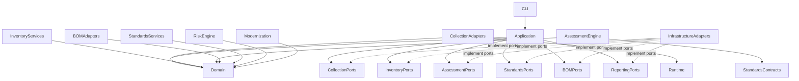

# Architecture Dependency and Migration Strategy

**Project:** Cryptographic Inventory, Security Assurance and Modernization Framework

**Version:** 0.1.0

**Status:** Proposed

## 1. Purpose

This document defines package dependency boundaries, interface ownership and the migration strategy for restructuring the framework.

The objectives are to preserve domain independence, prevent circular dependencies, support replaceable implementations and migrate existing functionality without losing compatibility.

## 2. Dependency Principles

The architecture follows these principles:

1. Dependencies point towards stable abstractions.
2. Domain models remain independent of infrastructure.
3. Collection and assessment remain separate.
4. Application services coordinate workflows through interfaces.
5. Infrastructure implements interfaces defined by application boundaries.
6. External formats are handled through dedicated adapters.
7. Historical evidence and assessment records remain reproducible.
8. Existing functionality is replaced only after its successor is validated.

## 3. Dependency Architecture

The composition root connects application services to concrete implementations through dependency injection.

The arrows represent logical dependencies, not necessarily direct Python imports. In particular, infrastructure adapters depend on the interfaces they implement, while application services depend on those interfaces rather than adapter implementations.

## 4. Package Dependency Rules

| Package | May depend on | Must not depend on |
|---|---|---|
| Domain | Python standard library and domain modules | Collectors, infrastructure, CycloneDX |
| Collection | Domain contracts, runtime capabilities | Assessment policies |
| Runtime | Domain runtime contracts and system interfaces | Assessment |
| Inventory | Domain and repository interfaces | Specific collectors |
| Standards | Domain and repository interfaces | Collection implementations |
| Assessment | Domain and assessment interfaces | Network scanners |
| BOM | Domain and inventory interfaces | Assessment classifications |
| Risk | Domain and assessment interfaces | Collection implementations |
| Modernization | Domain and risk interfaces | Collection implementations |
| Application | Domain and application-facing interfaces | Concrete infrastructure implementations |
| Infrastructure | Domain contracts and application-facing interfaces | Domain-owned business rules |
| Reporting | Application result contracts and domain references | Collection implementations |
| CLI | Application services and composition root | Direct business-rule implementation |

A package must not import another package merely because it currently contains a convenient utility. Shared functionality should have an explicitly defined owner.

## 5. Interface Ownership

Interfaces are defined by the component requiring the capability.

| Interface | Responsibility |
|---|---|
| `Collector` | Executes evidence collection. |
| `AssetRepository` | Retrieves and persists assets. |
| `EvidenceRepository` | Retrieves and persists evidence. |
| `InventoryRepository` | Manages inventory records. |
| `AssessmentPolicy` | Defines policy evaluation. |
| `PolicyRegistry` | Resolves available policy versions. |
| `StandardsRepository` | Retrieves standards editions and provisions. |
| `BOMImporter` | Imports external inventory documents. |
| `BOMExporter` | Exports standardized inventory documents. |
| `ReportRenderer` | Produces a requested report format. |

Concrete implementations belong in the relevant adapter or infrastructure package.

## 6. Composition Root

The application composition root is responsible for constructing and connecting implementations.

It will:

- Load and validate configuration.
- Detect runtime capabilities.
- Initialize repositories and persistence.
- Register collectors and assessment policies.
- Configure standards and BOM adapters.
- Construct application services.
- Connect CLI commands to application workflows.

Domain objects and individual policies must not construct infrastructure dependencies themselves.

## 7. Existing Implementation Migration

The existing implementation will be treated as migration source material, not as the target architecture.

| Existing component | Target responsibility |
|---|---|
| `collection/models.py` | Split into canonical domain evidence and TLS-specific contracts |
| `collection/tls_scanner.py` | TLS collection adapter |
| `collection/certificate_parser.py` | Certificate collection adapter |
| `collection/key_establishment.py` | Handshake and capability-probe collection |
| `collection/scan_results.py` | TLS observation and result construction |
| `assessment/models.py` | Domain assessment entities and execution contracts |
| `assessment/interfaces.py` | Assessment policy interface |
| `assessment/orchestrator.py` | Assessment engine |
| `assessment/registry.py` | Policy registry |
| `assessment/policy_setup.py` | Application composition and default registration |
| `application/` | Retain and adapt application services |
| `commands/` | CLI command handlers |
| `config/` | Infrastructure configuration |
| `storage/` | Infrastructure persistence |
| `reporting/` | Retain and adapt report generation |
| `utils/logger.py` | Infrastructure logging |

Modules containing unrelated responsibilities may be split. Existing behaviour must be understood before files are moved.

## 8. Migration Stages

| Stage | Focus | Deliverables |
|---|---|---|
| 1 | Current-state audit | File inventory, import dependencies and migration matrix |
| 2 | Domain foundations | Asset, inventory, evidence and assessment contracts |
| 3 | Runtime | Runtime profiles and capability detection |
| 4 | Collection | Refactored TLS and certificate collectors |
| 5 | Inventory | Asset registration, relationships and evidence management |
| 6 | Assessment | Versioned policies, rules and findings |
| 7 | Standards and BOM | Standards registry and CycloneDX adapters |
| 8 | Risk and modernization | Risk assessment and migration planning |
| 9 | Application integration | Services, persistence, configuration and CLI |
| 10 | Continuous assurance | Change detection and reassessment |

Each stage must pass its acceptance checks before the next stage begins.

## 9. Compatibility Strategy

Existing evidence and assessment files must remain readable during migration.

Compatibility will be provided through:

- Explicit schema versions.
- Version-aware deserialization.
- Legacy input adapters.
- Controlled output schema changes.
- Regression fixtures.
- Immutable historical assessment references.

Legacy structures must not be silently reinterpreted as canonical domain objects. Missing information and conversion limitations must remain explicit.

Existing CLI commands and output behaviour should be preserved where practical.

## 10. Testing and Validation

Each migration stage requires:

1. Focused unit tests.
2. Relevant integration and contract tests.
3. Import and dependency checks.
4. Existing regression tests.
5. Python 3.12 compatibility tests.
6. Python 3.15.2 compatibility tests.
7. Pre-commit validation.

The existing 324-test suite is the initial regression baseline. Additional tests are expected as the architecture expands.

Test acceptance depends on correctness and coverage, not maintaining a fixed test count.

## 11. Git and Migration Safeguards

Development will continue on `refactor/domain-architecture`.

Each meaningful migration stage requires a checkpoint commit.

Commit categories:

- `docs:` Architecture and specification changes.
- `refactor:` Structural and responsibility changes.
- `feat:` New functionality.
- `test:` Test coverage and regression protection.
- `fix:` Correctness and compatibility fixes.

The following safeguards apply:

- Do not delete working implementations before replacements are validated.
- Avoid combining unrelated migrations.
- Run focused tests after each change.
- Run the full test suite at meaningful checkpoints.
- Preserve existing evidence and assessment compatibility.
- Review import dependencies to prevent circular relationships.
- Document changes to public interfaces and persisted schemas.

## 12. Completion Criteria

The restructuring is complete when:

- Domain models are independent of implementation technologies.
- Collectors produce canonical evidence.
- Runtime capabilities are independently detected.
- Assessment policies consume canonical evidence.
- Standards and policies are versioned.
- Inventory and CycloneDX are independently managed.
- Application services use defined interfaces.
- Infrastructure implementations are replaceable.
- Historical records remain reproducible.
- Existing CLI functionality and supported Python environments remain operational.

**Guiding principle:** Build around stable domain responsibilities, migrate incrementally and preserve the integrity of existing evidence and assessment results.
