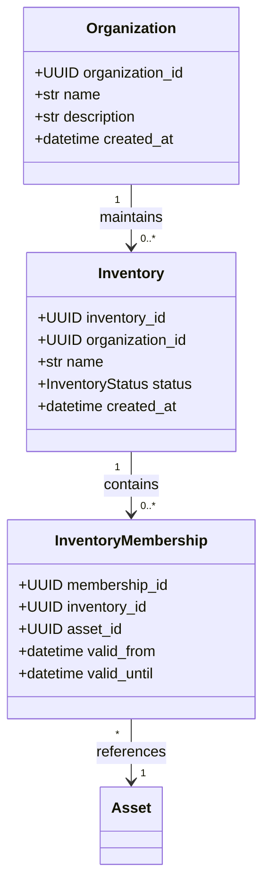
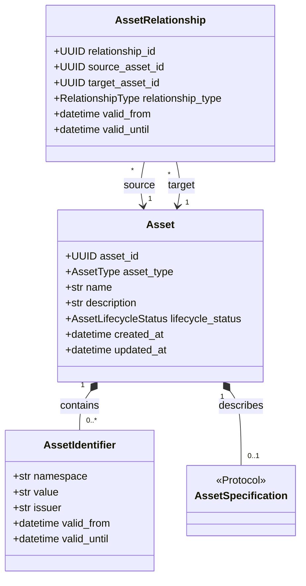
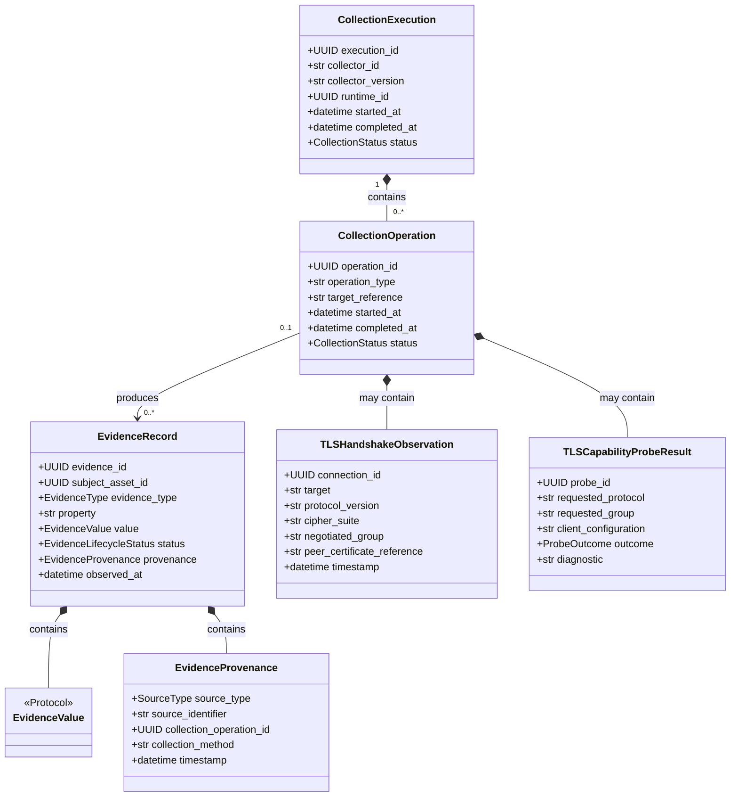
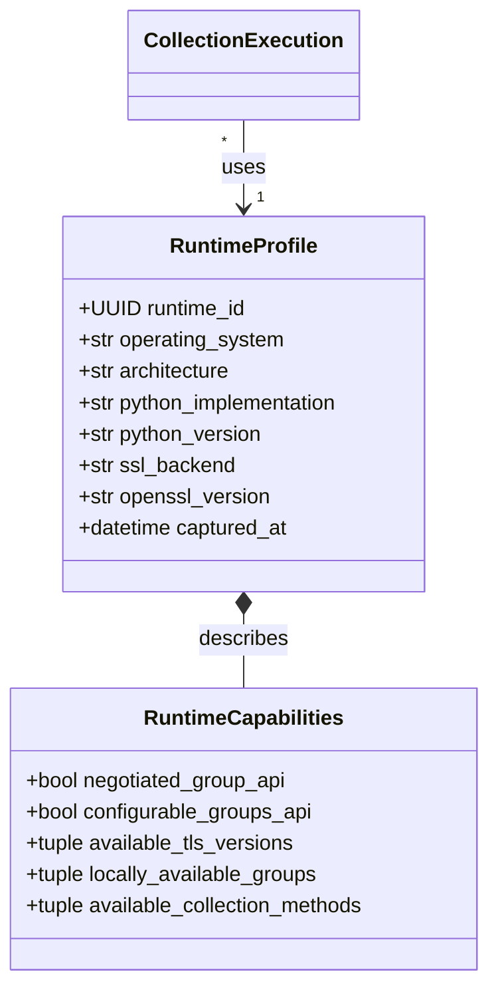
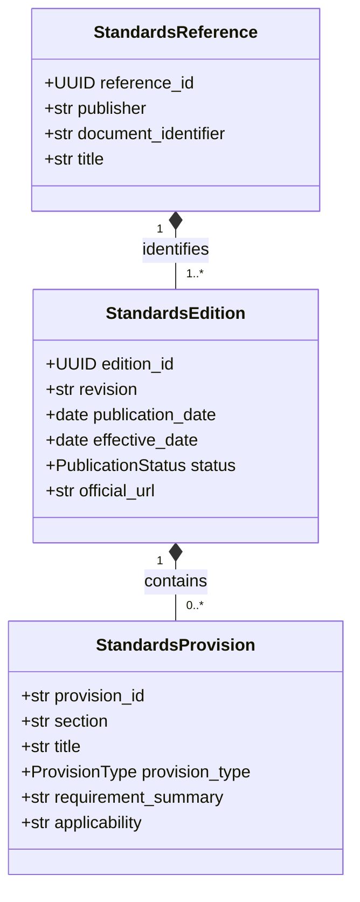
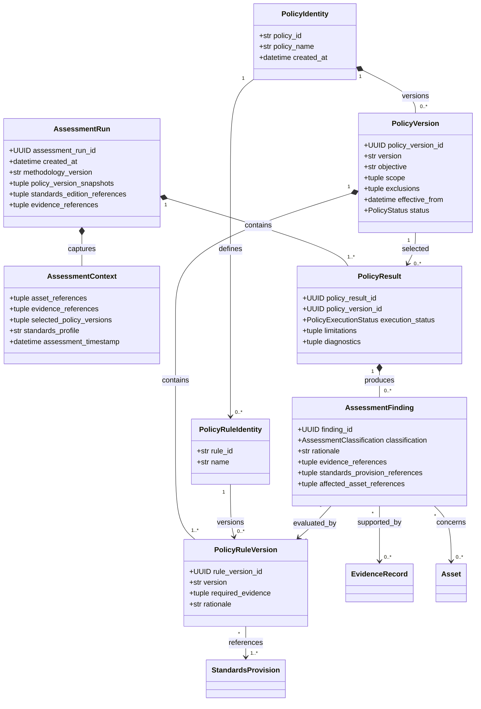
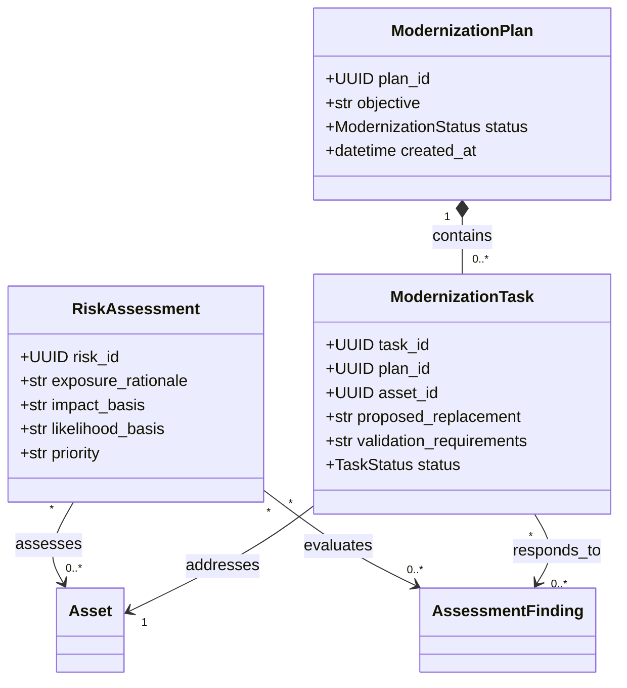

# Domain Class Diagram Specification

**Project:** Cryptographic Inventory, Security Assurance and Modernization Framework

**Version:** 0.1.0

**Status:** Proposed

## 1. Purpose

This document defines the proposed Python domain classes, their attributes, responsibilities, composition and relationships.

The class design follows the approved domain model, entity relationship specification and domain model consistency decisions.

It is independent of database technology, CycloneDX implementation and external serialization formats.

## 2. Class Design Principles

1. Entities have independent identities.
2. Value objects represent descriptive information without independent identity.
3. Composition is preferred over unnecessary inheritance.
4. Historical evidence and assessment snapshots are immutable.
5. Domain entities reference separate aggregates through identifiers.
6. Interfaces use structural typing through Protocol.
7. External data validation occurs at system boundaries.
8. Domain objects remain independent of collectors and storage implementations.

## 3. Organization and Inventory

### Responsibilities

**Organization**

Maintains organizational identity and ownership boundaries.

**Inventory**

Defines the organizational scope of asset discovery and assessment.

**InventoryMembership**

Records an asset's participation in an inventory without duplicating the asset.

## 4. Asset Domain

### Responsibilities

**Asset**

Maintains stable asset identity and lifecycle.

**AssetIdentifier**

Represents a namespaced external identifier.

Its equality should be based on its identifying value fields, not an independently generated UUID.

**AssetSpecification**

Defines type-specific attributes through composition.

Potential implementations include:

- NetworkEndpointSpecification.
- CertificateSpecification.
- SoftwareComponentSpecification.
- CryptographicKeySpecification.
- CryptographicModuleSpecification.
- RandomnessComponentSpecification.

**AssetRelationship**

Maintains an independently identifiable relationship between two assets.

## 5. Evidence and Collection Domain

### Responsibilities

**EvidenceRecord**

Represents a finalized observation, declaration, demonstrated capability or derived result.

It is immutable.

**EvidenceValue**

Represents a typed payload.

Examples include TLS observations, certificate metadata and software component information.

It should not be an unrestricted dictionary.

**EvidenceProvenance**

Preserves the origin of evidence.

It distinguishes collected, declared, imported and derived information.

**CollectionExecution**

Coordinates an individual collector execution.

**CollectionOperation**

Represents a distinct activity within an execution.

**TLSHandshakeObservation**

Describes one actual TLS handshake.

**TLSCapabilityProbeResult**

Describes one controlled capability probe.

Negotiated handshake evidence and capability-probe evidence must remain distinct.

## 6. Runtime Domain

### Responsibilities

**RuntimeProfile**

Identifies the environment performing collection.

**RuntimeCapabilities**

Describes locally available collection and cryptographic capabilities.

A runtime capability must never be interpreted as proof of remote endpoint support.

## 7. Standards Domain

### Responsibilities

**StandardsReference**

Maintains the stable publication identity.

**StandardsEdition**

Represents a specific publication revision.

**StandardsProvision**

Represents a specific provision within an edition.

A standards provision is an immutable value object belonging to an edition.

## 8. Assessment Domain

### Responsibilities

**PolicyIdentity**

Maintains a stable assessment policy identity.

**PolicyVersion**

Defines one immutable version of the policy specification.

**PolicyRuleIdentity**

Maintains the stable identity of an individual rule.

**PolicyRuleVersion**

Defines the specific requirements, rationale and references for one rule version.

Each rule version belongs to exactly one policy version.

**AssessmentContext**

Provides canonical assets, evidence and assessment configuration.

It must not depend on TLSScanResult or any other collector-specific structure.

**AssessmentRun**

Represents one assessment execution and preserves historical methodology.

**PolicyResult**

Records the execution outcome of one policy version.

**AssessmentFinding**

Records one assessment conclusion with explicit references to its originating rule and supporting evidence.

## 9. Risk and Modernization Domain

### Responsibilities

**RiskAssessment**

Evaluates technical findings against organizational context.

**ModernizationPlan**

Coordinates cryptographic modernization and migration activities.

**ModernizationTask**

Represents an actionable change affecting an asset.

Risk findings and modernization activities remain separate from technical assessment execution.

## 10. Interface Contracts

The following interfaces should use Python structural typing through `Protocol`.

### Collector

Responsible for collecting evidence.

Conceptual operation:

`collect(request) -> CollectionExecution`

### AssessmentPolicy

Responsible for evaluating an AssessmentContext.

Conceptual operation:

`assess(context) -> PolicyResult`

### AssetRepository

Responsible for retrieving and persisting asset entities.

### EvidenceRepository

Responsible for retrieving and persisting evidence records.

### StandardsRepository

Responsible for retrieving standards references, editions and provisions.

### PolicyRegistry

Responsible for retrieving available policy versions.

### BOMImporter

Responsible for importing external inventory documents.

### BOMExporter

Responsible for exporting standardized inventory documents.

These interfaces should not introduce dependencies on concrete persistence or external library implementations.

## 11. Type and Immutability Strategy

The implementation will use:

- `@dataclass` for domain entities.
- `@dataclass(frozen=True)` for immutable value objects and finalized records.
- `Enum` for controlled domain values.
- `Protocol` for service and collection interfaces.
- Pydantic for external input validation.
- Dedicated serializers for persistence and interoperability.

Nested mutable collections must not be allowed to undermine historical immutability.

Entity equality should be based on stable identity rather than all object fields.

## 12. Design Constraints

1. Asset identity must remain independent of external identifiers.
2. Inventory membership must not duplicate asset identity.
3. Evidence must preserve provenance.
4. Collection executions must reference their runtime.
5. A TLS handshake must describe one connection.
6. Capability probes must retain client configuration and outcome.
7. Assessment policies must consume canonical evidence.
8. Every finding must identify its rule version.
9. Every rule version must belong to one policy version.
10. Standards provisions must belong to a specific edition.
11. Historical assessment results must preserve their original references.
12. CycloneDX objects must not become internal domain models.

## 13. Implementation Readiness

The domain class design is considered ready for implementation when:

- Entity responsibilities are unambiguous.
- Value-object composition is established.
- Aggregate ownership is documented.
- Domain interfaces are defined.
- Immutability requirements are testable.
- Serialization boundaries are established.
- Existing application functionality can be migrated incrementally.

**Guiding principle:** Domain classes represent the framework's concepts and responsibilities. They should not be shaped around the current TLS scanner, JSON format or CycloneDX schema.
