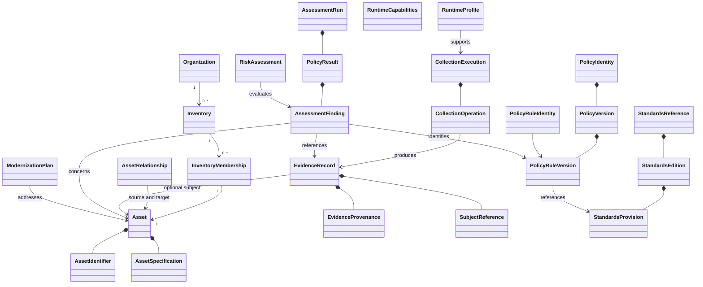

# Domain Class Design Specification

**Project:** Cryptographic Inventory, Security Assurance and Modernization Framework

**Version:** 0.1.0

**Status:** Proposed

## 1. Purpose

This document defines how the framework's domain concepts are represented as Python classes.

It specifies class responsibilities, attributes, composition, typing and immutability.

The design targets Python 3.12 and later and remains independent of persistence and external inventory formats.

## 2. Implementation Principles

The implementation will use:

- Dataclasses for domain entities and value objects.
- Frozen dataclasses for immutable records and snapshots.
- Enums for controlled domain values.
- `typing.Protocol` for structural interfaces.
- Pydantic for external input validation where appropriate.
- Composition rather than unnecessary inheritance.
- UUIDs for internal entity identities.
- Timezone-aware UTC timestamps.

Domain classes must not depend on OpenSSL, CycloneDX, database implementations or CLI components.

## 3. Organization and Inventory

| Class | Type | Responsibility |
|---|---|---|
| `Organization` | Entity | Maintains organizational identity and metadata. |
| `Inventory` | Entity | Defines an organizational inventory scope. |
| `InventoryMembership` | Entity | Records an asset's participation in an inventory. |

`InventoryMembership` references both `inventory_id` and `asset_id`.

An asset may participate in multiple inventories without duplication.

## 4. Asset Models

### Asset

**Type:** Entity

Maintains stable asset identity and lifecycle.

Principal attributes:

- `asset_id: UUID`
- `asset_type: AssetType`
- `name: str`
- `description: str | None`
- `identifiers: tuple[AssetIdentifier, ...]`
- `specification: AssetSpecification`
- `lifecycle_status: AssetLifecycleStatus`
- `created_at: datetime`
- `updated_at: datetime`

### AssetIdentifier

**Type:** Immutable value object.

Represents a namespaced external identifier, including its namespace, value, issuer and optional validity period.

### AssetSpecification

**Type:** Typed immutable value-object contract.

Represents attributes specific to an asset category.

Initial specifications may include:

- `NetworkEndpointSpecification`
- `CertificateSpecification`
- `SoftwareComponentSpecification`
- `CryptographicKeySpecification`
- `CryptographicModuleSpecification`
- `RandomnessComponentSpecification`

Specialized specifications should be introduced when collection requirements justify them.

### AssetRelationship

**Type:** Entity.

References source and target asset identifiers and records the relationship type, validity and supporting evidence references.

## 5. Evidence Models

### EvidenceRecord

**Type:** Immutable entity.

Represents a finalized observation, demonstrated capability, external declaration or derived result.

Attributes:

- `evidence_id: UUID`
- `subject: SubjectReference`
- `evidence_type: EvidenceType`
- `property: str`
- `value: EvidenceValue`
- `provenance: EvidenceProvenance`
- `observed_at: datetime`
- `lifecycle_status: EvidenceLifecycleStatus`
- `limitations: tuple[str, ...]`

### SubjectReference

**Type:** Immutable value object.

Identifies the asset, organization, runtime or collection activity described by the evidence.

### EvidenceValue

**Type:** Typed immutable value object.

Represents normalized evidence payloads, such as TLS observations, certificate metadata and software component information.

Arbitrary unvalidated dictionaries should not be the default representation.

### EvidenceProvenance

**Type:** Immutable value object.

Identifies the evidence source, collection operation, runtime or external declaration source, where applicable.

Provenance must allow imported and derived evidence that has no internal collection operation.

## 6. Collection Models

### CollectionExecution

**Type:** Entity.

Records one collector execution.

Attributes include:

- `execution_id: UUID`
- `collector_id: str`
- `collector_version: str`
- `runtime_id: UUID`
- `started_at: datetime`
- `completed_at: datetime | None`
- `status: CollectionStatus`
- `operations: tuple[CollectionOperation, ...]`

An execution may contain zero or more operations.

### CollectionOperation

**Type:** Entity owned by a CollectionExecution.

Records an individual activity, including its type, target, configuration, outcome and diagnostics.

An operation may produce zero or more evidence records.

### TLSHandshakeObservation

**Type:** Immutable typed value object.

Represents one actual TLS connection.

It records the negotiated protocol, cipher suite, key-establishment group, peer certificate reference and verification information.

All negotiated properties must originate from the same identified handshake.

### TLSCapabilityProbeResult

**Type:** Immutable typed value object.

Represents one controlled TLS capability probe.

It records the requested protocol or group, client configuration, outcome and diagnostics.

Probe results must remain distinct from observations obtained through another connection.

## 7. Runtime Models

### RuntimeProfile

**Type:** Immutable entity or snapshot.

Identifies the collection environment.

Attributes include:

- `runtime_id: UUID`
- `operating_system: str`
- `architecture: str`
- `python_implementation: str`
- `python_version: str`
- `ssl_backend: str`
- `openssl_version: str | None`
- `library_versions: tuple[LibraryVersion, ...]`
- `captured_at: datetime`

### RuntimeCapabilities

**Type:** Immutable value object.

Describes locally available APIs, cryptographic groups, TLS capabilities and supported collection methods.

It must not represent remote endpoint capabilities.

## 8. Standards Models

### StandardsReference

**Type:** Entity.

Maintains stable publication identity, publisher, document identifier and title.

### StandardsEdition

**Type:** Immutable entity.

Represents a specific publication revision, including publication status, dates and official URL.

### StandardsProvision

**Type:** Immutable value object.

Represents a specific requirement, recommendation or other provision within one standards edition.

It contains the section, title, provision type, requirement summary and applicability.

## 9. Assessment Models

| Class | Type | Responsibility |
|---|---|---|
| `PolicyIdentity` | Entity | Maintains stable policy identity. |
| `PolicyVersion` | Immutable entity | Defines one policy specification. |
| `PolicyRuleIdentity` | Entity | Maintains stable rule identity. |
| `PolicyRuleVersion` | Immutable entity | Defines one version of a rule. |
| `AssessmentContext` | Immutable value object | Supplies canonical evidence and assessment configuration. |
| `AssessmentRun` | Immutable entity | Records one assessment execution. |
| `PolicyResult` | Immutable entity | Records one policy execution. |
| `AssessmentFinding` | Immutable entity | Records an individual assessment conclusion. |

Each `PolicyRuleVersion` belongs to exactly one `PolicyVersion`.

Every finding identifies its originating rule version, affected assets, supporting evidence and applicable standards provisions.

The assessment engine must not depend on collector-specific models such as `TLSScanResult`.

## 10. Risk and Modernization Models

| Class | Type | Responsibility |
|---|---|---|
| `RiskAssessment` | Entity | Evaluates findings against organizational context. |
| `ModernizationPlan` | Entity | Coordinates cryptographic replacement activities. |
| `ModernizationTask` | Entity | Tracks an individual modernization activity. |

Risk assessments and modernization plans preserve their assumptions, affected assets, related findings and decision history.

## 11. Class Relationships

The diagram represents logical composition and references. Detailed cardinalities and aggregate ownership are defined in `entity-relationships.md`.

## 12. Enums and Controlled Types

Initial domain enumerations include:

- `AssetType`
- `AssetLifecycleStatus`
- `EvidenceType`
- `EvidenceLifecycleStatus`
- `CollectionStatus`
- `RelationshipType`
- `PublicationStatus`
- `ProvisionType`
- `PolicyStatus`
- `AssessmentClassification`
- `PolicyExecutionStatus`
- `ModernizationStatus`

Values will be defined in the relevant domain specifications.

## 13. Interfaces and Protocols

Use `Protocol` for contracts between independently implemented components.

| Protocol | Responsibility |
|---|---|
| `Collector` | Collects evidence through defined operations. |
| `AssetRepository` | Retrieves and persists assets. |
| `EvidenceRepository` | Retrieves and persists evidence. |
| `InventoryRepository` | Manages inventory records. |
| `AssessmentPolicy` | Evaluates an AssessmentContext. |
| `PolicyRegistry` | Resolves available policy versions. |
| `StandardsRepository` | Retrieves publications and provisions. |
| `BOMImporter` | Imports external inventory documents. |
| `BOMExporter` | Exports standardized inventory documents. |

Interfaces should be defined by the application boundary that requires their capabilities. Concrete implementations belong in adapters or infrastructure packages.

## 14. Immutability and Validation

Finalized evidence, runtime profiles, standards editions, policy versions, rule versions, assessment runs and findings must be immutable.

Python `frozen=True` does not provide deep immutability. Nested collections must therefore use immutable structures or validated immutable value objects.

Pydantic should validate untrusted external data before it enters the domain. It should not be mandatory for every internal domain object.

## 15. Serialization and Compatibility

Dedicated serializers and adapters translate domain objects into native JSON, assessment records, CycloneDX documents and external API representations.

Persisted records must carry explicit schema versions.

The implementation must support Python 3.12 and 3.15.2 initially. Runtime capability detection, rather than version comparisons alone, determines available collection operations.

**Guiding principle:** Domain classes represent stable concepts and responsibilities; collectors, storage implementations and external formats interact with them through explicit contracts.
