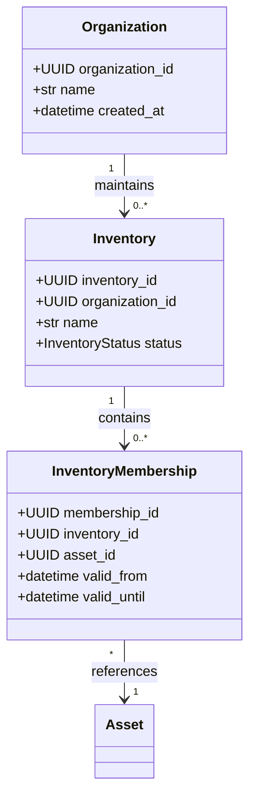
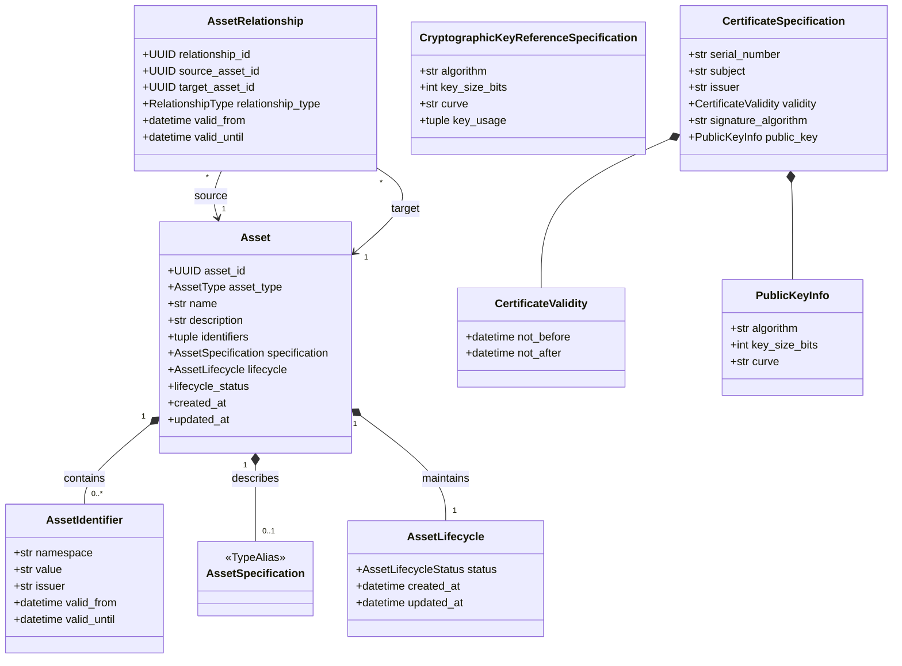
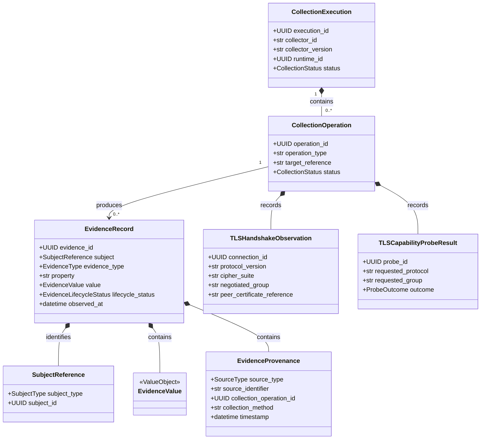
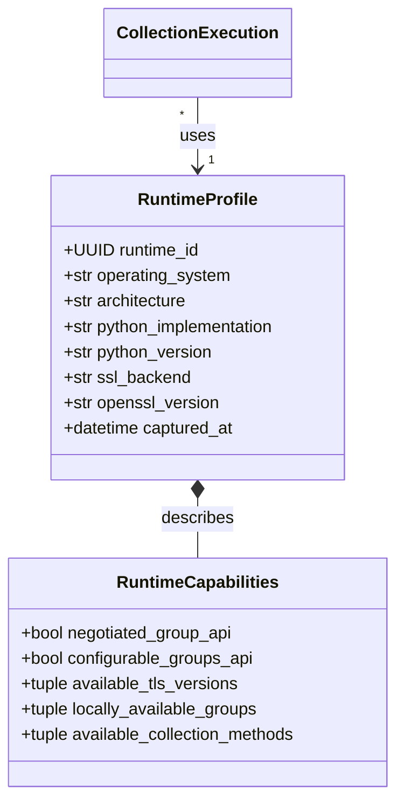
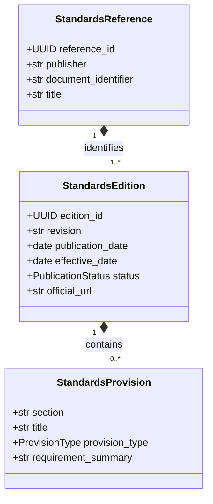
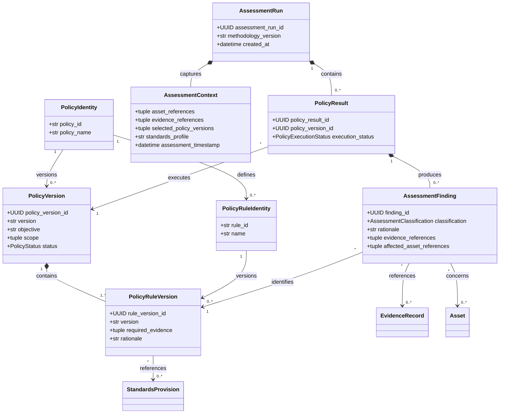

# Domain Class Diagram

**Project:** Cryptographic Inventory, Security Assurance and Modernization Framework

**Version:** 0.1.0

**Status:** Proposed

## 1. Purpose

This document provides a visual representation of the framework's proposed Python domain classes, their composition and references.

It complements `domain-class-design.md` and `entity-relationship-diagram.md`.

The diagrams represent logical class relationships rather than prescribing database structures.

## 2. Organization and Inventory

`InventoryMembership` connects an existing asset to an inventory without duplicating its identity.

## 3. Asset Domain

`AssetSpecification` is a type alias for the currently supported typed specifications.

An Asset may have no specification when its technical characteristics are not yet established.

`AssetIdentifier` values are composed by Asset and may retain optional validity periods.

`AssetLifecycle` represents the current lifecycle state and timestamps.

`AssetRelationship` references independently identifiable assets and does not own them.

## 4. Evidence and Collection

Evidence records remain independent of collection execution. Provenance connects collected, declared, imported and derived evidence to their origins.

TLS handshake observations and capability probes represent distinct operations and must not be combined into one observation.

## 5. Runtime Domain

Runtime profiles describe the collector environment, not the remote endpoint.

## 6. Standards Domain

Standards provisions are immutable value objects belonging to a specific edition.

## 7. Assessment Domain

Every rule version belongs to one policy version. Findings identify their exact originating rule version.

A policy rule may have no external standards provision when it represents a documented organizational or project-specific requirement.

## 8. Risk and Modernization

Risk assessments consume technical findings and organizational context. Modernization plans coordinate changes without modifying historical assessment results.

## 9. Interface Contracts

The architecture uses Python structural typing through `Protocol` for independently implemented components.

| Protocol | Responsibility |
|---|---|
| `Collector` | Produces collection results and evidence. |
| `AssetRepository` | Manages asset persistence. |
| `EvidenceRepository` | Retrieves and persists evidence. |
| `InventoryRepository` | Manages inventory records. |
| `AssessmentPolicy` | Evaluates an assessment context. |
| `PolicyRegistry` | Resolves policy versions. |
| `StandardsRepository` | Retrieves standards editions and provisions. |
| `BOMImporter` | Imports external inventory documents. |
| `BOMExporter` | Exports standardized inventory documents. |

Interfaces belong to the application boundary requiring the capability. Implementations belong to their respective adapters or infrastructure packages.

## 10. Implementation Constraints

- Entities use stable internal identities.
- Value objects are immutable.
- Aggregate references use identifiers.
- Historical evidence and findings remain immutable.
- Domain objects do not depend on external serialization formats.
- Collectors produce canonical evidence.
- Assessment policies do not depend on collector implementations.

**Guiding principle:** Class composition represents domain responsibilities; interfaces enable independent implementations; immutable records preserve historical meaning.
