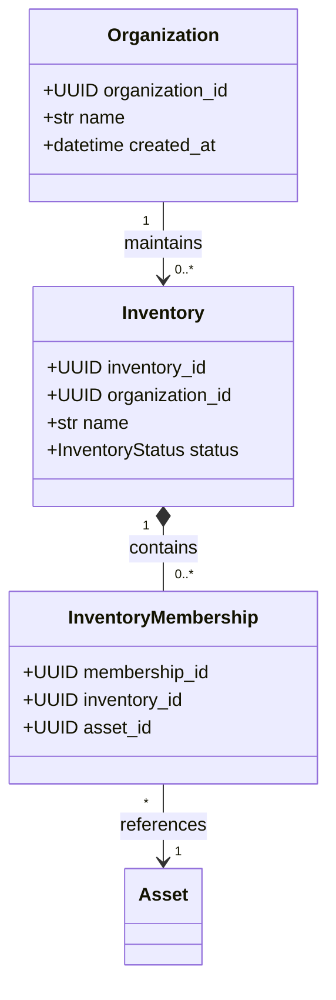
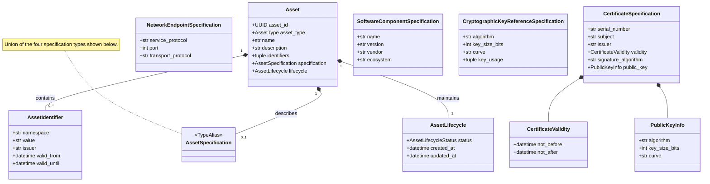
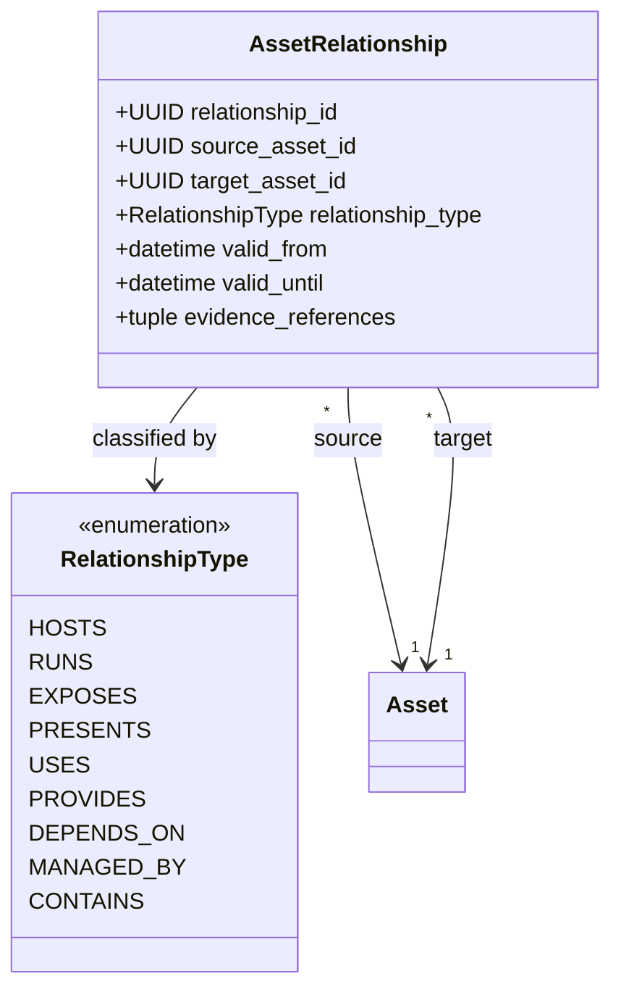
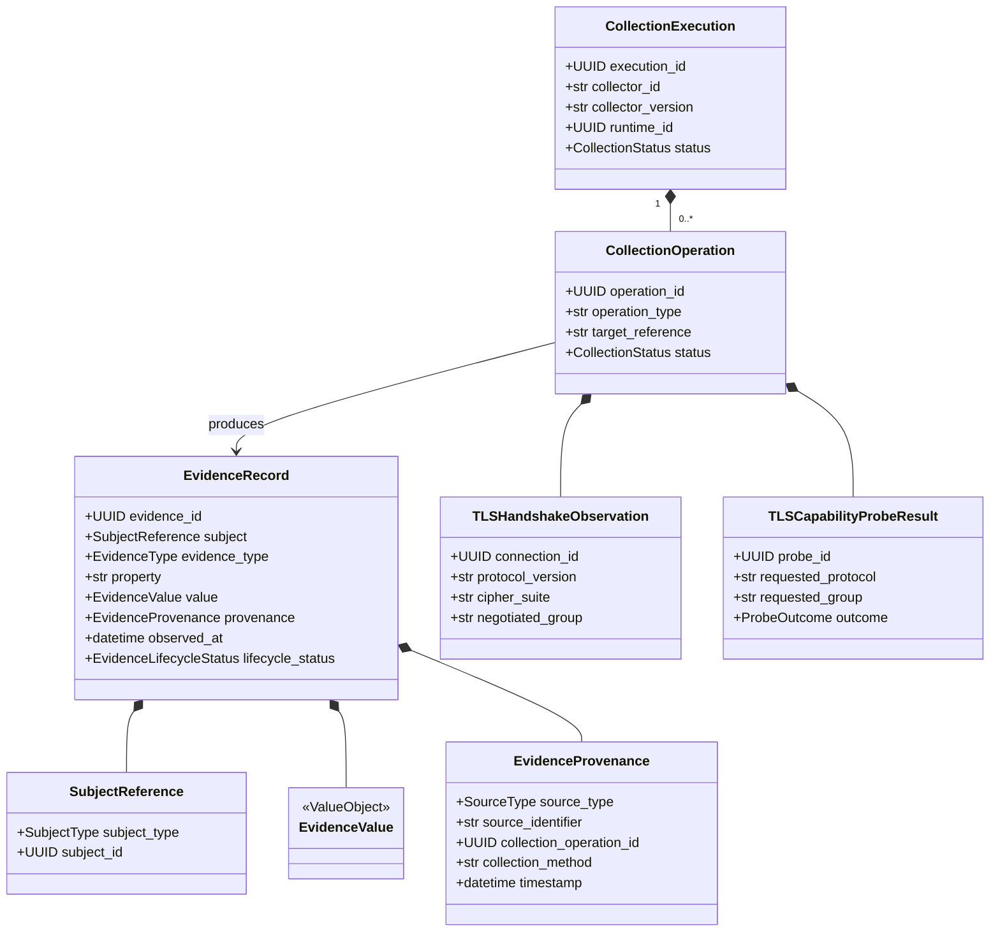
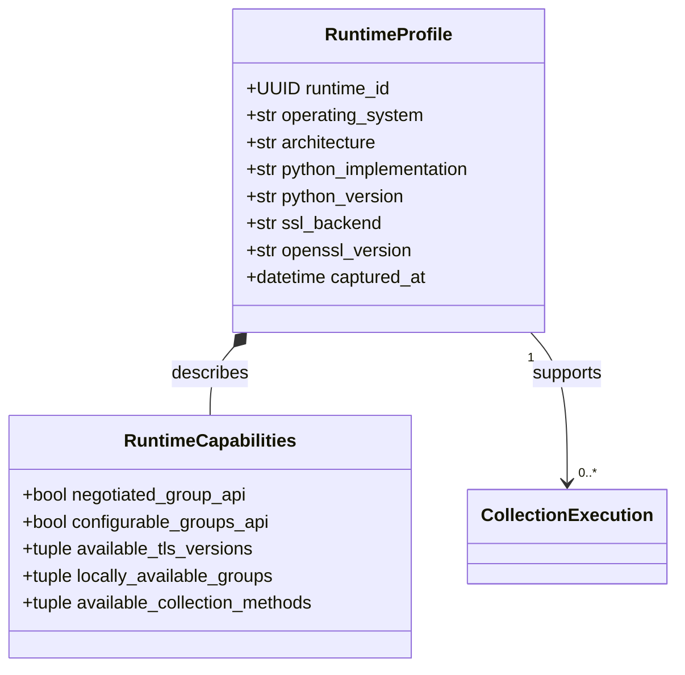
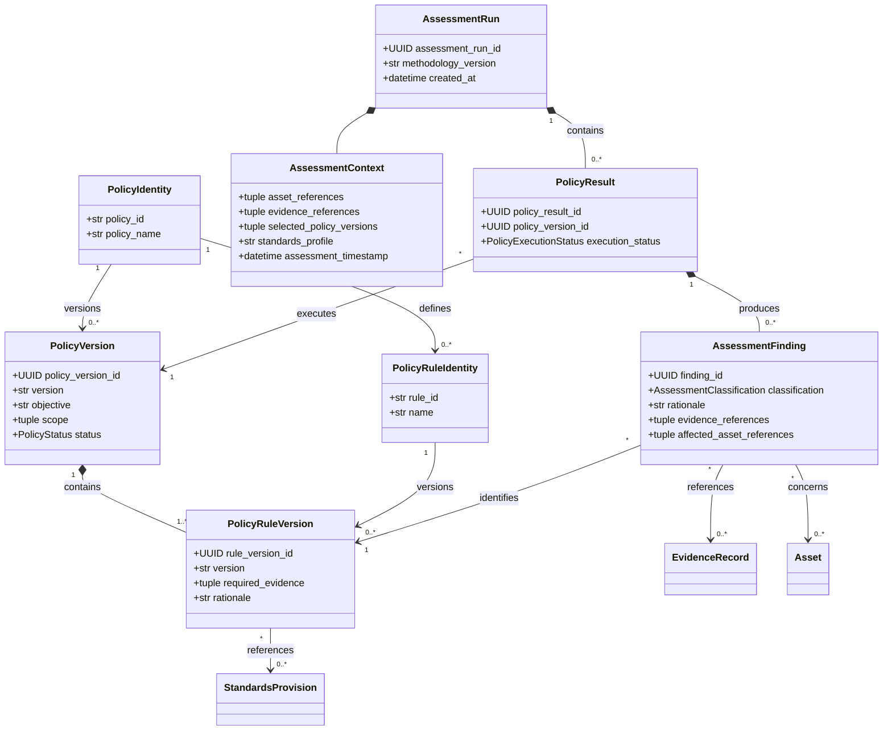
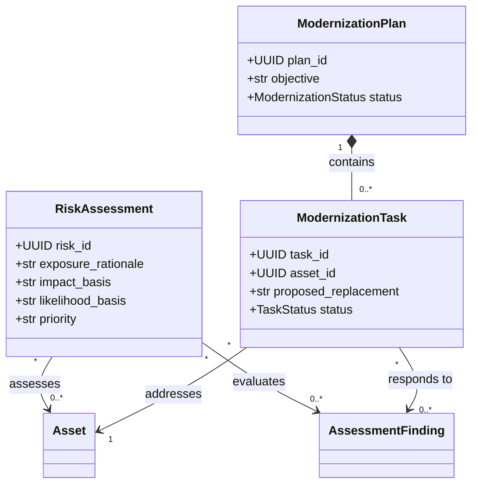

# Domain Class Diagram

**Project:** Cryptographic Inventory, Security Assurance and Modernization Framework

**Version:** 0.1.0

**Status:** Proposed

## 1. Purpose

This document illustrates the main domain classes, their attributes and how they connect.

The diagrams represent the logical design, not a database schema. Class responsibilities are described in `domain-class-design.md`.

## 2. Organization and Inventory

An asset may participate in multiple inventories without duplicating its identity.

## 3. Asset Domain

An Asset owns its identifiers, optional specification and lifecycle information.

## 4. Asset Relationships

Relationships have their own identities and reference assets through UUIDs.

The relationship rules check whether the source and target asset classifications are compatible.

## 5. Evidence and Collection

Collection operations may produce evidence. Evidence can also originate from imports, declarations or analysis without an internal collection operation.

## 6. Runtime Domain

The runtime describes the environment performing collection, not the remote endpoint.

## 7. Standards Domain

Each provision belongs to a particular publication edition.

## 8. Assessment Domain

Findings identify their originating rule version and reference the evidence and assets involved.

## 9. Risk and Modernization

Risk assessments evaluate findings. Modernization plans organize changes to affected assets.

**Guiding principle:** The diagrams show what the domain classes represent and how they connect. Detailed responsibilities and validation rules are defined in `domain-class-design.md`.
