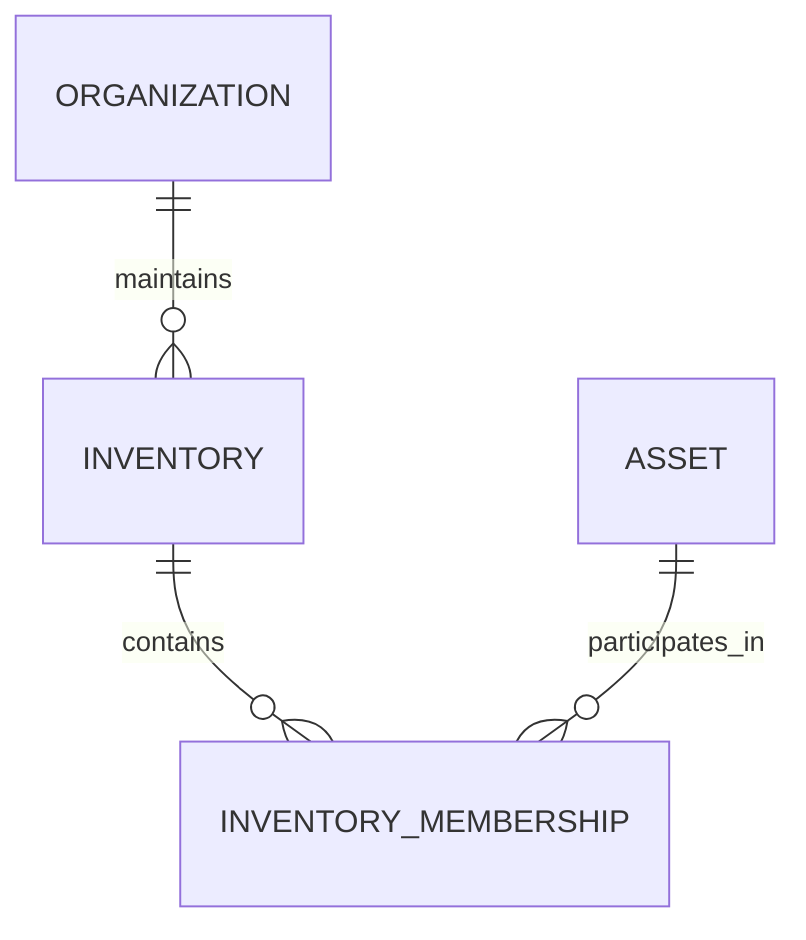
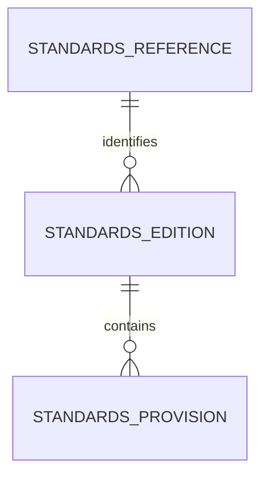
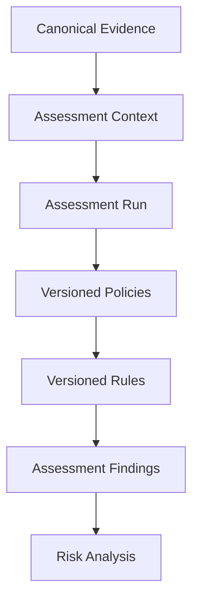

# Domain Model Specification

**Project:** Cryptographic Inventory, Security Assurance and Modernization Framework

**Version:** 0.1.0

**Status:** Proposed

## 1. Purpose

The domain model defines the fundamental concepts underlying cryptographic discovery, inventory management, evidence collection, security assessment and cryptographic modernization.

It provides a technology-independent foundation for the framework. Collection tools, cryptographic libraries, storage implementations and external inventory formats interact with these concepts through defined interfaces.

## 2. Architectural Principles

The domain follows these principles:

1. Assets have stable internal identities independent of external identifiers.
2. Evidence preserves its subject, value, origin and provenance.
3. Collection activities are separate from the evidence they produce.
4. Runtime capabilities are distinct from remote system capabilities.
5. Assessment policies consume canonical evidence rather than collector-specific models.
6. Standards and assessment rules are independently versioned.
7. Historical evidence and assessment results remain reproducible.
8. Domain models are independent of persistence and external inventory formats.
9. Cryptographic secrets are not collected or stored by default.

## 3. Domain Overview

The framework consists of the following interconnected domains:

| Domain | Responsibility |
|---|---|
| Organization and Inventory | Defines organizational boundaries and asset inventories. |
| Assets | Represents systems, components, services and cryptographic objects. |
| Relationships | Represents dependencies and associations between assets. |
| Evidence | Records observations, declarations and derived information. |
| Collection | Records discovery and evidence collection activities. |
| Runtime | Describes collection environments and capabilities. |
| Standards | Maintains authoritative publications and provisions. |
| Assessment | Evaluates evidence against versioned policies and rules. |
| Risk and Modernization | Supports risk analysis and cryptographic replacement planning. |

## 4. Organization and Inventory

### Organization

Represents an organization responsible for one or more cryptographic inventories.

### Inventory

Defines an organizational scope for discovering, registering and assessing assets.

### InventoryMembership

Associates an asset with an inventory without duplicating its identity.

An asset may belong to multiple inventories.

## 5. Asset Domain

### Asset

Represents an identifiable entity or component within an organizational environment that provides, consumes, stores, processes or depends on cryptographic functionality and is relevant to the organization's cryptographic inventory, security assessment or cryptographic modernization activities.

An asset may directly implement cryptographic functionality or depend on other assets that provide it.

Every asset has a stable internal UUID independent of its external identifiers.

Principal attributes include:

- Internal asset identifier.
- Primary asset classification.
- Name and description.
- External identifiers.
- Optional type-specific specification.
- Lifecycle information.

### AssetIdentifier

Represents a namespaced external identifier associated with an asset.

Examples include hostnames, IP addresses, certificate fingerprints, software package identifiers and vendor-assigned resource identifiers.

An identifier contains:

- Namespace.
- Value.
- Optional issuer.
- Optional association validity period.

The validity period describes when the identifier is considered associated with the asset. It is distinct from the time at which evidence about that association was collected.

External identifiers do not replace internal asset identity.

### AssetSpecification

Contains attributes specific to an asset category.

Specifications are represented as typed, immutable value objects.

Currently implemented specifications include:

- `NetworkEndpointSpecification`
- `CertificateSpecification`
- `SoftwareComponentSpecification`
- `CryptographicKeyReferenceSpecification`

Certificate and public-key metadata are further represented through:

- `CertificateValidity`
- `PublicKeyInfo`

Additional specifications for computing systems, applications, cryptographic modules, randomness components and cryptographic services will be introduced when their collection requirements are established.

An asset may initially have no specification when its technical characteristics are not yet known.

### AssetLifecycle

Represents the current lifecycle status and timestamps of an asset.

It contains:

- Lifecycle status.
- Creation timestamp.
- Last-update timestamp.

Lifecycle information is separate from evidence freshness and collection outcomes.

Assets are immutable domain objects. Lifecycle changes produce updated asset instances while preserving the internal asset identifier and original creation timestamp.

Historical versions are maintained by the future inventory persistence mechanism, not by the Asset entity itself.

### AssetRelationship

Represents a directed relationship between two assets.

Examples include `hosts`, `runs`, `exposes`, `presents`, `uses`, `implements`, `depends_on` and `managed_by`.

Relationships have independent identities and may preserve historical validity and supporting evidence.

### Asset Identity Resolution

Asset identity resolution determines whether a newly discovered asset corresponds to an existing inventory asset.

It considers external identifiers, asset classification, supporting evidence and the context in which discovery occurred.

Identity resolution is separate from Asset construction.

Matching must distinguish confirmed identities from probable or uncertain matches. Uncertain matches must be recorded for review rather than automatically merged.

External identifiers alone must not be treated as universally reliable proof of asset identity.

## 6. Evidence Domain

### EvidenceRecord

Represents a finalized observation, demonstrated capability, external declaration or derived result.

Evidence may describe an asset, organization, runtime or collection activity.

Evidence types:

| Type | Meaning |
|---|---|
| `observed` | Directly observed behaviour or configuration |
| `capability` | Demonstrated capability |
| `declared` | Information supplied by an organization or vendor |
| `derived` | Result of documented analysis or transformation |

An evidence record contains:

- Evidence identifier.
- Subject reference.
- Evidence type and property.
- Typed value.
- Provenance.
- Observation timestamp.
- Lifecycle status.
- Known limitations.

### EvidenceProvenance

Identifies the origin of evidence, including its source, collection operation, runtime or derivation process where applicable.

### EvidenceValue

Represents a semantically typed evidence payload, such as TLS observations, certificate metadata or software component information.

Evidence values must not rely on unrestricted, unvalidated dictionaries as their default representation.

Evidence lifecycle is distinct from collection outcome. Finalized evidence records are immutable; subsequent observations create new records.

## 7. Collection Domain

### CollectionExecution

Represents one execution of a collector. It records collector identity, version, runtime, timestamps, overall status and diagnostics.

### CollectionOperation

Represents an individual activity within a collection execution.

An execution may contain zero or more operations. An operation may produce zero or more evidence records.

Collection outcomes include success, partial completion, inconclusive results, unsupported client capabilities, timeouts and failures.

### TLS-specific observations

Two distinct concepts are required:

- `TLSHandshakeObservation`: Records one actual negotiated TLS connection.
- `TLSCapabilityProbeResult`: Records an independent controlled probe.

Negotiated protocol, cipher suite and key-establishment group must originate from the same identified handshake.

Capability probes must preserve their client configuration, outcome and limitations.

## 8. Runtime Domain

### RuntimeProfile

Represents an immutable snapshot of the collection environment.

It records:

- Operating system and architecture.
- Python implementation and version.
- SSL backend and OpenSSL version.
- Relevant cryptographic library versions.
- Runtime capability information.
- Capture timestamp.

### RuntimeCapabilities

Describes locally available APIs, cryptographic groups, protocols and collection methods.

**Local capabilities must never be interpreted as proof of remote endpoint capabilities.**

## 9. Standards Domain

### StandardsReference

Represents the stable identity of an authoritative publication, including publisher, document identifier and title.

### StandardsEdition

Represents a specific publication revision, including publication date, effective date, status and official URL.

### StandardsProvision

Represents an immutable requirement, recommendation or other relevant provision within a specific edition.

Historical editions remain available for assessment reproducibility.

## 10. Assessment Domain

The assessment domain interprets canonical evidence against versioned requirements.

| Concept | Responsibility |
|---|---|
| PolicyIdentity | Maintains a stable policy identity. |
| PolicyVersion | Defines an immutable policy specification. |
| PolicyRuleIdentity | Maintains a stable rule identity. |
| PolicyRuleVersion | Defines an immutable version of a rule. |
| AssessmentContext | Supplies assets, evidence and assessment configuration. |
| AssessmentRun | Represents an assessment execution. |
| PolicyResult | Records an individual policy execution. |
| AssessmentFinding | Records an individual assessment conclusion. |

Each rule version belongs to exactly one policy version.

Every finding identifies its originating rule version, affected assets, supporting evidence and applicable standards provisions.

Policy execution status is independent of finding classification. A successfully executed policy may produce `unknown` findings when evidence is insufficient.

## 11. Risk and Modernization

### RiskAssessment

Evaluates technical findings against organizational context.

Relevant considerations include:

- Data sensitivity.
- Information protection lifetime.
- System criticality.
- Cryptographic exposure.
- Migration feasibility.

Risk decisions must preserve their assumptions and rationale.

### ModernizationPlan

Coordinates cryptographic replacement and modernization activities.

It identifies affected assets, proposed replacements, migration tasks, validation requirements and residual exposure.

Risk assessment and modernization remain separate from technical policy execution.

## 12. Domain Invariants

The implementation must enforce:

1. Every asset has a stable internal identity.
2. Inventory membership does not duplicate assets.
3. Evidence preserves its subject and provenance where applicable.
4. Collection outcomes are distinct from evidence values.
5. TLS negotiated properties belong to one identified handshake.
6. Scanner and target runtime information remain distinct.
7. Historical evidence and findings cannot be silently overwritten.
8. Every finding references its originating rule version.
9. Every rule version belongs to one policy version.
10. Standards provisions belong to a specific edition.
11. Missing evidence does not automatically imply security or insecurity.
12. Private keys and secret material are excluded from ordinary inventory evidence.

## 13. Interoperability and Implementation Boundaries

Domain objects remain independent of JSON, databases, Pydantic models and CycloneDX structures.

Dedicated adapters translate between domain objects and external representations.

CycloneDX provides inventory interoperability; it does not define the framework's internal domain model or assessment methodology.

Implementation details, including Python classes and interfaces, are specified separately in `domain-class-design.md`.

**Guiding principle:** Assets represent what exists; evidence represents what is known; collection records how knowledge was obtained; standards define applicable requirements; assessment interprets evidence; risk and modernization support organizational decisions.
