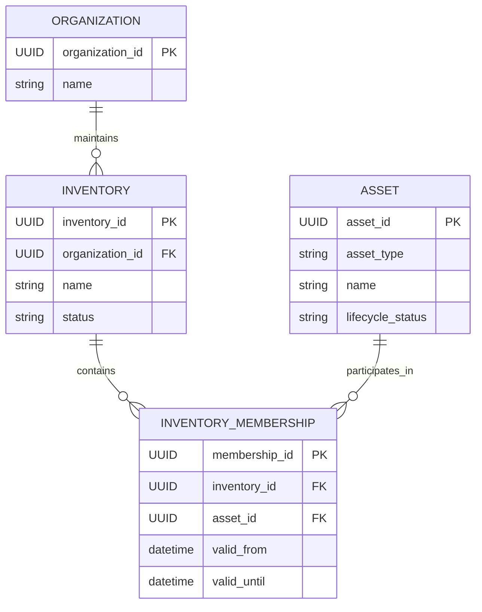
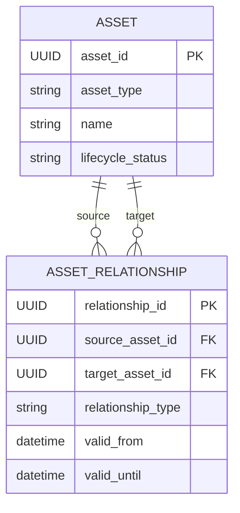
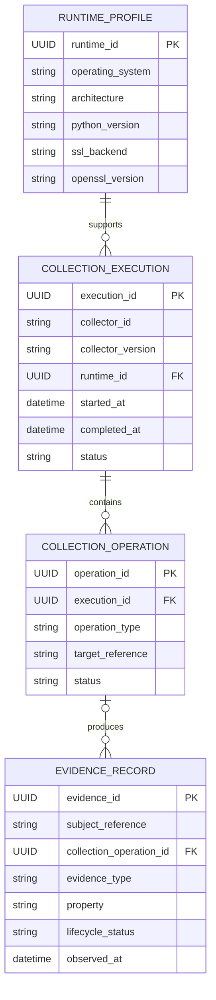
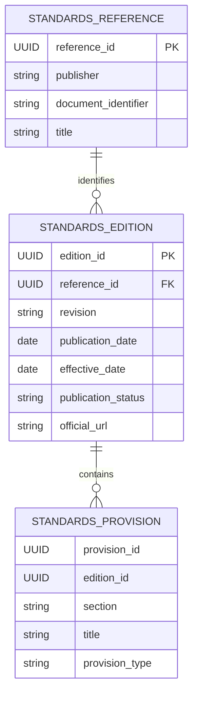
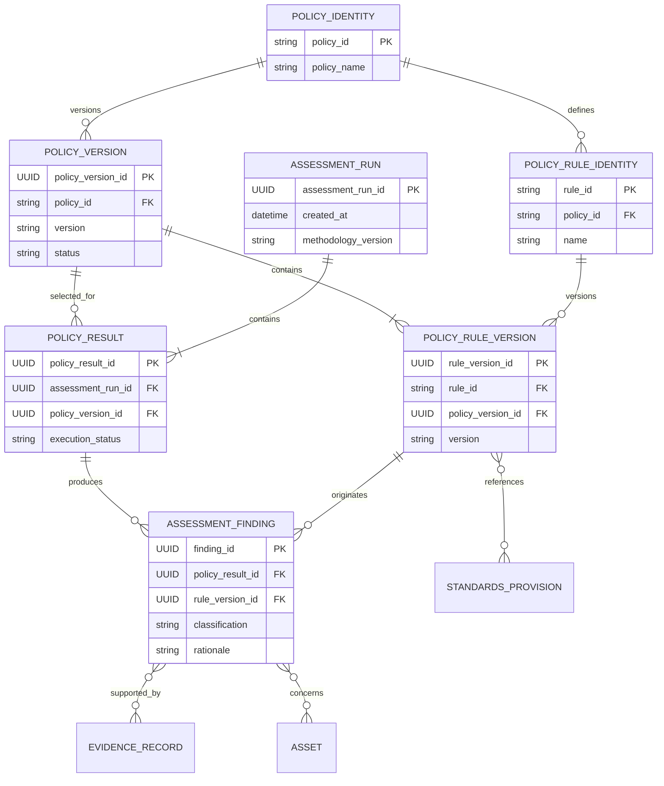
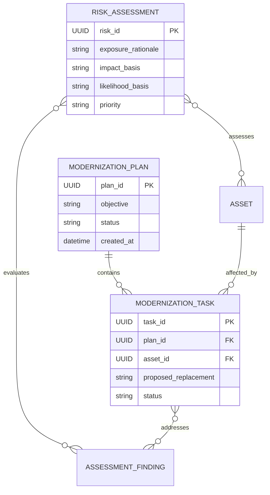

# Domain Entity Relationship Diagram

**Project:** Cryptographic Inventory, Security Assurance and Modernization Framework

**Version:** 0.1.0

**Status:** Proposed

## 1. Purpose

This document provides a visual representation of the framework's domain relationships, ownership and cardinalities.

It complements `domain-model.md` and `entity-relationships.md`. It describes logical relationships rather than prescribing a database implementation.

## 2. Organization and Inventory

An organization maintains inventories. Assets participate in inventories through membership records.

An asset may participate in multiple inventories without duplicating its identity.

## 3. Assets and Relationships

Each relationship connects two assets and has its own identity and lifecycle.

`AssetIdentifier` and `AssetSpecification` are value objects composed into an asset. They are not independent domain entities.

## 4. Evidence and Collection

An execution may contain zero or more operations. An operation may produce zero or more evidence records.

Evidence originating from declarations, imports or derivations may have no internal collection operation.

The `subject_reference` identifies the asset, organization or other subject described. It is a logical reference, not necessarily a direct foreign key to an asset.

Evidence provenance identifies the source and collection history.

## 5. Standards

A standards reference identifies a publication, an edition identifies a specific revision, and provisions belong to that edition.

`StandardsProvision` is logically represented here but is implemented as an immutable value object within a standards edition.

## 6. Assessment

Important constraints:

- Every rule version belongs to exactly one policy version.
- Every finding references its originating rule version.
- The finding's rule version must belong to the policy version executed by its policy result.
- Findings reference evidence and affected assets without owning them.
- Policy execution status is independent of finding classification.
- A rule may have no external standards references when it represents a documented organizational or project-specific requirement.

## 7. Risk and Modernization

Risk assessments consume technical findings and organizational context.

Modernization plans coordinate changes to affected assets and address identified findings.

Neither modifies historical assessment records.

## 8. Relationship Summary

| Relationship | Cardinality |
|---|---|
| Organization → Inventory | 1:N |
| Inventory → InventoryMembership | 1:N |
| Asset → InventoryMembership | 1:N |
| Asset → AssetRelationship | 1:N participation |
| RuntimeProfile → CollectionExecution | 1:N |
| CollectionExecution → CollectionOperation | 1:N |
| CollectionOperation → EvidenceRecord | 1:N, operation optional |
| StandardsReference → StandardsEdition | 1:N |
| StandardsEdition → StandardsProvision | 1:N |
| PolicyIdentity → PolicyVersion | 1:N |
| PolicyVersion → PolicyRuleVersion | 1:N |
| AssessmentRun → PolicyResult | 1:N |
| PolicyResult → AssessmentFinding | 1:N |
| AssessmentFinding → EvidenceRecord | N:M |
| AssessmentFinding → Asset | N:M |
| PolicyRuleVersion → StandardsProvision | N:M |
| RiskAssessment → AssessmentFinding | N:M |
| ModernizationPlan → ModernizationTask | 1:N |

## 9. Design Constraints

1. Internal asset identities must remain stable.
2. Inventory membership must not duplicate assets.
3. Asset relationships must reference existing assets.
4. Evidence must preserve its subject and provenance.
5. Failed collection operations must not create artificial evidence.
6. Runtime capabilities must not be confused with remote capabilities.
7. Historical evidence and assessment results must remain immutable.
8. Findings must reference exact rule versions.
9. Standards provisions must identify their originating editions.
10. Private keys and secret material must not be stored as ordinary inventory data.

**Guiding principle:** The ERD represents domain relationships and ownership, independently of database and serialization technologies.
