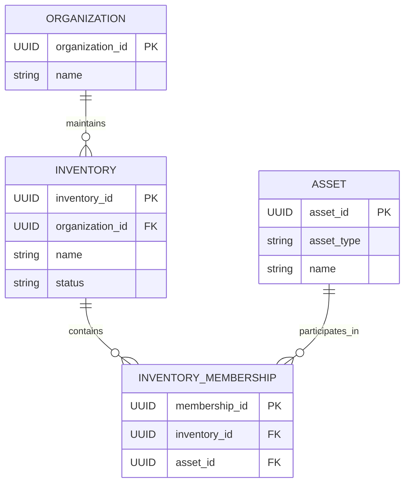
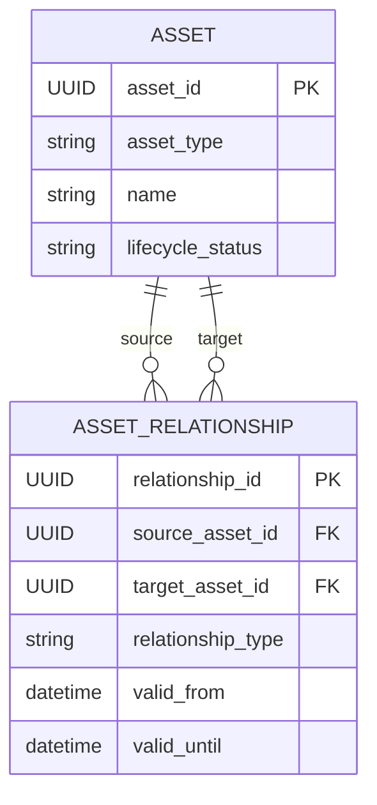
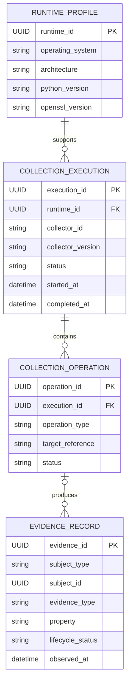
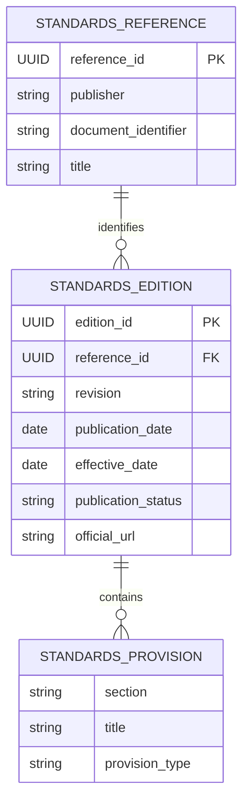
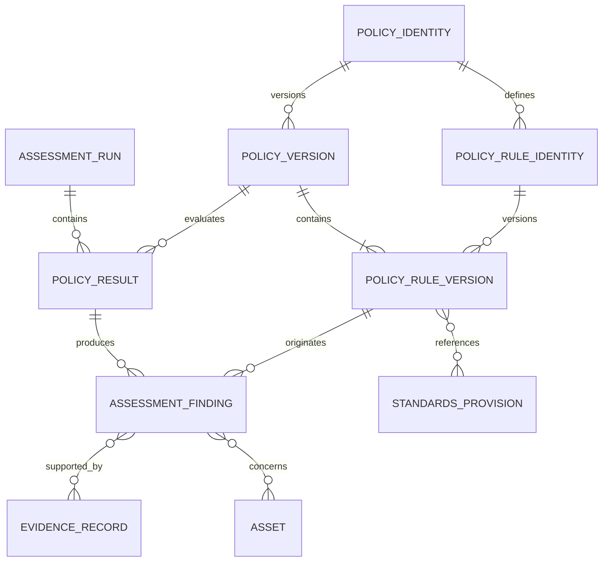
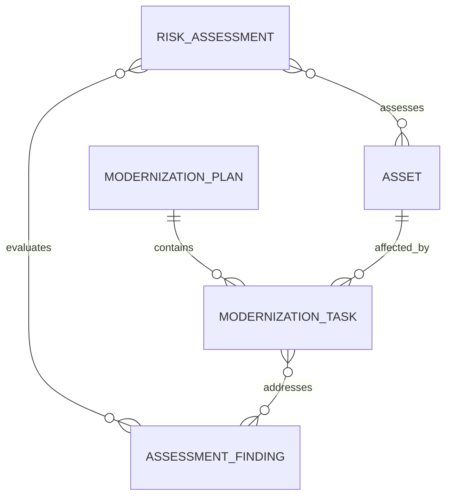

# Domain Entity Relationship Diagram

**Project:** Cryptographic Inventory, Security Assurance and Modernization Framework

**Version:** 0.1.0

**Status:** Proposed

## 1. Purpose

This document illustrates how the framework's main entities are connected.

It shows their ownership, references and cardinalities. The diagrams describe the logical domain model, not a required database structure.

## 2. Organization and Inventory

An asset may belong to multiple inventories without creating duplicate asset records.

## 3. Assets and Relationships

An Asset owns its identifiers, specification and lifecycle information.

An AssetRelationship has its own identity and references two assets by UUID. It may also contain supporting evidence references.

Relationships are directed. The same two assets may have different relationships when they represent different facts.

## 4. Evidence and Collection

An execution may contain multiple operations. An operation may produce zero or more evidence records.

An evidence record may have no internal collection operation when it originates from an external declaration, import or documented analysis.

Its subject reference identifies what the evidence describes. It is not necessarily a direct reference to an Asset.

## 5. Standards

A StandardsReference identifies a publication. Each edition represents a particular revision.

`StandardsProvision` is an immutable value object contained within an edition, not an independently identified entity.

## 6. Assessment

Each rule version belongs to one policy version.

An AssessmentRun contains its assessment context and policy results. A PolicyResult records the execution status and owns the findings it produces.

Every finding references its originating rule version, supporting evidence and affected assets.

A successfully executed policy may produce findings classified as unknown when the available evidence is insufficient.

## 7. Risk and Modernization

Risk assessments evaluate findings and affected assets.

Modernization plans contain tasks that address affected assets and assessment findings.

Historical assessment results remain unchanged by subsequent modernization activities.

## 8. Relationship Summary

| Relationship | Cardinality |
|---|---|
| Organization → Inventory | 1:N |
| Inventory → InventoryMembership | 1:N |
| Asset → InventoryMembership | 1:N |
| Asset → AssetRelationship | 1:N participation |
| RuntimeProfile → CollectionExecution | 1:N |
| CollectionExecution → CollectionOperation | 1:N |
| CollectionOperation → EvidenceRecord | 1:N; operation optional |
| StandardsReference → StandardsEdition | 1:N |
| StandardsEdition → StandardsProvision | 1:N |
| PolicyIdentity → PolicyVersion | 1:N |
| PolicyVersion → PolicyRuleVersion | 1:N |
| AssessmentRun → PolicyResult | 1:N |
| PolicyResult → AssessmentFinding | 1:N |
| AssessmentFinding → EvidenceRecord | N:M |
| AssessmentFinding → Asset | N:M |
| PolicyRuleVersion → StandardsProvision | N:M |
| RiskAssessment → AssessmentFinding | N:M |
| ModernizationPlan → ModernizationTask | 1:N |

## 9. Design Rules

1. Internal asset identities remain stable.
2. Inventory membership does not duplicate assets.
3. Relationships reference assets by UUID.
4. Evidence preserves its subject and origin.
5. Collection outcomes remain separate from evidence values.
6. Historical evidence and assessment results are preserved.
7. Every finding identifies its originating rule version.
8. Standards provisions belong to a specific edition.
9. Missing evidence does not establish security or insecurity.
10. Private keys and secret material are not stored as ordinary inventory data.

**Guiding principle:** Entities maintain their own information, references connect independent entities, and historical records preserve previous decisions and observations.
