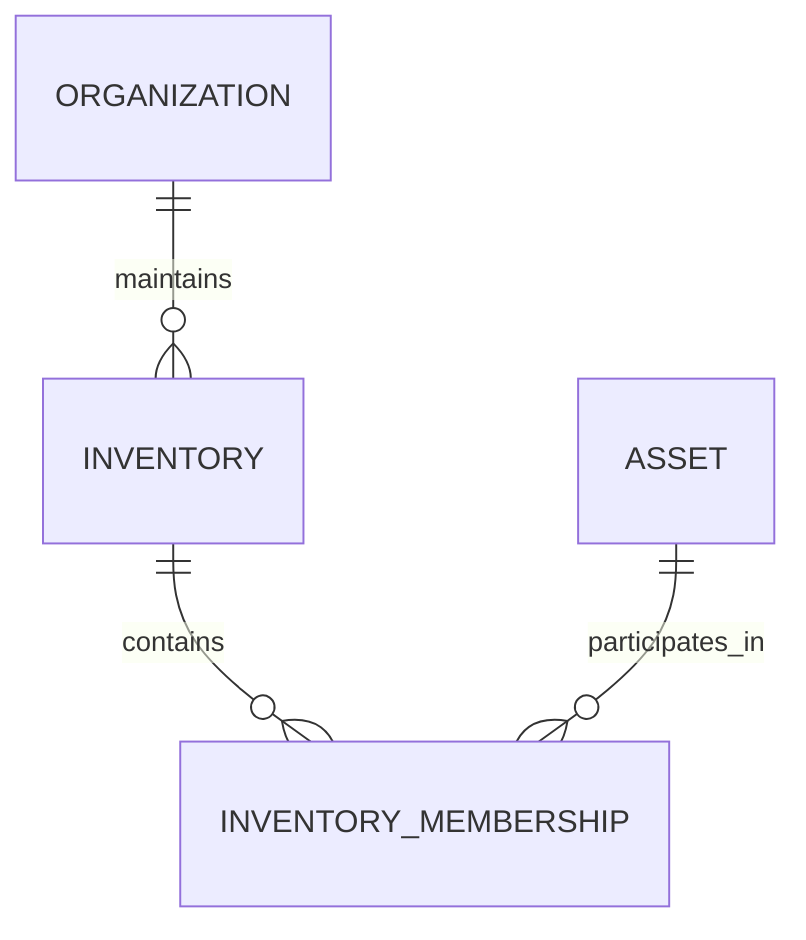
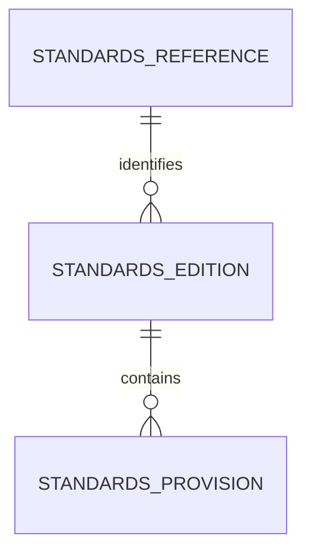
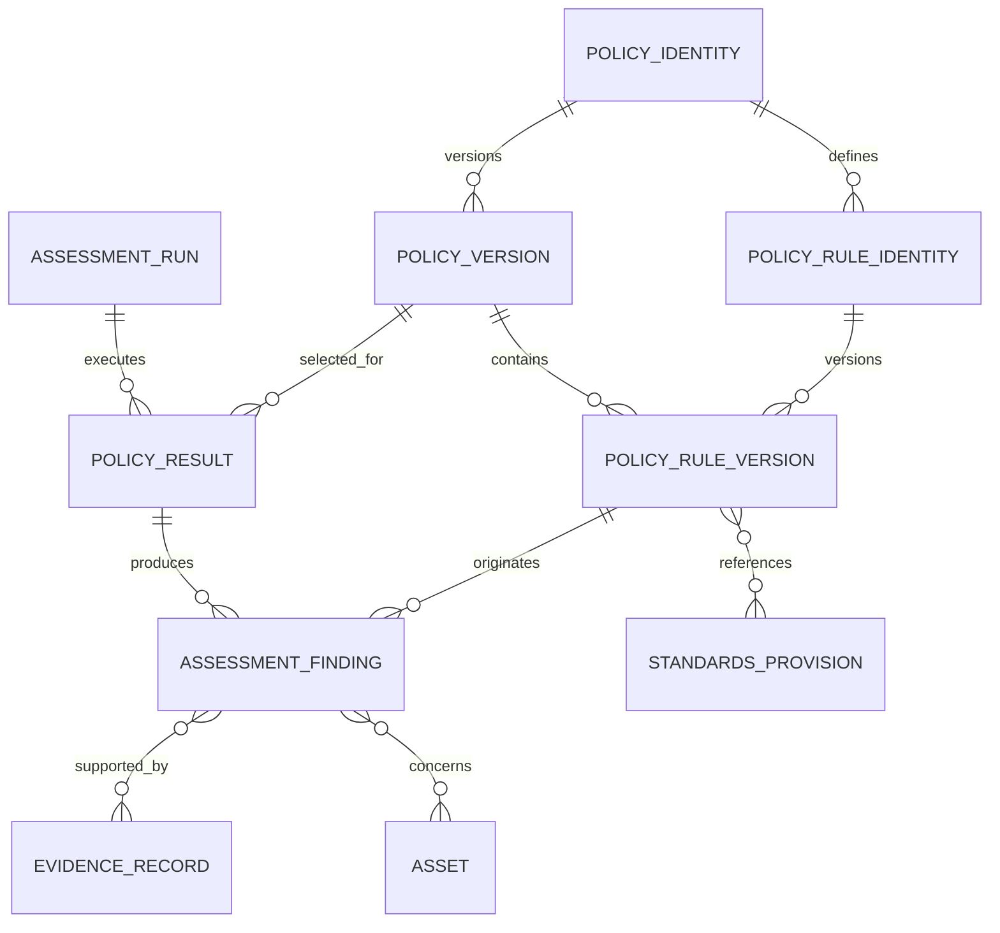
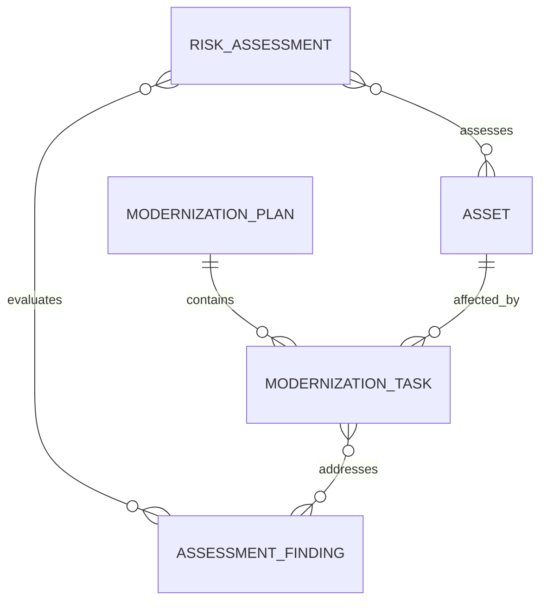

# Entity Relationships and Aggregate Boundaries

**Project:** Cryptographic Inventory, Security Assurance and Modernization Framework

**Version:** 0.1.0

**Status:** Proposed

## 1. Purpose

This document defines the ownership, cardinalities and relationships between domain entities.

It complements `domain-model.md` by establishing how entities interact and which objects they own.

## 2. Organization and Inventory

An organization maintains inventories. Assets participate in inventories through independent membership records.



An asset may belong to multiple inventories without duplicating its identity.

`InventoryMembership` references both `inventory_id` and `asset_id`. It preserves membership validity and lifecycle.

## 3. Asset Relationships

Assets are independently identifiable entities. Relationships connect assets without embedding complete Asset objects.

```mermaid
erDiagram
    ASSET ||--o{ ASSET_RELATIONSHIP : source
    ASSET ||--o{ ASSET_RELATIONSHIP : target

## 4. Evidence and Collection

```mermaid
erDiagram
    RUNTIME_PROFILE ||--o{ COLLECTION_EXECUTION : supports
    COLLECTION_EXECUTION ||--o{ COLLECTION_OPERATION : contains
    COLLECTION_OPERATION ||--o{ EVIDENCE_RECORD : produces
```

A collection execution may contain zero or more operations. An operation may produce zero or more evidence records.

Evidence may also originate from external declarations, imports or derivations without an internal collection operation.

An evidence record may describe an asset, organization, runtime or collection activity. Its subject reference is therefore not restricted to an asset.

**Ownership rules:**

- CollectionExecution owns its collection operations.
- CollectionOperation records its outcome and diagnostics.
- EvidenceRecord is independently identifiable and immutable after finalization.
- EvidenceProvenance identifies the source and collection history.
- RuntimeProfile describes the environment performing collection.

A failed operation does not create an artificial evidence record.

## 5. Standards



A reference identifies a publication, an edition identifies a specific revision, and a provision identifies a requirement or recommendation within that edition.

`StandardsProvision` is an immutable value object belonging to one edition.

Historical editions remain available for assessment reproducibility.

## 6. Assessment



**Ownership rules:**

- PolicyVersion owns its applicable rule versions.
- Each PolicyRuleVersion belongs to exactly one PolicyVersion.
- AssessmentRun owns its policy execution results.
- PolicyResult owns the findings it produces.
- Findings reference evidence, affected assets and standards provisions without owning them.

Every finding identifies its originating rule version.

The rule version must belong to the same policy version executed by its PolicyResult.

Policy execution status and finding classification remain independent.

## 7. Risk and Modernization



Risk assessments evaluate technical findings against organizational context.

Modernization plans coordinate changes to affected assets and respond to identified findings.

Risk assessments and modernization activities do not modify historical assessment results.

## 8. Aggregate Boundaries

| Aggregate root | Owned objects |
|---|---|
| Organization | Organizational metadata |
| Inventory | Inventory metadata and membership records |
| Asset | Asset identifiers, specification and lifecycle |
| AssetRelationship | Relationship information |
| EvidenceRecord | Evidence value and provenance |
| CollectionExecution | Collection operations |
| RuntimeProfile | Runtime capability snapshot |
| StandardsEdition | Standards provisions |
| PolicyVersion | Policy rule versions |
| AssessmentRun | Policy results and findings |
| RiskAssessment | Risk decision information |
| ModernizationPlan | Modernization tasks |

References between independent aggregates use identifiers rather than unrestricted object ownership.

## 9. Design Constraints

1. Asset identity must not depend on external identifiers.
2. Inventory membership must not duplicate asset identity.
3. Asset relationships must reference valid assets.
4. Evidence must preserve its subject and provenance where applicable.
5. Collection outcomes must remain separate from evidence values.
6. Collection executions must reference their runtime.
7. Historical evidence and assessment findings must remain immutable.
8. Every finding must reference its exact rule version.
9. Every rule version must belong to one policy version.
10. Standards provisions must identify their originating edition.
11. Missing evidence must not imply security or insecurity.
12. Private keys and secret material must not be stored as ordinary inventory values.

**Guiding principle:** Ownership determines lifecycle; references establish relationships; immutable records preserve history.
