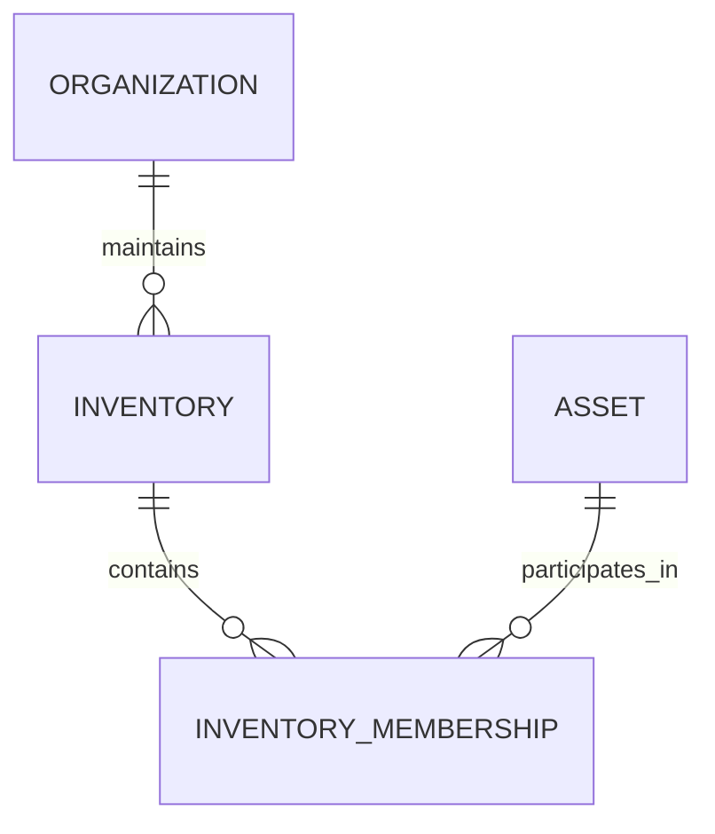
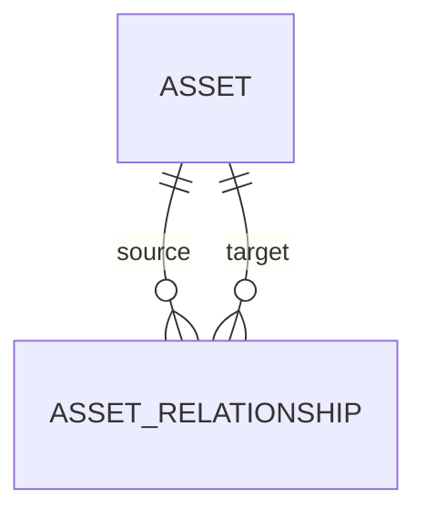
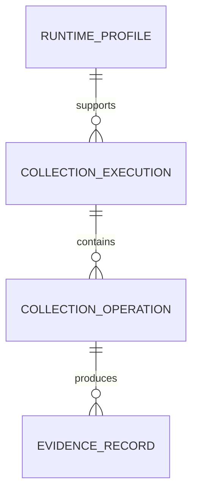
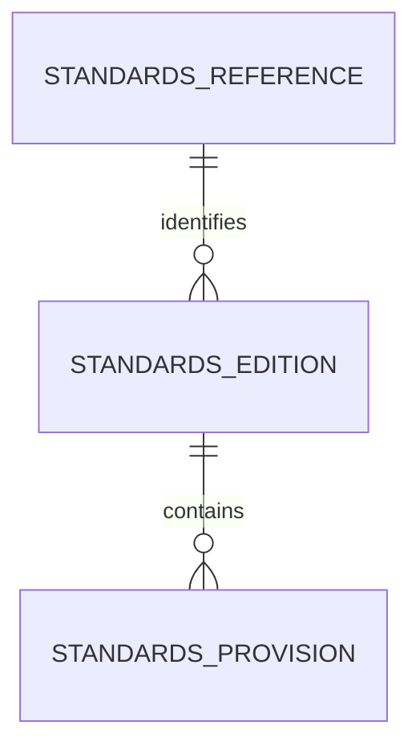
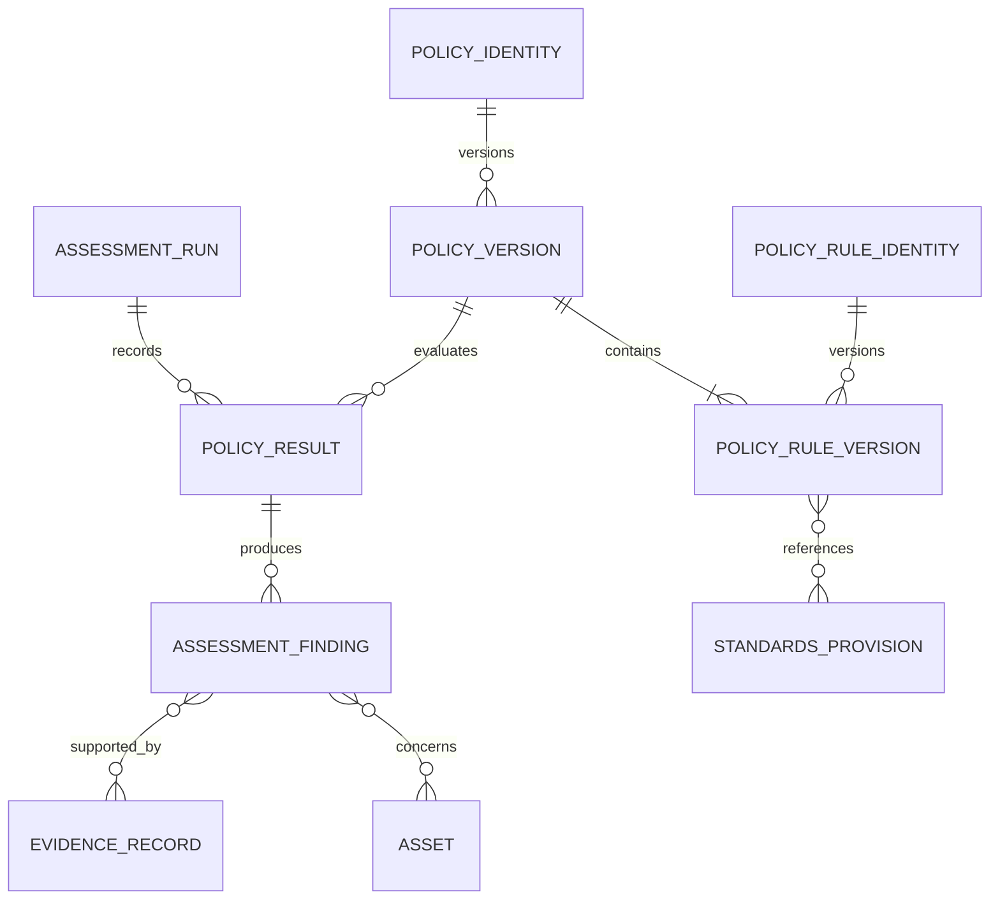
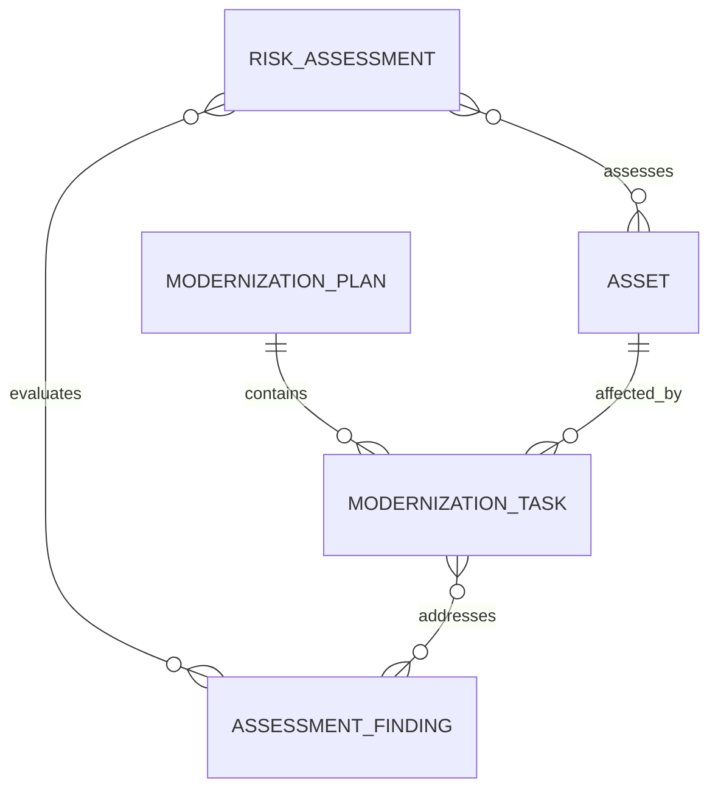

# Entity Relationships and Aggregate Boundaries

**Project:** Cryptographic Inventory, Security Assurance and Modernization Framework

**Version:** 0.1.0

**Status:** Proposed

## 1. Purpose

This document explains how the main domain entities are connected and which objects they own.

It defines their relationships, ownership and cardinalities without prescribing a database design.

## 2. Organization and Inventory

An organization maintains one or more inventories. Assets participate in inventories through membership records.

An asset may belong to multiple inventories without being duplicated.

`InventoryMembership` references an existing asset through its UUID.

## 3. Assets and Relationships

An Asset owns its identifiers, specification and lifecycle information.

An `AssetRelationship` connects two independently identifiable assets using their UUIDs.

Relationships are directed: the source and target have defined meanings.

The same two assets may have different relationships when each represents a distinct fact.

For example:

The relationship record stores identifiers, relationship type, validity information and supporting evidence references. It does not contain complete Asset objects.

Structural validation checks the relationship's attributes. Semantic validation checks whether its source and target asset classifications are permitted.

The inventory application is responsible for confirming asset existence and preventing duplicate persisted relationships.

## 4. Evidence and Collection

Collection records produce evidence, but evidence remains independently identifiable.

A collection execution may contain multiple operations. An operation may produce zero or more evidence records.

Evidence may also originate from external declarations, imports or documented analysis without an internal collection operation.

Each evidence record identifies its subject, value, provenance and observation time.

A failed collection operation does not create an artificial evidence record.

## 5. Standards

A publication may have multiple editions. Each edition contains its own requirements and recommendations.

Historical editions remain available so previous assessments can be understood and reproduced.

A provision belongs to one specific edition.

## 6. Assessment

Policies contain versioned rules. Assessment runs record policy execution and its findings.

Each rule version belongs to one policy version.

Every finding identifies its originating rule version and references its supporting evidence and affected assets.

Policy execution status is separate from finding classification. A successfully executed policy may produce an unknown result when evidence is insufficient.

## 7. Risk and Modernization

Risk assessments evaluate findings and affected assets. Modernization plans organize the resulting work.

Risk decisions preserve their assumptions and rationale.

Modernization plans reference affected assets and findings without modifying historical assessment results.

## 8. Ownership

The following table summarizes the main ownership boundaries.

| Owner | Owned objects |
|---|---|
| Inventory | Membership records |
| Asset | Identifiers, specification and lifecycle |
| AssetRelationship | Relationship attributes and evidence UUID references |
| EvidenceRecord | Evidence value and provenance |
| CollectionExecution | Collection operations |
| RuntimeProfile | RuntimeCapabilities snapshot |
| StandardsEdition | Standards provisions |
| PolicyVersion | Policy rule versions |
| AssessmentRun | Assessment context and policy results |
| PolicyResult | Assessment findings |
| RiskAssessment | Risk decision information |
| ModernizationPlan | Modernization tasks |

Independent entities reference one another through identifiers rather than embedding complete copies.

## 9. Design Rules

1. Asset identity is independent of external identifiers.
2. Inventory membership does not create duplicate assets.
3. Relationships reference assets by UUID.
4. Relationship compatibility is separate from asset-existence checks.
5. Evidence retains its subject and origin.
6. Collection outcomes remain separate from evidence values.
7. Historical evidence and assessment findings are preserved.
8. Every finding identifies its originating rule version.
9. Every rule version belongs to one policy version.
10. Standards provisions belong to a specific edition.
11. Missing evidence does not establish security or insecurity.
12. Private keys and secret material are not stored as ordinary inventory data.

**Guiding principle:** Ownership determines what an entity maintains; references connect independent entities; historical records preserve what was known and when.
