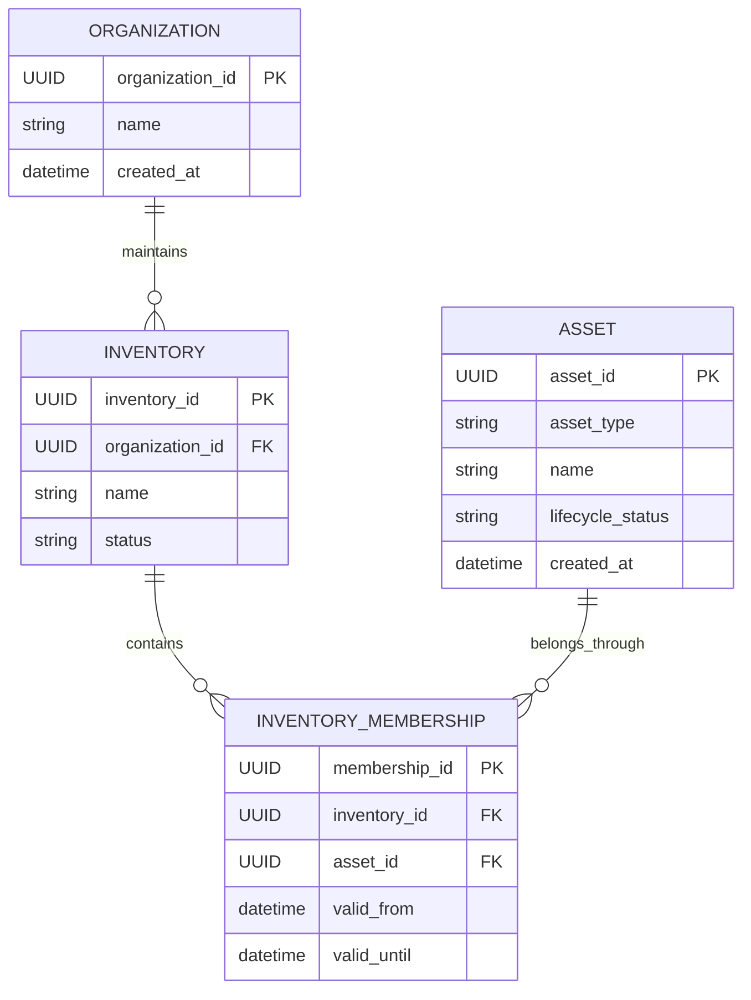
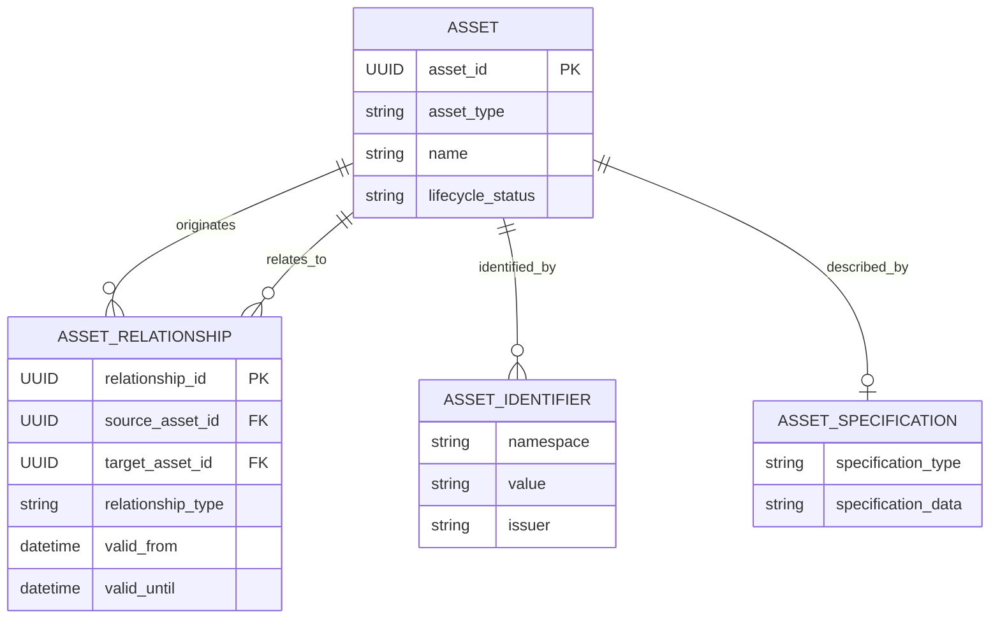
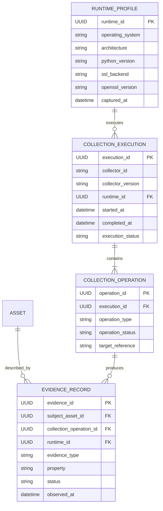
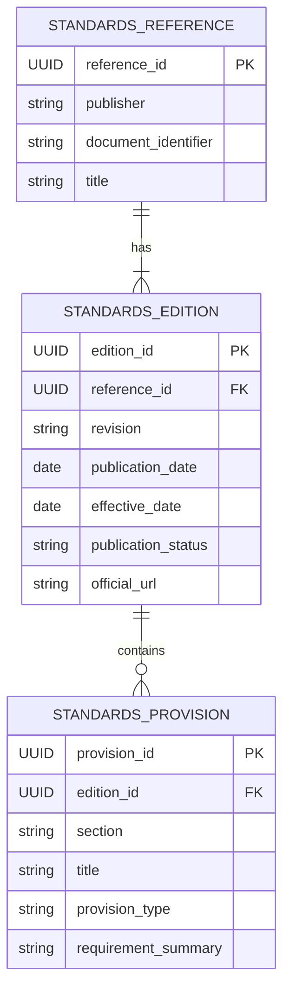
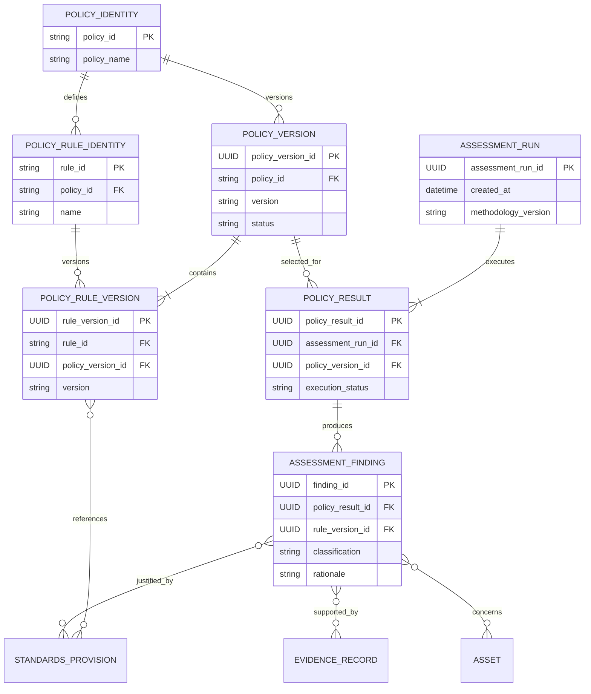
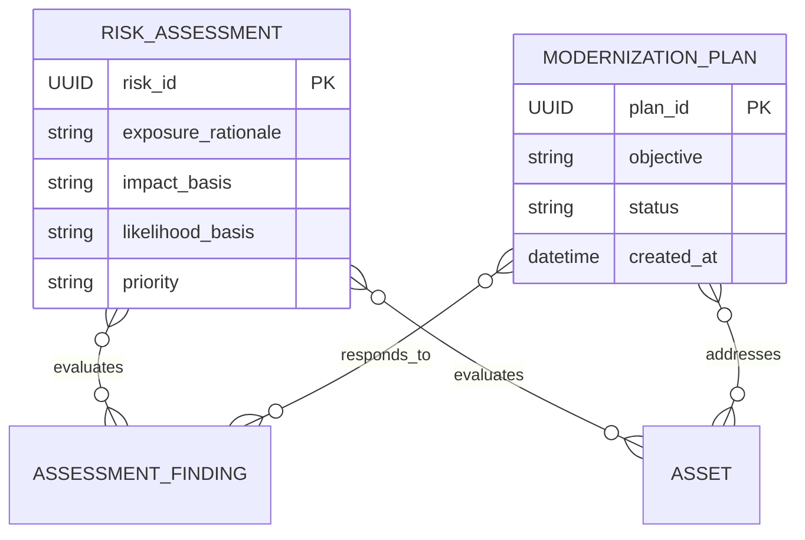

# Domain Entity Relationship Diagram

**Project:** Cryptographic Inventory, Security Assurance and Modernization Framework

**Version:** 0.1.0

**Status:** Proposed

## 1. Purpose

This document defines the entity relationships and cardinalities of the framework.

It provides a consolidated view of organizational inventory, cryptographic assets, evidence collection, runtime provenance, standards management, assessment execution and risk analysis.

The diagram represents logical domain relationships. It does not prescribe a particular relational database or persistence implementation.

## 2. Organizational Inventory Relationships

An organization maintains inventories.

An asset can participate in multiple inventories through separate membership records.

This avoids duplicating an asset when it belongs to multiple organizational inventory scopes.

## 3. Asset Relationships

Asset identifiers and specifications are value objects composed into the Asset aggregate.

The diagram represents their conceptual relationships. They do not necessarily require independent domain entity identities.

Asset relationships are independently identifiable because they have their own lifecycle and supporting evidence.

A relationship must identify both its source and target assets.

## 4. Evidence and Collection Relationships

A collection execution contains one or more collection operations.

Each operation may produce zero or more evidence records.

An execution may therefore complete partially or fail without necessarily producing evidence for every requested operation.

Declared or imported evidence may not have a collection operation. Its provenance must identify the appropriate external source instead.

Runtime profiles represent the collector environment, not the remote target environment.

## 5. Standards Relationships

A standards reference represents a publication identity.

An edition represents a particular publication revision.

A provision belongs to exactly one edition.

Historical editions must remain available for assessment reproducibility.

## 6. Assessment Relationships

A stable policy identity may have multiple versions.

Each rule identity may also have multiple versions.

A rule version belongs to exactly one policy version.

Policy rules reference exact standards provisions.

Assessment findings reference the specific rule version that produced them.

Findings can reference multiple evidence records and may concern multiple assets.

The policy result records execution status independently of finding classifications.

## 7. Risk and Modernization Relationships

Risk assessments consume technical findings and organizational context.

Modernization plans coordinate changes to affected assets and respond to identified findings.

Risk evaluation and migration activities remain separate from technical assessment execution.

## 8. Relationship and Ownership Rules

| Relationship | Cardinality | Ownership |
|---|---|---|
| Organization to Inventory | 1:N | Inventory references Organization |
| Inventory to Membership | 1:N | Inventory owns membership records |
| Asset to Membership | 1:N | Membership references Asset |
| Asset to Identifier | 1:N | Asset composes identifiers |
| Asset to Specification | 1:0..1 | Asset composes its specification |
| Asset to Evidence | 1:N | Evidence independently references Asset |
| CollectionExecution to Operation | 1:N | Execution owns operations |
| CollectionOperation to Evidence | 1:N | Operation produces evidence |
| RuntimeProfile to CollectionExecution | 1:N | Execution references RuntimeProfile |
| StandardsReference to Edition | 1:N | Edition references publication identity |
| StandardsEdition to Provision | 1:N | Edition owns provisions |
| PolicyIdentity to PolicyVersion | 1:N | Version references policy identity |
| PolicyVersion to RuleVersion | 1:N | Version owns applicable rule versions |
| RuleIdentity to RuleVersion | 1:N | Version references rule identity |
| PolicyResult to Finding | 1:N | Result owns findings |
| Finding to Evidence | N:M | Finding references evidence |
| Finding to StandardsProvision | N:M | Finding references provisions |
| Finding to Asset | N:M | Finding identifies affected assets |
| RiskAssessment to Finding | N:M | Risk assessment references findings |
| ModernizationPlan to Asset | N:M | Plan references affected assets |

## 9. Important Constraints

The implementation must enforce:

1. Asset identifiers are namespaced.
2. Inventory membership must not duplicate asset identity.
3. Asset relationships cannot reference nonexistent assets.
4. Collection executions must identify their runtime.
5. Failed collection operations must not create invented evidence.
6. Finalized evidence records must be immutable.
7. Historical standards editions must remain identifiable.
8. Every rule version must belong to one policy version.
9. Every finding must reference its originating rule version.
10. Historical assessment runs must preserve their policy and standards references.
11. Risk assessments must reference the technical findings they evaluate.
12. Private keys and secret material must not be stored as ordinary inventory values.

## 10. Design Limitations

This ERD is a logical domain model.

It does not prescribe:

- SQL table names.
- Foreign-key implementation details.
- Database technology.
- JSON serialization.
- ORM relationships.
- CycloneDX component structure.

Those decisions belong to later persistence and interoperability design.

**Guiding principle:** Model the relationships required by the cryptographic domain before selecting the technology used to store them.
