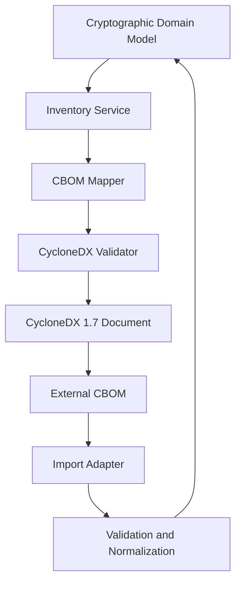
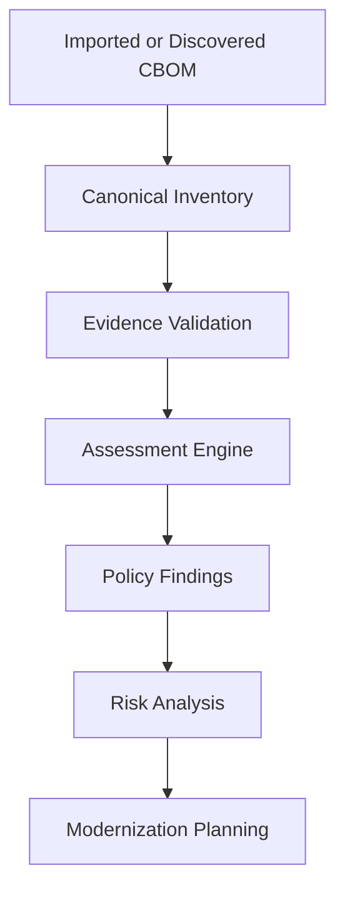
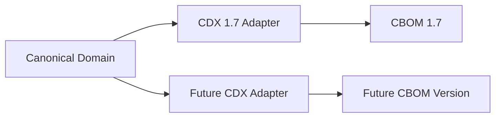

# CycloneDX CBOM Integration

**Project:** Cryptographic Inventory, Security Assurance and Modernization Framework

**Version:** 0.1.0

**Status:** Proposed

## 1. Purpose

This document defines how the framework integrates with CycloneDX Cryptography Bill of Materials (CBOM).

The integration supports standardized cryptographic inventory exchange while preserving the independence of the internal domain model.

## 2. Standards and Scope

The initial integration targets:

- CycloneDX 1.7.
- ECMA-424, Second Edition.
- JSON serialization.

CycloneDX provides a standardized representation of software, hardware, services, dependencies and cryptographic assets.

The framework will use CBOM to exchange cryptographic inventory information with compatible tools and organizations.

## 3. Architectural Separation

The internal domain model remains the authoritative representation of assets, evidence and relationships.

CycloneDX-specific structures must not become internal domain entities.

## 4. Cryptographic Asset Representation

CycloneDX represents cryptographic assets through components classified as `cryptographic-asset`, with cryptographic details described through `cryptoProperties`.

Relevant asset types include:

- Algorithms.
- Protocols.
- Certificates.
- Public keys.
- Private keys.
- Secret keys.

The framework must map its internal assets and cryptographic specifications to the appropriate CycloneDX representations.

Not every internal asset necessarily maps to an individual cryptographic component.

## 5. Asset and Relationship Mapping

| Internal concept | CycloneDX representation |
|---|---|
| Software component | Component |
| Cryptographic library | Software component |
| Cryptographic algorithm | Cryptographic asset |
| TLS protocol | Cryptographic asset |
| X.509 certificate | Cryptographic asset |
| Cryptographic key reference | Appropriate cryptographic asset |
| Component dependency | Dependency relationship |
| BOM generation context | Metadata |

Mapping must preserve identifiers, relationships and supported cryptographic properties.

Internal relationships that cannot be represented directly must be handled through documented mappings or extensions where appropriate.

## 6. CBOM Import and Export

### Export

The exporter converts canonical inventory information into a CycloneDX BOM.

It must:

1. Select inventory assets within the requested scope.
2. Map supported assets and cryptographic properties.
3. Preserve component identifiers and relationships.
4. Include appropriate BOM metadata.
5. Validate the generated document against the selected specification.

### Import

The importer accepts external CycloneDX documents.

It must:

1. Identify the BOM format and specification version.
2. Validate document structure.
3. Extract supported components and cryptographic properties.
4. Resolve component references and dependencies.
5. Normalize imported information into domain models.
6. Record source and import provenance.
7. Report unsupported or ambiguous information.

Importing a BOM must not silently establish that its declarations have been independently verified.

## 7. CBOM and Assessment Integration

CBOM provides inventory information, not a complete security assessment.

The assessment engine consumes normalized inventory and evidence.

CycloneDX component declarations alone must not be interpreted as proof of deployed functionality, algorithm security or PQC readiness.

## 8. Validation and Interoperability

The integration must support:

- CycloneDX schema validation.
- Specification version identification.
- Component reference consistency.
- Dependency relationship validation.
- Cryptographic property validation.
- Import and export diagnostics.
- Preservation of supported metadata.

The integration must distinguish unsupported information from invalid information.

Information that cannot be represented in the selected CycloneDX version must not be silently discarded.

## 9. Security and Data Handling

CBOM documents may contain sensitive infrastructure information.

The integration must:

- Avoid exporting private keys and secret material.
- Minimize unnecessary infrastructure details.
- Preserve appropriate asset identifiers.
- Support controlled access to generated inventories.
- Avoid treating imported declarations as verified observations.

## 10. Versioning and Evolution

CycloneDX versions must be handled through version-specific adapters.

The internal domain model must not change merely because CycloneDX introduces new fields or asset representations.

Schema upgrades require compatibility testing and documented mapping changes.

## 11. Implementation Priorities

1. Establish the internal-to-CycloneDX mapping.
2. Implement CycloneDX 1.7 export.
3. Validate generated documents.
4. Implement CycloneDX import.
5. Preserve asset and dependency relationships.
6. Add interoperability and contract tests.
7. Evaluate future CycloneDX versions independently.

**Guiding principle:** Maintain one canonical internal inventory while supporting standardized cryptographic inventory exchange through replaceable CycloneDX adapters.
