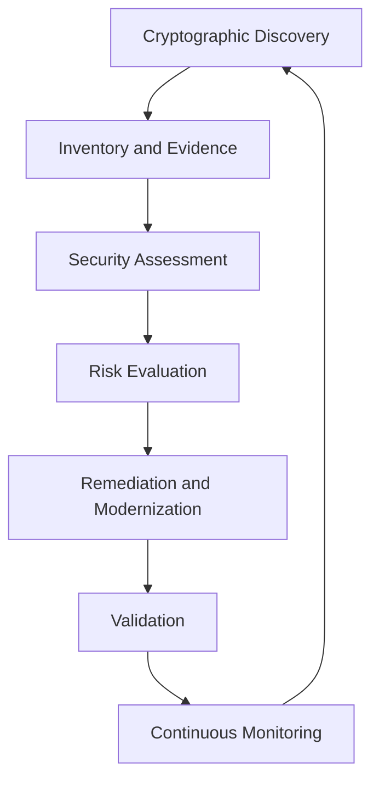
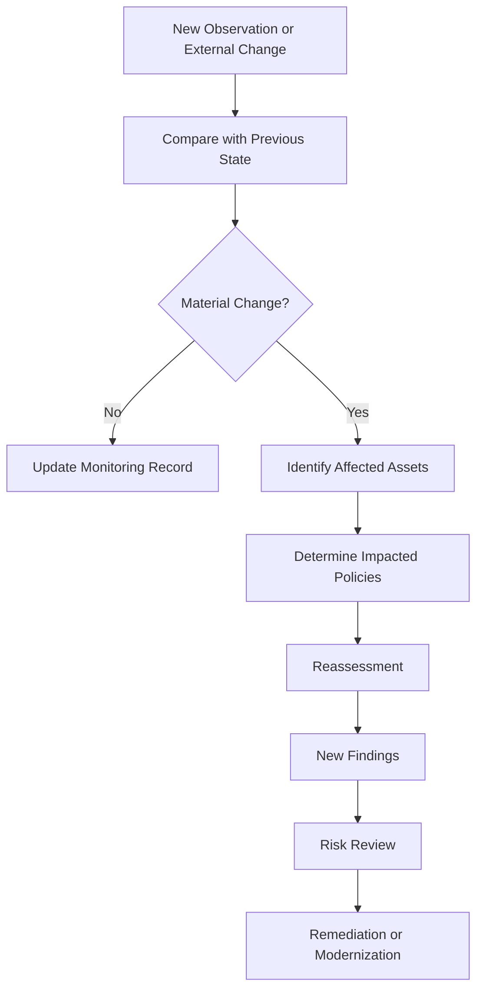

# Continuous Cryptographic Assurance

**Project:** Cryptographic Inventory, Security Assurance and Modernization Framework

**Version:** 0.1.0

**Status:** Proposed

## 1. Purpose

Continuous cryptographic assurance enables organizations to maintain visibility and oversight of their cryptographic infrastructure throughout its lifecycle.

The framework extends beyond initial PQC migration to support ongoing discovery, assessment, risk monitoring and cryptographic modernization.

## 2. Assurance Lifecycle

Continuous assurance builds upon the framework's inventory, evidence and assessment capabilities.

Each cycle updates the organization's understanding of its cryptographic environment.

Historical observations and assessment results remain available for comparison.

## 3. Continuous Assurance Activities

The framework should support the following activities:

| Activity | Objective |
|---|---|
| Asset discovery | Identify newly deployed or modified cryptographic assets. |
| Configuration monitoring | Detect changes in protocols, algorithms and cryptographic configurations. |
| Certificate monitoring | Identify expiration, trust and certificate configuration changes. |
| Dependency monitoring | Discover changes in cryptographic libraries and dependencies. |
| Standards monitoring | Identify relevant publications, revisions and security recommendations. |
| Vulnerability monitoring | Identify newly disclosed weaknesses affecting cryptographic components. |
| Assessment | Re-evaluate assets against applicable policies. |
| Migration validation | Verify that modernization activities achieve their intended objectives. |

Monitoring must distinguish verified changes from incomplete or inconclusive observations.

## 4. Change Detection and Reassessment

Changes to cryptographic assets, evidence, dependencies or applicable standards may require reassessment.

Potential triggers include:

- Changes to negotiated TLS configurations.
- Certificate replacement or expiration.
- Cryptographic library upgrades.
- Newly identified algorithm vulnerabilities.
- Changes to supported cryptographic mechanisms.
- Relevant standards revisions.
- Changes in organizational security requirements.

Not every change requires a complete reassessment. The framework should identify affected assets and policies to support targeted evaluation.

## 5. Historical Assurance and Traceability

Continuous assurance requires preserving historical information.

The framework should maintain relationships between:

- Previous and current asset states.
- Evidence observations.
- Collection executions and runtime profiles.
- Assessment runs and policy versions.
- Standards editions.
- Risk decisions.
- Modernization activities.

This enables organizations to investigate configuration drift, demonstrate remediation and explain previous assessment decisions.

Historical evidence and findings must not be silently overwritten.

## 6. Cryptographic Modernization

PQC migration is one major modernization activity, but cryptographic evolution does not end with migration.

The framework should support:

- Replacement of deprecated algorithms.
- Migration between cryptographic standards.
- Cryptographic library upgrades.
- Key and certificate lifecycle improvements.
- Hybrid-to-fully-post-quantum transition assessment.
- Cryptographic agility evaluation.
- Compatibility and interoperability validation.

Modernization plans should identify affected assets, dependencies, proposed changes, validation requirements and residual exposure.

## 7. Assurance After PQC Migration

A successful PQC migration does not guarantee permanent cryptographic security.

Organizations must continue monitoring:

| Area | Ongoing concern |
|---|---|
| PQC algorithms | New cryptanalysis and security revisions |
| Implementations | Software vulnerabilities and implementation weaknesses |
| Cryptographic libraries | Updates, configuration and dependency changes |
| Key management | Key lifecycle, storage and access controls |
| Randomness | Entropy source and DRBG assurance |
| Interoperability | Compatibility between systems and implementations |
| Standards | New requirements, revisions and transition guidance |

The framework must support reassessment as cryptographic technologies and security requirements evolve.

## 8. Automation and Operational Boundaries

Continuous assurance may use scheduled discovery, event-driven triggers and external notifications.

Automation must respect collection authorization, resource limits and organizational access controls.

Findings should support human review where evidence is insufficient or remediation decisions have organizational consequences.

The framework must not automatically modify cryptographic configurations without explicitly authorized operational controls.

## 9. Implementation Priorities

Continuous assurance will be introduced incrementally:

1. Preserve historical inventory and evidence.
2. Detect asset and configuration changes.
3. Compare successive assessment results.
4. Identify affected policies and assets.
5. Integrate standards and vulnerability updates.
6. Track modernization activities.
7. Support scheduled and event-driven reassessment.

## 10. Success Criteria

The framework should eventually enable organizations to:

- Maintain an up-to-date cryptographic inventory.
- Trace cryptographic dependencies.
- Detect material configuration changes.
- Identify emerging cryptographic exposure.
- Evaluate standards and technology changes.
- Validate completed modernization activities.
- Maintain reproducible historical assessments.
- Demonstrate ongoing cryptographic assurance.

**Guiding principle:** Cryptographic security is a lifecycle responsibility. Discovery establishes visibility, evidence establishes what is known, assessment identifies concerns, and continuous assurance maintains that understanding as technology and requirements evolve.
