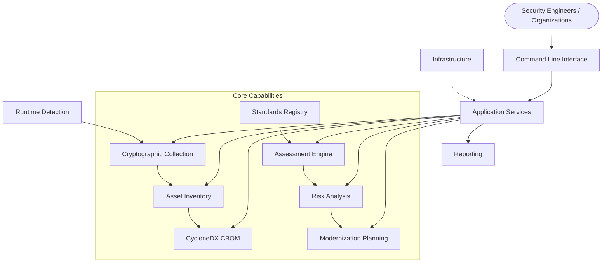
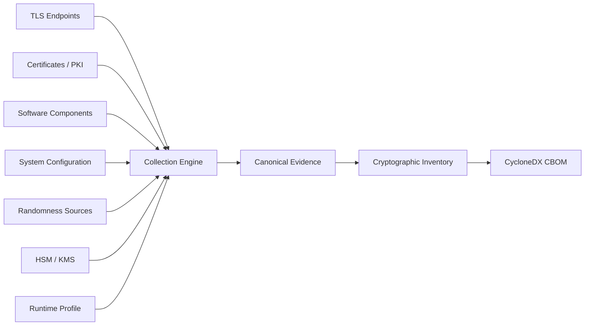
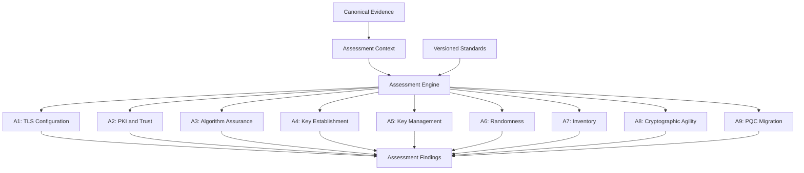
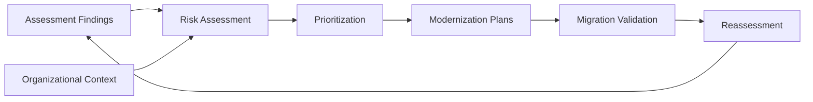

# Framework Architecture Overview

**Project:** Cryptographic Inventory, Security Assurance and Modernization Framework

**Version:** 0.1.0

**Status:** Proposed

## 1. Purpose

The framework provides a structured approach to discovering cryptographic assets, collecting evidence, assessing security requirements and supporting cryptographic modernization.

It is designed to support organizations throughout the lifecycle of their cryptographic infrastructure, including post-quantum cryptography migration.

## 2. System Architecture

The framework separates domain concepts, collection mechanisms, assessment policies and infrastructure implementations.

The domain model provides common representations for assets, relationships, evidence and assessment results.

## 3. Evidence Collection and Inventory

Independent collectors discover cryptographic assets and collect supporting evidence.

Every observation should preserve its subject, source, timestamp, collection method and limitations.

Collectors do not make assessment decisions.

## 4. Security Assessment

The assessment engine evaluates canonical evidence against independently versioned policies, rules and standards.

Each policy has its own scope, evidence requirements, assessment rules and standards references.

Findings retain traceability to the evidence and rules that produced them.

## 5. Risk and Modernization

Assessment findings provide inputs to organizational risk analysis and modernization planning.

PQC migration is a major use case, but the framework is designed to support cryptographic modernization beyond the initial migration.

## 6. Architectural Boundaries

The framework follows separation of concerns and dependency inversion.

- **Domain:** Defines assets, evidence, relationships and assessment concepts.
- **Collection:** Discovers assets and obtains evidence.
- **Runtime:** Identifies collection environment and capabilities.
- **Inventory:** Manages assets and their relationships.
- **BOM:** Provides CycloneDX interoperability.
- **Assessment:** Evaluates evidence against versioned requirements.
- **Standards:** Maintains authoritative publications and provisions.
- **Risk:** Evaluates technical findings against organizational context.
- **Modernization:** Coordinates cryptographic replacement activities.
- **Application:** Coordinates workflows.
- **Infrastructure:** Implements persistence and external integrations.

The domain remains independent of OpenSSL, CycloneDX, databases and CLI implementations.

## 7. Development Roadmap

| Phase | Focus |
|---|---|
| 1 | Domain and evidence foundations |
| 2 | Runtime and collection architecture |
| 3 | TLS and certificate assessment |
| 4 | Cryptographic inventory and CBOM |
| 5 | Standards and policy management |
| 6 | Broader cryptographic discovery |
| 7 | Risk and PQC modernization |
| 8 | Continuous cryptographic assurance |

The architecture describes the intended system. Implementation will progress incrementally, with completed and planned capabilities documented separately.

## 8. Further Documentation

| Subject | Documentation |
|---|---|
| Domain design | `domain/` |
| Package organization | `package-architecture.md` |
| Collection requirements | `collection/` |
| CycloneDX integration | `interoperability/cyclonedx-cbom.md` |
| Assessment methodology | `../../assessment/assessment-methodology.md` |
| Assessment policies | `../../policies/` |
| Standards references | `../../standards/standards-reference.md` |
| Continuous assurance | `modernization/continuous-assurance.md` |

**Guiding principle:** Discover cryptographic assets, preserve reliable evidence, assess evolving requirements and support continuous modernization.
