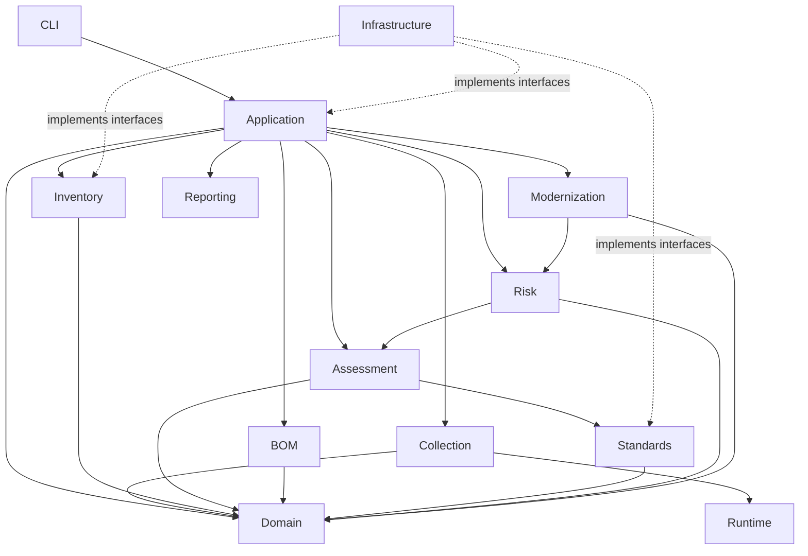

# Package Architecture Specification

**Project:** Cryptographic Inventory, Security Assurance and Modernization Framework

**Version:** 0.1.0

**Status:** Proposed

## 1. Purpose

This document defines the framework's Python package structure, responsibilities and dependency boundaries.

The architecture follows the approved domain model and separates business concepts from collection technologies, application workflows and infrastructure implementations.

## 2. Architectural Organization

The application is organized into the following components:

| Component | Responsibility |
|---|---|
| Domain | Fundamental entities, value objects and domain rules. |
| Collection | Asset discovery and evidence collection. |
| Runtime | Execution environment and capability detection. |
| Inventory | Asset registration, relationships and reconciliation. |
| BOM | External inventory import and export. |
| Standards | Standards references, editions and provisions. |
| Assessment | Versioned policies, rules and findings. |
| Risk | Contextual risk evaluation and prioritization. |
| Modernization | Cryptographic replacement and migration planning. |
| Application | Coordinates application workflows. |
| Infrastructure | Persistence, configuration and external integrations. |
| Reporting | Human-readable reports. |
| CLI | Command-line interaction. |

## 3. Proposed Package Structure

```text
src/
└── pqc_inventory/
    │
    ├── domain/
    │   ├── organization/
    │   ├── inventory/
    │   ├── assets/
    │   ├── relationships/
    │   ├── evidence/
    │   ├── collection/
    │   ├── runtime/
    │   ├── standards/
    │   ├── assessment/
    │   ├── risk/
    │   └── modernization/
    │
    ├── collection/
    │   ├── interfaces.py
    │   ├── common/
    │   ├── tls/
    │   ├── certificates/
    │   ├── key_establishment/
    │   ├── randomness/
    │   ├── software/
    │   └── system/
    │
    ├── runtime/
    │   ├── detector.py
    │   ├── capabilities.py
    │   ├── environment.py
    │   └── backends/
    │
    ├── inventory/
    │   ├── service.py
    │   ├── repository.py
    │   ├── resolver.py
    │   └── reconciliation.py
    │
    ├── bom/
    │   ├── interfaces.py
    │   └── cyclonedx/
    │       ├── importer.py
    │       ├── exporter.py
    │       ├── mapper.py
    │       └── validator.py
    │
    ├── standards/
    │   ├── registry.py
    │   ├── repository.py
    │   └── change_tracking.py
    │
    ├── assessment/
    │   ├── interfaces.py
    │   ├── engine.py
    │   ├── context.py
    │   ├── registry.py
    │   ├── execution.py
    │   ├── profiles/
    │   └── policies/
    │       ├── a1_tls_configuration/
    │       ├── a2_pki_trust/
    │       ├── a3_algorithm_assurance/
    │       ├── a4_key_establishment/
    │       ├── a5_key_management/
    │       ├── a6_randomness/
    │       ├── a7_inventory/
    │       ├── a8_crypto_agility/
    │       └── a9_pqc_migration/
    │
    ├── risk/
    │   ├── context.py
    │   ├── evaluation.py
    │   └── prioritization.py
    │
    ├── modernization/
    │   ├── planning.py
    │   ├── tasks.py
    │   └── validation.py
    │
    ├── application/
    │   ├── discovery_service.py
    │   ├── collection_service.py
    │   ├── inventory_service.py
    │   ├── assessment_service.py
    │   ├── modernization_service.py
    │   ├── report_service.py
    │   └── workflow_service.py
    │
    ├── infrastructure/
    │   ├── persistence/
    │   ├── configuration/
    │   ├── filesystem/
    │   ├── cryptographic_backends/
    │   └── external_services/
    │
    ├── reporting/
    ├── cli/
    ├── templates/
    ├── __init__.py
    └── __main__.py
```

This is the target structure. Packages and modules will be introduced when their responsibilities are justified.

## 4. Package Responsibilities

### Domain

Defines entities, value objects, enumerations and domain invariants.

It includes asset identity, evidence, collection records, runtime profiles, standards and assessment concepts.

It must remain independent of external libraries and infrastructure.

### Collection

Implements independent collectors for TLS, certificates, key establishment, software, randomness and system configuration.

Collectors produce canonical evidence and collection results. They do not perform security assessments.

### Runtime

Identifies the collection environment and discovers available Python, SSL, OpenSSL and cryptographic capabilities.

Runtime detection must distinguish local collection capabilities from remote endpoint capabilities.

### Inventory

Manages asset registration, inventory membership, identifiers, relationships and inventory reconciliation.

### BOM

Provides CycloneDX CBOM import and export through dedicated adapters.

CycloneDX is an interoperability format, not the internal domain model.

### Standards

Manages standards publications, editions, provisions and changes.

Standards updates require controlled review before affecting assessment rules.

### Assessment

Executes versioned assessment policies and rules against canonical evidence.

Each policy owns distinct assessment responsibilities and produces traceable findings.

### Risk and Modernization

Risk evaluates technical findings against organizational context.

Modernization coordinates cryptographic replacement, migration activities and validation.

These components must not modify historical technical findings.

### Application

Coordinates discovery, collection, inventory, assessment, modernization and reporting workflows.

Application services depend on interfaces rather than concrete infrastructure implementations.

### Infrastructure

Implements persistence, configuration, filesystem operations and external integrations.

### Reporting and CLI

Reporting prepares human-readable outputs.

The CLI validates user input and delegates operations to application services.

Neither component should contain assessment methodology.

## 5. Dependency Architecture

The intended dependency direction is:



The infrastructure implementations are connected through dependency injection at application startup.

### Dependency rules

1. Domain must not depend on application or infrastructure.
2. Collection must not depend on assessment policies.
3. Assessment must not perform network collection.
4. Assessment must consume canonical evidence.
5. BOM adapters must not implement assessment classifications.
6. Risk must consume assessment findings.
7. Modernization must preserve historical assessment results.
8. CLI must delegate business operations to application services.
9. Circular package dependencies are prohibited.

## 6. Interface Placement

Interfaces belong to the component requiring the capability.

| Interface | Responsibility |
|---|---|
| `Collector` | Executes evidence collection. |
| `AssetRepository` | Manages asset persistence. |
| `EvidenceRepository` | Manages evidence persistence. |
| `AssessmentPolicy` | Defines policy execution. |
| `PolicyRegistry` | Resolves policy versions. |
| `StandardsRepository` | Retrieves standards references and provisions. |
| `BOMImporter` | Imports external inventory documents. |
| `BOMExporter` | Exports standardized inventory documents. |

Concrete implementations belong in the relevant adapters or infrastructure packages.

## 7. Test Organization

Tests will follow the architectural boundaries:

```text
tests/
├── unit/
│   ├── domain/
│   ├── collection/
│   ├── runtime/
│   ├── inventory/
│   ├── standards/
│   ├── assessment/
│   └── risk/
│
├── integration/
│   ├── tls/
│   ├── certificates/
│   ├── inventory/
│   ├── assessment/
│   └── cyclonedx/
│
├── contracts/
│   ├── collectors/
│   ├── evidence/
│   ├── policies/
│   └── bom/
│
└── system/
    ├── cli/
    └── workflows/
```

Tests will migrate alongside their corresponding source modules.

Python 3.12 and 3.15.2 must remain supported during the initial migration.

## 8. Migration Strategy

The restructuring will follow this sequence:

| Stage | Focus |
|---|---|
| 1 | Domain models and contracts |
| 2 | Runtime detection and capabilities |
| 3 | TLS and certificate collection |
| 4 | Inventory and evidence management |
| 5 | Assessment engine and policies |
| 6 | Standards registry |
| 7 | CycloneDX integration |
| 8 | Risk and modernization |
| 9 | Application, infrastructure and CLI integration |
| 10 | Reporting and continuous assurance |

Existing functionality, persisted evidence and CLI behaviour must remain compatible where practical.

Legacy data will be handled through explicit version-aware adapters.

## 9. Architectural Constraints

- Domain models remain technology-independent.
- Collectors produce canonical evidence.
- Historical evidence and findings remain immutable.
- Assessment policies are independently versioned.
- Standards references preserve publication editions.
- CycloneDX is isolated behind adapters.
- Runtime capabilities are detected rather than assumed.
- New functionality must respect established package boundaries.

**Guiding principle:** Organize the application around stable domain responsibilities, with independently replaceable collectors, assessment policies and infrastructure integrations.
