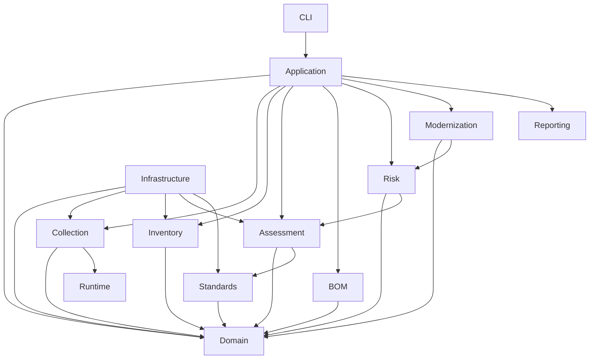

# Package Architecture Specification

**Project:** Cryptographic Inventory, Security Assurance and Modernization Framework

**Version:** 0.1.0

**Status:** Proposed

## 1. Purpose

This document defines the target Python package architecture for the framework.

It establishes:

- Package responsibilities.
- Module organization.
- Dependency boundaries.
- Interface locations.
- Integration points.
- Source-code migration strategy.
- Test organization.

The architecture is derived from the approved domain model, entity relationship specification and domain class design.

The objective is to establish a modular application that accommodates new cryptographic technologies, collection methods, assessment policies and external inventory standards.

## 2. Architectural Principles

The package architecture follows these principles:

1. Domain independence.
2. Separation of concerns.
3. Dependency inversion.
4. Composition over unnecessary inheritance.
5. Explicit interfaces between components.
6. Independent collection and assessment.
7. Interoperability through adapters.
8. Runtime capability awareness.
9. Testability and maintainability.
10. Incremental implementation.

The package structure must not be driven exclusively by the current TLS scanner implementation.

## 3. High-Level Architecture

The application is organized into the following logical components:

| Component | Responsibility |
|---|---|
| Domain | Defines the framework's fundamental entities and value objects. |
| Collection | Discovers assets and collects evidence. |
| Runtime | Discovers execution environment and cryptographic capabilities. |
| Inventory | Manages cryptographic assets and relationships. |
| BOM | Provides standardized inventory import and export. |
| Standards | Manages authoritative standards and their versions. |
| Assessment | Evaluates evidence against versioned policies and rules. |
| Risk | Evaluates technical findings against organizational context. |
| Modernization | Coordinates cryptographic replacement and migration activities. |
| Application | Coordinates application workflows. |
| Infrastructure | Implements persistence, configuration and external integrations. |
| Reporting | Generates assessment and inventory reports. |
| CLI | Provides command-line interaction. |

## 4. Proposed Package Structure

```text
src/
└── pqc_inventory/
    │
    ├── domain/
    │   ├── __init__.py
    │   │
    │   ├── organization/
    │   │   ├── entities.py
    │   │   └── values.py
    │   │
    │   ├── inventory/
    │   │   ├── entities.py
    │   │   └── values.py
    │   │
    │   ├── assets/
    │   │   ├── entities.py
    │   │   ├── identifiers.py
    │   │   ├── specifications.py
    │   │   └── relationships.py
    │   │
    │   ├── evidence/
    │   │   ├── entities.py
    │   │   ├── provenance.py
    │   │   ├── values.py
    │   │   └── references.py
    │   │
    │   ├── collection/
    │   │   ├── entities.py
    │   │   └── values.py
    │   │
    │   ├── runtime/
    │   │   ├── entities.py
    │   │   └── capabilities.py
    │   │
    │   ├── standards/
    │   │   ├── entities.py
    │   │   └── values.py
    │   │
    │   ├── assessment/
    │   │   ├── entities.py
    │   │   ├── policies.py
    │   │   ├── findings.py
    │   │   └── values.py
    │   │
    │   └── risk/
    │       ├── entities.py
    │       └── values.py
    │
    ├── collection/
    │   ├── __init__.py
    │   ├── interfaces.py
    │   ├── services.py
    │   │
    │   ├── common/
    │   │   ├── target_resolution.py
    │   │   ├── validation.py
    │   │   └── diagnostics.py
    │   │
    │   ├── tls/
    │   │   ├── scanner.py
    │   │   ├── handshake.py
    │   │   ├── probes.py
    │   │   ├── models.py
    │   │   └── utilities.py
    │   │
    │   ├── certificates/
    │   │   ├── parser.py
    │   │   ├── validation.py
    │   │   └── chain.py
    │   │
    │   ├── software/
    │   │   ├── discovery.py
    │   │   └── dependencies.py
    │   │
    │   ├── randomness/
    │   │   ├── discovery.py
    │   │   └── validation.py
    │   │
    │   └── system/
    │       ├── discovery.py
    │       └── cryptographic_configuration.py
    │
    ├── runtime/
    │   ├── __init__.py
    │   ├── detector.py
    │   ├── capabilities.py
    │   ├── environment.py
    │   └── backends/
    │
    ├── inventory/
    │   ├── __init__.py
    │   ├── services.py
    │   ├── repositories.py
    │   ├── discovery.py
    │   └── reconciliation.py
    │
    ├── bom/
    │   ├── __init__.py
    │   ├── interfaces.py
    │   └── cyclonedx/
    │       ├── importer.py
    │       ├── exporter.py
    │       ├── mapper.py
    │       └── validator.py
    │
    ├── standards/
    │   ├── __init__.py
    │   ├── registry.py
    │   ├── repository.py
    │   ├── applicability.py
    │   └── change_tracking.py
    │
    ├── assessment/
    │   ├── __init__.py
    │   ├── interfaces.py
    │   ├── engine.py
    │   ├── context.py
    │   ├── registry.py
    │   ├── execution.py
    │   │
    │   ├── policies/
    │   │   ├── a1_tls_configuration/
    │   │   ├── a2_pki_trust/
    │   │   ├── a3_algorithm_assurance/
    │   │   ├── a4_key_establishment/
    │   │   ├── a5_key_management/
    │   │   ├── a6_randomness/
    │   │   ├── a7_inventory/
    │   │   ├── a8_crypto_agility/
    │   │   └── a9_pqc_migration/
    │   │
    │   └── profiles/
    │
    ├── risk/
    │   ├── __init__.py
    │   ├── assessment.py
    │   ├── evaluation.py
    │   └── prioritization.py
    │
    ├── modernization/
    │   ├── __init__.py
    │   ├── planning.py
    │   ├── tasks.py
    │   └── validation.py
    │
    ├── application/
    │   ├── __init__.py
    │   ├── scan_service.py
    │   ├── inventory_service.py
    │   ├── assessment_service.py
    │   ├── report_service.py
    │   └── workflow_service.py
    │
    ├── infrastructure/
    │   ├── __init__.py
    │   ├── persistence/
    │   ├── configuration/
    │   ├── filesystem/
    │   ├── serialization/
    │   └── external_services/
    │
    ├── reporting/
    │   ├── __init__.py
    │   ├── interfaces.py
    │   ├── builders/
    │   └── renderers/
    │
    ├── cli/
    │   ├── __init__.py
    │   ├── parser.py
    │   └── commands/
    │
    ├── templates/
    │   ├── config/
    │   └── reports/
    │
    ├── __init__.py
    └── __main__.py
```

This is a target structure. Directories will be introduced when their responsibilities are defined and implementation is justified.

Empty directories and speculative modules should not be created merely to match the diagram.

## 5. Package Responsibilities

### 5.1 Domain

Defines the fundamental concepts of the framework.

It contains:

- Entities.
- Value objects.
- Domain enumerations.
- Domain-level invariants.
- Domain identifiers.

The domain must not depend on:

- OpenSSL.
- Python SSL implementations.
- Pydantic.
- CycloneDX.
- JSON persistence.
- CLI commands.
- Reporting frameworks.

### 5.2 Collection

Implements asset discovery and evidence collection.

Individual collectors operate independently.

Initial collection responsibilities include:

- TLS endpoint discovery.
- Certificate inspection.
- Software dependency discovery.
- Cryptographic configuration discovery.
- Randomness-related evidence collection.

Collectors must produce evidence through established domain contracts.

They must not make assessment decisions.

### 5.3 Runtime

Discovers the environment in which collection occurs.

Responsibilities include:

- Python runtime identification.
- Operating-system identification.
- SSL backend identification.
- OpenSSL version discovery.
- Cryptographic library discovery.
- Available API detection.
- Runtime capability profiles.

Runtime capabilities describe the collector rather than remote endpoint capabilities.

### 5.4 Inventory

Coordinates asset registration and inventory management.

Responsibilities include:

- Asset registration.
- Identifier resolution.
- Inventory membership.
- Relationship management.
- Duplicate detection.
- Historical inventory snapshots.
- Inventory reconciliation.

### 5.5 BOM

Provides external BOM interoperability.

The CycloneDX integration will support:

- CBOM generation.
- CBOM import.
- Asset mapping.
- Relationship mapping.
- Schema validation.
- Import diagnostics.

The BOM layer must not become the internal domain model.

### 5.6 Standards

Manages standards references and their versions.

Responsibilities include:

- Standards publication registration.
- Edition management.
- Provision references.
- Standards applicability.
- Supersession relationships.
- Standards change tracking.

Standards updates must not automatically modify assessment classifications.

### 5.7 Assessment

Executes versioned assessment policies and rules.

Responsibilities include:

- Policy registration.
- Policy selection.
- Rule evaluation.
- Evidence requirement checking.
- Finding generation.
- Assessment execution.
- Historical policy snapshots.

Assessment logic must remain independent of collection implementations.

### 5.8 Risk

Evaluates technical findings against organizational context.

Responsibilities include:

- Exposure evaluation.
- Impact analysis.
- Likelihood rationale.
- Risk prioritization.
- Residual exposure analysis.

Risk methodology must be documented independently of individual technical policies.

### 5.9 Modernization

Coordinates cryptographic replacement activities.

Responsibilities include:

- Modernization planning.
- Affected asset identification.
- Proposed cryptographic replacements.
- Migration task tracking.
- Validation planning.
- Residual risk tracking.

Modernization activities must not modify historical assessment findings.

### 5.10 Application

Coordinates use cases across the framework.

Examples:

- Scan endpoints.
- Discover cryptographic assets.
- Generate inventory.
- Run assessments.
- Generate reports.
- Execute complete workflows.

Application services should depend on interfaces rather than concrete infrastructure implementations wherever practical.

### 5.11 Infrastructure

Implements technical mechanisms required by the application.

Responsibilities include:

- JSON and other persistence implementations.
- Configuration loading.
- Filesystem operations.
- External API integrations.
- Serialization adapters.
- Logging.

Infrastructure implements application-facing interfaces.

### 5.12 Reporting

Transforms inventory and assessment results into human-readable outputs.

Initial formats:

- JSON.
- Markdown.
- HTML.

Future formats may include PDF and machine-readable compliance reports.

### 5.13 CLI

Provides command-line interaction.

The CLI should validate user input and delegate actual operations to application services.

It must not contain assessment logic or collection implementations.

## 6. Dependency Architecture

The intended dependency direction is:



The diagram represents logical dependencies. Exact Python imports will be constrained further through interfaces and dependency injection.

### Dependency rules

1. Domain must not import application or infrastructure packages.
2. Domain must not import collectors or external inventory libraries.
3. Collection must not import assessment policies.
4. Assessment must not import TLS scanner implementations.
5. Assessment must not perform network operations.
6. BOM adapters must not contain assessment classifications.
7. Risk must consume assessment outputs rather than duplicate technical policy rules.
8. Modernization must not directly modify historical findings.
9. CLI must delegate business operations to application services.
10. Infrastructure must implement defined interfaces rather than control domain behaviour.
11. Circular imports between packages must be avoided.
12. New dependencies must be justified and documented.

## 7. Interface Placement

Interfaces should be placed according to the responsibility they protect.

| Interface | Proposed location |
|---|---|
| Collector | `collection/interfaces.py` |
| AssessmentPolicy | `assessment/interfaces.py` |
| AssetRepository | Inventory application boundary |
| EvidenceRepository | Collection or evidence application boundary |
| StandardsRepository | `standards/` application boundary |
| BOMImporter | `bom/interfaces.py` |
| BOMExporter | `bom/interfaces.py` |
| ReportRenderer | `reporting/interfaces.py` |

Concrete implementations belong in their respective infrastructure or adapter packages.

## 8. Data and Serialization Boundaries

The framework will maintain separate representations for:

1. Domain objects.
2. Native evidence records.
3. Assessment result records.
4. CycloneDX BOM documents.
5. Configuration documents.

Dedicated serializers and adapters must translate between these representations.

Domain objects must not contain database-specific or CycloneDX-specific logic.

External documents must be validated before their contents enter the domain.

Persisted historical records must retain their original schema versions.

## 9. Existing Source Migration Map

The existing implementation will be migrated incrementally.

| Existing module | Proposed destination |
|---|---|
| `collection/models.py` | Split between domain evidence and `collection/tls/models.py` |
| `collection/tls_scanner.py` | `collection/tls/scanner.py` |
| `collection/certificate_parser.py` | `collection/certificates/parser.py` |
| `collection/key_establishment.py` | `collection/tls/` or dedicated key-establishment collector |
| `collection/scan_results.py` | `collection/tls/` |
| `collection/tls_utils.py` | `collection/tls/` and `collection/common/` |
| `collection/target_loader.py` | `collection/common/` |
| `collection/domain_loader.py` | `collection/common/` |
| `assessment/models.py` | Split between `domain/assessment/` and assessment execution contracts |
| `assessment/interfaces.py` | `assessment/interfaces.py` |
| `assessment/orchestrator.py` | `assessment/engine.py` |
| `assessment/registry.py` | `assessment/registry.py` |
| `assessment/policies/` | `assessment/policies/` |
| `application/` | Retain and evolve |
| `commands/` | `cli/commands/` |
| `config/` | `infrastructure/configuration/` |
| `storage/` | `infrastructure/persistence/` |
| `reporting/` | Retain and evolve |
| `utils/logger.py` | Infrastructure logging |

A source module may be split into several modules when it currently combines unrelated responsibilities.

Files must not be moved solely to match directory names.

## 10. Test Organization

Tests will evolve toward the following structure:

```text
tests/
│
├── unit/
│   ├── domain/
│   ├── collection/
│   ├── runtime/
│   ├── inventory/
│   ├── standards/
│   ├── assessment/
│   └── risk/
│
├── integration/
│   ├── tls/
│   ├── certificates/
│   ├── inventory/
│   ├── assessment/
│   └── cyclonedx/
│
├── contracts/
│   ├── collectors/
│   ├── evidence/
│   ├── policies/
│   └── bom/
│
└── system/
    ├── cli/
    └── workflows/
```

Tests should be migrated alongside their corresponding source components.

The existing 324-test suite remains the initial regression baseline.

Additional compatibility tests will run under Python 3.12 and Python 3.15.2.

## 11. Configuration and Runtime Support

The package architecture must support different Python and cryptographic library environments.

The application will use runtime capability detection rather than rigid version-based assumptions.

The supported development environments initially include:

- Python 3.12.
- Python 3.15.2.

Runtime differences must be recorded with collection provenance.

An unavailable collection capability must be represented explicitly.

## 12. Migration Strategy

Restructuring will proceed incrementally.

### Stage 1: Domain foundations

Introduce:

- Asset models.
- Inventory models.
- Evidence models.
- Provenance models.
- Runtime models.

### Stage 2: Collection migration

Move and refine:

- TLS scanning.
- Certificate parsing.
- Handshake observations.
- Capability probes.
- Collection execution.

### Stage 3: Assessment migration

Introduce:

- Versioned policy models.
- Rule versions.
- Assessment contexts.
- Assessment runs.
- Findings.

### Stage 4: Standards integration

Introduce:

- Standards references.
- Standards editions.
- Standards provisions.
- Standards registry.

### Stage 5: Inventory and CBOM

Introduce:

- Inventory services.
- Asset relationship management.
- CycloneDX import/export.
- Inventory validation.

### Stage 6: Risk and modernization

Introduce:

- Risk assessment models.
- Migration prioritization.
- Modernization plans.
- Validation workflows.

### Stage 7: Application and infrastructure integration

Reorganize existing services, persistence, configuration, reporting and CLI modules.

Each stage must preserve existing functionality and pass its relevant tests before proceeding.

## 13. Migration Safeguards

The following safeguards are mandatory:

1. Existing CLI commands must remain functional during migration.
2. Existing TLS evidence must remain readable through explicit schema adapters.
3. Historical assessment results must retain their original policy metadata.
4. Source files must not be deleted before replacements are validated.
5. Tests must be migrated with their corresponding components.
6. Both supported Python environments must be tested.
7. Public interfaces must be changed deliberately.
8. Persisted schema changes must be documented.
9. Circular dependencies must be prevented.
10. Each meaningful migration stage must have a checkpoint commit.

## 14. Architectural Acceptance Criteria

The package architecture will be considered established when:

- Each package has a documented responsibility.
- Domain models are independent of infrastructure.
- Collectors produce canonical evidence.
- Runtime capabilities are independently discoverable.
- Assessment policies consume canonical evidence.
- Standards references are independently versioned.
- CycloneDX operates through adapters.
- Application services coordinate workflows.
- Historical evidence and results remain reproducible.
- Automated tests protect package boundaries and compatibility.

## 15. Future Extensibility

The architecture must accommodate future additions without requiring changes to unrelated components.

Examples include:

- SSH and IPsec collectors.
- New TLS implementations.
- Additional PQC algorithms.
- New entropy-source evidence providers.
- Cloud KMS integrations.
- HSM inventory adapters.
- Additional BOM formats.
- New standards registries.
- Organizational assessment profiles.
- Continuous cryptographic assurance capabilities.

New functionality should integrate through established domain contracts and interfaces.

**Guiding principle:** Organize the application around stable domain responsibilities and explicit dependency boundaries, allowing collection technologies, cryptographic standards and external integrations to evolve independently.
