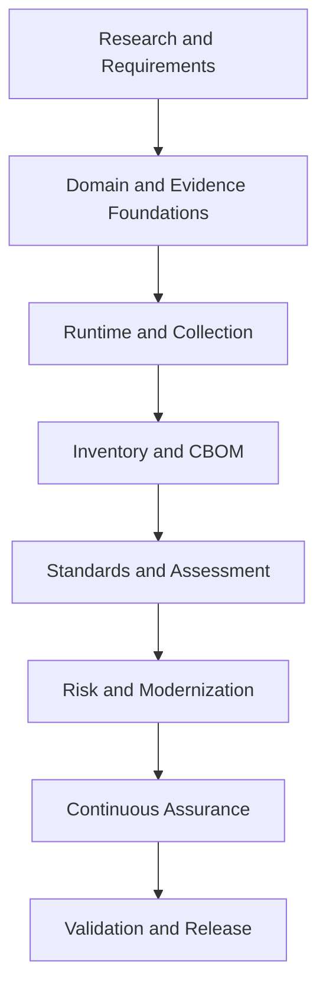

# Research and Development Plan

**Project:** Cryptographic Inventory, Security Assurance and Modernization Framework

**Version:** 0.1.0

**Status:** Proposed

**Research baseline:** November 9, 2026

## 1. Research Purpose

The purpose of this research is to establish the mathematical, technical, architectural and standards foundations for an extensible cryptographic assurance framework.

The framework aims to discover cryptographic assets, collect verifiable evidence, assess security requirements and support cryptographic modernization throughout organizational infrastructure.

Its scope extends beyond initial post-quantum cryptography migration to continuous cryptographic assurance.

### Research objectives

1. Discover and classify organizational cryptographic assets.
2. Establish a canonical, verifiable evidence model.
3. Accommodate differences in operating systems and cryptographic implementations.
4. Support standardized cryptographic inventory exchange.
5. Evaluate cryptographic configurations against versioned requirements.
6. Identify cryptographic exposure and modernization priorities.
7. Support cryptographic agility and continuous assurance.

## 2. Research Questions

The research addresses eight fundamental questions.

| ID | Research question |
|---|---|
| RQ1 | What cryptographic assets should organizations discover and inventory? |
| RQ2 | What evidence is required to assess those assets reliably? |
| RQ3 | How can evidence be collected across different execution environments? |
| RQ4 | How should cryptographic assets and dependencies be represented interoperably? |
| RQ5 | How can assessment decisions remain traceable to changing standards? |
| RQ6 | How should cryptographic risks and PQC migration priorities be evaluated? |
| RQ7 | How can cryptographic mechanisms be replaced without unacceptable operational disruption? |
| RQ8 | How can inventories and assessments remain current throughout an organization's lifecycle? |

## 3. Research Principles

The research and implementation follow these principles:

- **Evidence-driven:** Conclusions must be supported by observations, declarations or documented derivations.
- **Separation of concerns:** Collection, inventory, assessment, risk and modernization have distinct responsibilities.
- **Standards traceability:** Assessment rules identify applicable publications, provisions and versions.
- **Runtime adaptability:** Collection accommodates differences in Python, OpenSSL and cryptographic libraries.
- **Interoperability:** External inventory standards support information exchange.
- **Reproducibility:** Historical assessments preserve their original evidence and methodology.
- **Security by design:** Sensitive cryptographic material receives appropriate protection.
- **Continuous modernization:** The framework evolves with cryptographic technologies and security requirements.

## 4. Research Workstreams

The research is organized into nine workstreams.

| Workstream | Research focus | Principal deliverable |
|---|---|---|
| WS1 — Asset Discovery | Cryptographic asset taxonomy, identification and relationships | Asset taxonomy |
| WS2 — Evidence Architecture | Evidence types, provenance, validation and lifecycle | Canonical evidence model |
| WS3 — Runtime Capabilities | Python, OpenSSL, operating systems and cryptographic APIs | Runtime capability model |
| WS4 — Interoperability | CycloneDX, CBOM and inventory exchange | CBOM integration specification |
| WS5 — Standards and Methodology | Standards provisions, versioning and assessment traceability | Standards registry and methodology |
| WS6 — Cryptographic Assurance | Classical and post-quantum algorithms, key establishment, key management and randomness | Assessment specifications A1–A6 |
| WS7 — Cryptographic Agility | Replaceable implementations, dependencies and interoperability | A8 specification |
| WS8 — Risk and Migration | Quantum exposure, organizational risk and migration prioritization | A9 specification |
| WS9 — Continuous Assurance | Configuration changes, reassessment and modernization monitoring | Continuous assurance architecture |

### Important research areas

**WS1–WS2: Discovery and evidence**

Investigate systems, applications, network services, certificates, cryptographic libraries, HSMs, KMS platforms and randomness components.

Establish how assets are identified and how observations, declarations and derived evidence retain provenance.

**WS3–WS4: Runtime and interoperability**

Examine Python SSL interfaces, OpenSSL implementations, providers, cryptographic APIs and runtime capability differences.

Evaluate CycloneDX 1.7 and ECMA-424 for cryptographic inventory representation, dependencies and evidence exchange.

**WS5–WS6: Standards and cryptographic assurance**

Study NIST, IETF, FIPS and Canadian cybersecurity publications.

Investigate algorithm suitability, cryptographic module assurance, key establishment, key management, entropy sources and random bit generators.

**WS7–WS8: Agility and modernization**

Investigate cryptographic replacement, vendor dependencies, information protection lifetimes, harvest-now-decrypt-later exposure and migration feasibility.

**WS9: Continuous assurance**

Study configuration drift, cryptographic dependency changes, standards updates, certificate lifecycle changes and targeted reassessment.

## 5. Assessment Policy Framework

The research establishes nine independent assessment responsibilities.

| Policy | Responsibility |
|---|---|
| A1 | TLS Protocol Configuration |
| A2 | PKI and Digital Trust |
| A3 | Cryptographic Algorithm and Module Assurance |
| A4 | Key Establishment and KEM Security |
| A5 | Cryptographic Key Management |
| A6 | Random Bit Generation and Entropy Assurance |
| A7 | Cryptographic Inventory and Supply-Chain Visibility |
| A8 | Cryptographic Agility and Interoperability |
| A9 | PQC Exposure and Migration Prioritization |

Each policy requires a documented scope, evidence requirements, assessment rules, rationale, standards references and version.

Research must also identify overlapping responsibilities so that the same security property is not inconsistently assessed by multiple policies.

## 6. Standards Research

The initial research prioritizes the following publications.

| Area | Principal references |
|---|---|
| TLS | RFC 9846, RFC 8996, RFC 9325, RFC 9852, RFC 10015 |
| Hybrid TLS | RFC 9954, RFC 10024 |
| PQC algorithms | FIPS 203, FIPS 204, FIPS 205 |
| PQC transition | NIST IR 8547 |
| Key management | NIST SP 800-57 |
| Entropy and randomness | NIST SP 800-90A, 800-90B, 800-90C |
| Module validation | FIPS 140-3 and CMVP |
| Cryptographic agility | NIST CSWP 39upd1 |
| Canadian guidance | ITSP.40.111 Version 5 |
| Cryptographic inventory | CycloneDX 1.7 / ECMA-424 |

Standards research must distinguish normative requirements, recommendations, drafts, errata and superseded publications.

Publication changes must undergo review before affecting assessment rules.

The detailed catalogue is maintained in `docs/standards/standards-reference.md`.

## 7. Research Methodology

Five complementary methods will guide the research.

| Method | Purpose |
|---|---|
| Standards analysis | Extract requirements, recommendations and applicable provisions. |
| Technical literature review | Examine cryptographic research and recognized engineering guidance. |
| Experimental validation | Test implementation behaviour in controlled environments. |
| Data-model research | Validate asset, evidence and interoperability representations. |
| Implementation-driven evaluation | Develop prototypes where theoretical analysis is insufficient. |

### Experimental environment

The initial laboratory includes:

- Windows development environment.
- Kali Linux WSL.
- Ubuntu Server.
- Python 3.12 and 3.15.2.
- Multiple OpenSSL implementations.

Experiments must record software versions, configurations, inputs, expected results, observations and limitations.

Results must be reproducible and distinguish environment-specific behaviour from general technical conclusions.

## 8. Development Roadmap

Research workstreams guide investigation, while development proceeds through the following dependency-oriented phases.

| Phase | Focus |
|---|---|
| 1 | Research and architectural foundations |
| 2 | Domain and evidence models |
| 3 | Runtime capabilities and collection |
| 4 | Cryptographic inventory and CBOM |
| 5 | Standards registry and assessment policies |
| 6 | Risk and PQC migration |
| 7 | Cryptographic modernization and agility |
| 8 | Continuous assurance and validation |

Each phase requires documented requirements, implementation tests and an acceptance review.

## 9. Initial Scope and Success Criteria

The initial implementation prioritizes TLS endpoint discovery, certificate inspection, key-establishment evidence, runtime provenance and foundational assessments.

It will also establish canonical evidence persistence, initial CycloneDX export and structured reporting.

The first implementation must not claim complete enterprise cryptographic inventory coverage or comprehensive organizational PQC readiness.

The broader framework will be successful when it can:

1. Discover cryptographic assets through independent collectors.
2. Produce traceable and verifiable evidence.
3. Explain runtime dependencies and collection limitations.
4. Exchange interoperable cryptographic inventories.
5. Assess configurations against versioned requirements.
6. Explain findings through evidence, rules and standards.
7. Identify cryptographic exposure and modernization priorities.
8. Support migration validation and continuous reassessment.

**Guiding principle:** Build a defensible cryptographic assurance framework that remains useful as algorithms, implementations, standards and organizational requirements evolve.
