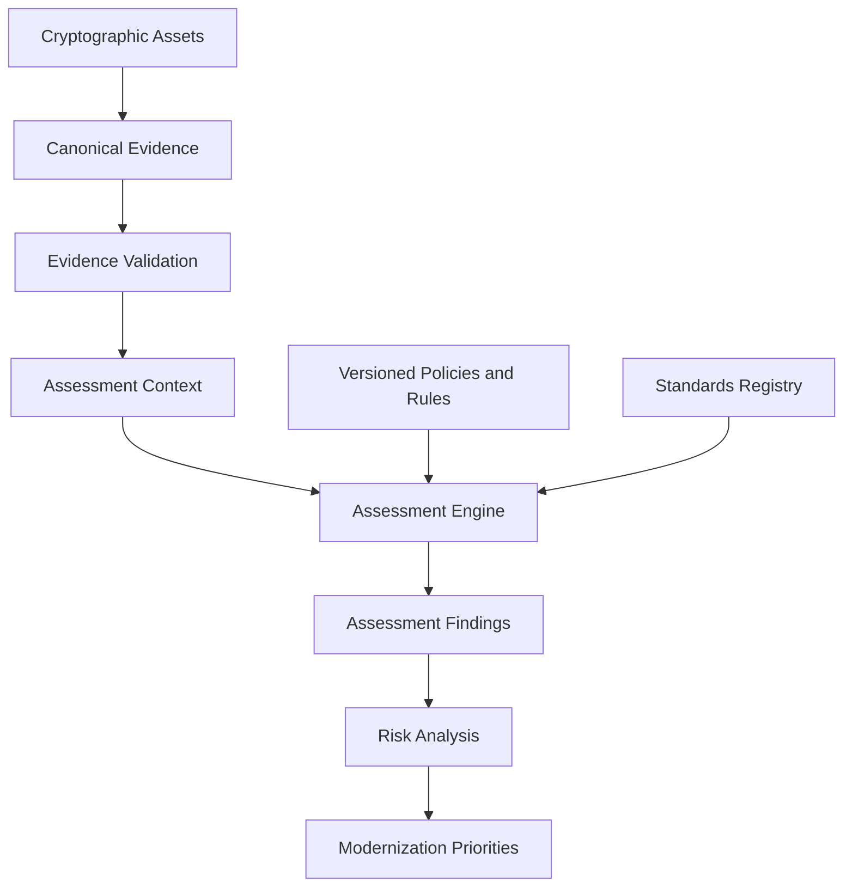

# Assessment Methodology

**Project:** Cryptographic Inventory, Security Assurance and Modernization Framework

**Version:** 0.1.0

**Status:** Proposed

## 1. Purpose

This document defines the methodology for evaluating cryptographic assets against documented security requirements.

The assessment framework uses collected evidence, versioned policies and authoritative standards to produce traceable findings.

It supports cryptographic security assurance, PQC readiness and continuous modernization.

## 2. Assessment Principles

Assessments must follow these principles:

1. Evidence-driven conclusions.
2. Explicit and independently versioned assessment rules.
3. Traceability to applicable standards.
4. Separation of technical findings from organizational risk.
5. Transparent handling of missing or inconclusive evidence.
6. Reproducibility of historical assessments.
7. No unsupported assumptions about cryptographic security.

## 3. Assessment Workflow

The assessment engine consumes validated evidence and executes selected policy versions.

Collection and assessment are independent operations.

## 4. Assessment Policies

The framework initially defines nine assessment areas.

| Policy | Responsibility |
|---|---|
| A1 | TLS Protocol Configuration |
| A2 | PKI and Digital Trust |
| A3 | Cryptographic Algorithm and Module Assurance |
| A4 | Key Establishment and KEM Security |
| A5 | Cryptographic Key Management |
| A6 | Random Bit Generation and Entropy Assurance |
| A7 | Cryptographic Inventory and Supply-Chain Visibility |
| A8 | Cryptographic Agility and Interoperability |
| A9 | PQC Exposure and Migration Prioritization |

Each policy has independent scope, evidence requirements, rules and standards references.

The policy catalogue is maintained in `docs/policies/`.

## 5. Finding Classification

The initial classification vocabulary is:

| Classification | Meaning |
|---|---|
| `acceptable` | Satisfies the applicable assessment rule. |
| `acceptable_with_review` | Requires further review or consideration. |
| `unacceptable` | Violates an applicable assessment requirement. |
| `unknown` | Available evidence does not support a conclusion. |

These classifications are project-specific assessment outcomes, not universal security ratings.

Policy execution status is separate from finding classification.

A policy may execute successfully while producing an `unknown` finding.

## 6. Evidence Requirements

Each assessment rule must identify:

- Required evidence properties.
- Applicable asset types.
- Evidence quality and provenance requirements.
- Evaluation criteria.
- Classification rationale.
- Supporting standards provisions.
- Known limitations.

Missing, unsupported or inconclusive evidence must not automatically imply security or insecurity.

Derived findings must remain traceable to their originating evidence and rule versions.

## 7. Standards Traceability

Every standards-based rule must identify its applicable publication edition and provision.

The standards registry maintains publication identities, editions and provisions.

Standards changes require review before they affect assessment rules.

A new standards edition must not silently alter historical findings.

Project-specific requirements must be explicitly identified when they are not directly mandated by an external standard.

## 8. Policy and Historical Versioning

Each assessment preserves:

- Policy identity and version.
- Rule identities and versions.
- Applicable standards editions.
- Evidence references.
- Assessment methodology version.
- Execution timestamp.
- Assessment limitations.

Historical assessment results are immutable.

Reassessment creates a new assessment run rather than rewriting previous conclusions.

## 9. Risk and Modernization

Technical assessment findings provide inputs to organizational risk analysis.

Risk prioritization may consider:

- Data sensitivity.
- Information protection lifetime.
- System criticality.
- External exposure.
- Cryptographic dependencies.
- Migration feasibility.
- Available mitigations.

Risk decisions must preserve their assumptions and rationale.

PQC migration planning and cryptographic modernization are separate activities that consume assessment and risk results.

## 10. Assessment Limitations

An assessment establishes conclusions only within its documented scope and available evidence.

The framework must not claim:

- Complete cryptographic inventory coverage without sufficient discovery.
- Algorithm security from an algorithm name alone.
- Endpoint capabilities from scanner capabilities.
- Entropy assurance from DRBG identification alone.
- Organizational PQC readiness from TLS observations alone.

Assessment reports must disclose relevant evidence gaps and limitations.

**Guiding principle:** Every assessment conclusion must be explainable through its evidence, rule, rationale and applicable standards.
