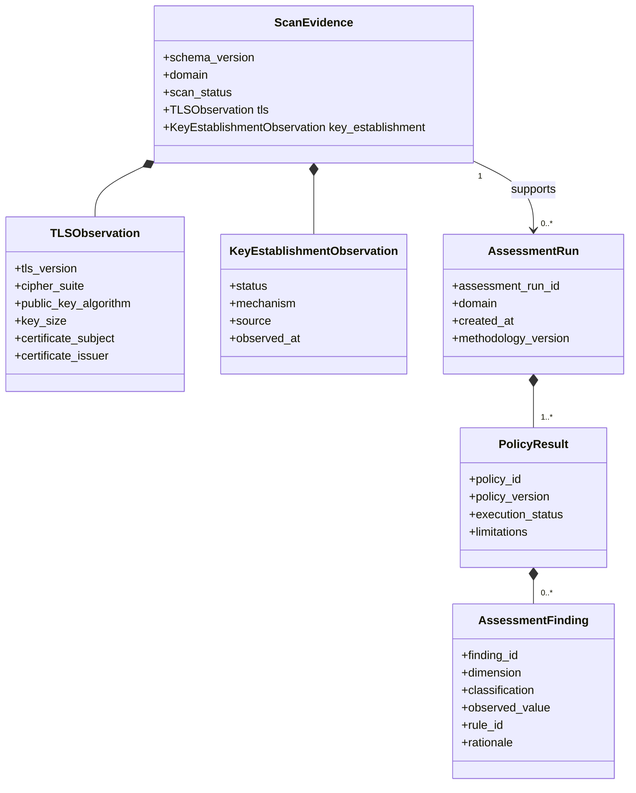
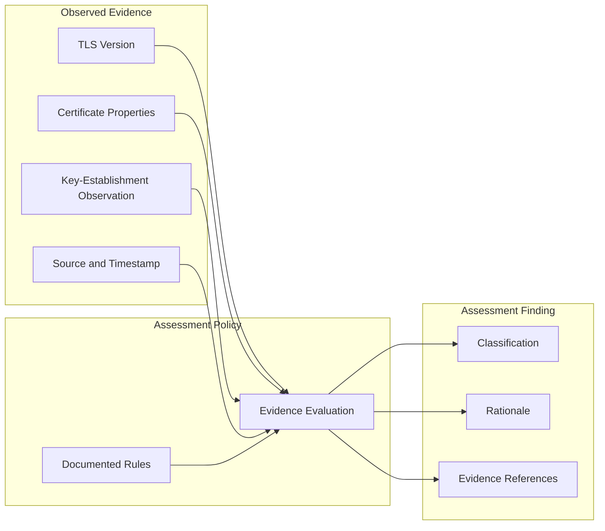
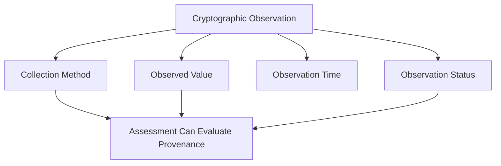
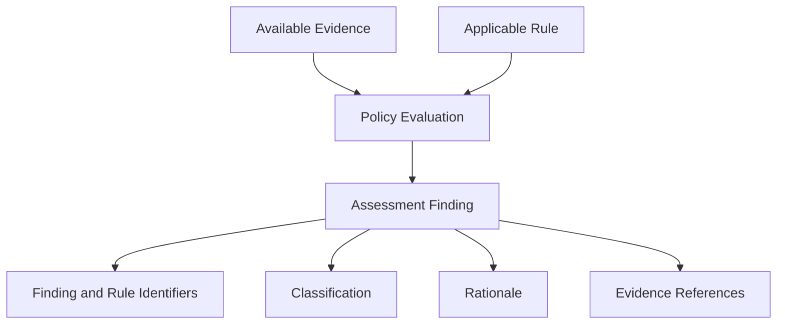
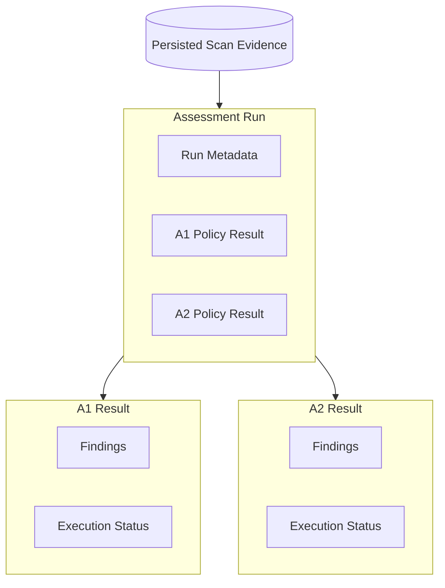
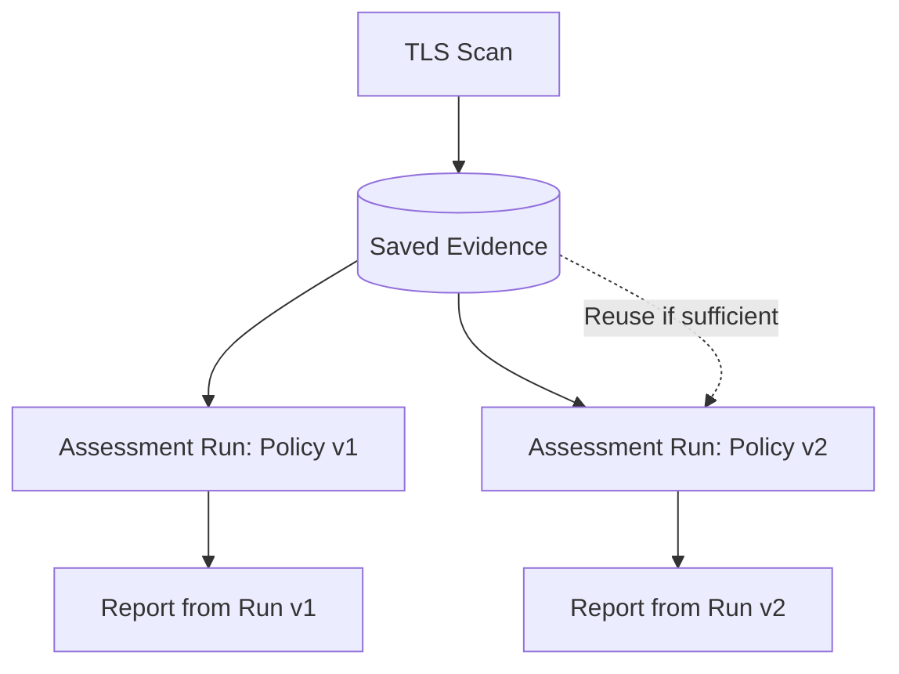

# Data Model

## 1. Purpose

This document defines the target data model for the Cryptographic Inventory and PQC Risk Assessment project.

The model separates collected observations from assessment conclusions. This allows the system to preserve evidence, explain findings, and reassess previously collected information when policies change.

The examples illustrate the proposed design. They are not a guarantee that the current repository already produces these structures.

## 2. Core Data Relationships



The principal relationships are:

* A scan produces evidence.
* Evidence can support multiple assessment runs.
* An assessment run contains policy results.
* A policy result contains zero or more findings.
* A finding explains a conclusion derived from evidence.

The implementation may initially embed evidence inside an assessment record or persist it separately. The storage design must preserve the logical distinction.

## 3. Evidence Versus Conclusion

This is the most important distinction in the data model.



The scanner records observations. The assessment policy interprets those observations according to documented rules.

For example:

* **Evidence:** The negotiated TLS version was `TLSv1.3`.
* **Rule:** A documented A1 rule evaluates the observed TLS version.
* **Finding:** The classification assigned by that rule, with an explanation.

The classification cannot be derived from the evidence alone without the relevant rule.

## 4. Scan Evidence

A conceptual scan-evidence record is:

```json
{
  "schema_version": "1.0",
  "domain": "example.com",
  "scan": {
    "status": "completed",
    "started_at": "2026-10-20T12:00:00Z",
    "completed_at": "2026-10-20T12:00:03Z"
  },
  "tls": {
    "status": "observed",
    "tls_version": "TLSv1.3",
    "cipher_suite": "TLS_AES_256_GCM_SHA384",
    "public_key_algorithm": "RSA",
    "key_size": 3072,
    "certificate_subject": "CN=example.com",
    "certificate_issuer": "CN=Example Issuing CA",
    "not_before": "2026-01-01T00:00:00Z",
    "not_after": "2027-01-01T00:00:00Z"
  }
}
```

*Illustrative example only; it does not represent a real scan.*

The final structure must reflect what the scanner actually collects.

### Evidence requirements

* Preserve the target identity.
* Record the scan outcome.
* Retain available TLS and certificate observations.
* Represent missing or unavailable evidence explicitly.
* Preserve errors rather than silently discarding failed scans.
* Distinguish the target hostname from the certificate's identity.

A missing key size must not be represented as a zero-bit key. An unavailable observation must not be treated as proof of a secure configuration.

## 5. Evidence Provenance

Evidence provenance explains where an observation came from and how it was obtained.



For example:

```json
{
  "status": "observed",
  "mechanism": "X25519",
  "source": "separate_openssl_handshake",
  "observed_at": "2026-10-20T12:00:04Z"
}
```

The provenance matters because an observation made during a separate handshake must not automatically be described as the mechanism negotiated during another connection.

The system should distinguish:

* A mechanism observed in a connection.
* A mechanism advertised by an endpoint.
* A mechanism inferred from indirect evidence.
* A mechanism that could not be determined.

These are different evidentiary claims.

## 6. Assessment Context

An assessment context supplies a policy with the information required to evaluate a target.

Conceptually, it includes:

* Target identity.
* Available scan evidence.
* Assessment configuration.
* Relevant methodology metadata.

Policies should evaluate supplied evidence rather than perform their own network scans.

If required evidence is missing, the policy must handle that condition explicitly.

## 7. Assessment Finding

A finding represents one assessment conclusion.



A proposed finding record is:

```json
{
  "finding_id": "A1-TLS-VERSION",
  "policy_id": "A1",
  "dimension": "tls_version",
  "classification": "acceptable",
  "observed_value": "TLSv1.3",
  "rule_id": "A1-RULE-001",
  "rationale": "The observation satisfies the documented rule.",
  "evidence_references": [
    "tls.tls_version"
  ]
}
```

The rule identifier and rationale must match the actual assessment methodology.

### Classification definitions

| Classification           | Meaning                                                                           |
| ------------------------ | --------------------------------------------------------------------------------- |
| `acceptable`             | The evidence satisfies the applicable documented rule.                            |
| `acceptable_with_review` | The rule's conditions are met, but a documented caveat or further review applies. |
| `unacceptable`           | The evidence violates the applicable documented rule.                             |
| `unknown`                | Available evidence cannot support a reliable conclusion.                          |

The assessment methodology must define the precise conditions for each classification.

`unknown` does not mean `acceptable`, and it does not automatically mean `unacceptable`.

A single target may produce multiple findings under one policy. Consequently, finding counts and affected-target counts must be calculated separately.

## 8. Policy Result

A policy result records the outcome of applying a particular assessment policy.

```json
{
  "policy_id": "A1",
  "policy_version": "1.0",
  "execution_status": "completed",
  "findings": [],
  "limitations": []
}
```

### Execution status

| Status         | Meaning                                                |
| -------------- | ------------------------------------------------------ |
| `completed`    | The policy completed its defined assessment operation. |
| `partial`      | Some intended evaluations could not be completed.      |
| `not_assessed` | The policy was not executed.                           |
| `failed`       | The policy execution failed.                           |

Execution status describes the assessment process, not the classification of the findings.

A completed policy can produce `unknown` findings. A partial policy can still produce valid findings for the evidence it successfully evaluated.

The `limitations` field should describe constraints that affect interpretation.

## 9. Assessment Run

An assessment run groups the results produced when policies evaluate a target.



A proposed assessment-run record is:

```json
{
  "schema_version": "1.0",
  "assessment_run_id": "run-example-001",
  "domain": "example.com",
  "created_at": "2026-10-20T12:05:00Z",
  "evidence_reference": "scan-example-001",
  "methodology_version": "1.0",
  "assessments": {
    "A1": {
      "policy_id": "A1",
      "policy_version": "1.0",
      "execution_status": "completed",
      "findings": [],
      "limitations": []
    }
  }
}
```

*Illustrative structure only.*

An assessment run should identify:

* The target.
* The assessment-run identifier.
* The evidence used.
* The assessment timestamp.
* The methodology version.
* The policy versions and execution statuses.

## 10. Reassessment and Persistence



When assessment rules change, the system should be able to produce a new assessment run from saved evidence, provided the evidence supports the new rules.

A policy version change does not necessarily require a schema-version change. Conversely, a change to the persisted data structure may require a schema-version change even when assessment rules remain unchanged.

The initial implementation may use JSON files. The storage layer should centralize loading, saving, validation, and compatibility handling.

## 11. Validation and Compatibility

Persisted data must be validated before assessment or reporting.

Validation should cover:

* Required fields and field types.
* Supported schema versions.
* Recognized execution statuses and classifications.
* Required policy metadata.
* Finding structure.
* Evidence references.
* Failed or incomplete scan records.

Invalid data should produce a clear error rather than a misleading assessment.

The implementation should adopt a consistent model-validation approach. Typed dictionaries, dataclasses, Pydantic, or another suitable approach can be evaluated before implementation; they should not be mixed arbitrarily.

Existing repository models and saved JSON files must be reviewed before migration. Valid JSON is not necessarily valid data under the new schema.

## 12. Design Invariants

The following constraints govern the implementation:

1. Evidence and assessment conclusions remain distinct.
2. Missing evidence never silently becomes proof of security.
3. Policy execution status is independent of finding classification.
4. Evidence provenance is retained where it affects interpretation.
5. Every finding identifies its applicable rule and rationale.
6. Policy and schema versions are tracked independently.
7. Reports do not introduce new assessment decisions.
8. Reassessment reuses evidence when sufficient.
9. Incompatible persisted data is rejected or explicitly migrated.
10. New policies must define their evidence requirements and classification rules before implementation.
