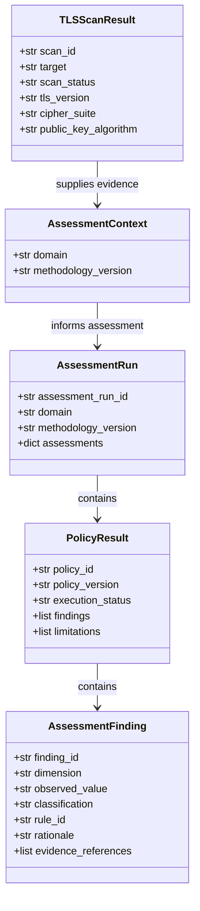

# Data Model

## 1. Overview

The project uses two main data models:

* **TLS scan evidence:** Records TLS configuration and certificate information collected from a target.
* **Assessment results:** Records policy evaluations of the collected evidence.

Scan evidence is represented by `TLSScanResult`. Assessment results use `AssessmentRun`, `PolicyResult`, and `AssessmentFinding`.

## 2. Data Relationships

## 3. TLS Scan Evidence

`TLSScanResult` is a `TypedDict` defined in `collection/models.py`. It records the target, scan status, timestamps, certificate information, TLS configuration, and diagnostic messages.

Key fields include:

| Field                                 | Purpose                                                      |
| ------------------------------------- | ------------------------------------------------------------ |
| `scan_id`                             | Identifies the scan                                          |
| `target`                              | Domain or IP address scanned                                 |
| `scan_status`                         | Indicates whether the scan completed, was partial, or failed |
| `tls_version`                         | Records the observed TLS version                             |
| `cipher_suite`                        | Records the negotiated cipher suite                          |
| `public_key_algorithm`                | Identifies the certificate public-key algorithm              |
| `certificate_signature_algorithm_oid` | Identifies the certificate signature algorithm               |
| `key_establishment_group`             | Records an observed key-establishment group, when available  |
| `diagnostics`                         | Records issues encountered during collection                 |

Optional fields may be absent when evidence cannot be collected.

### Key-establishment evidence

Key-establishment information is collected through a separate OpenSSL handshake. It should be interpreted with its provenance in mind; it does not necessarily describe the same handshake as the primary TLS scan.

## 4. Assessment Results

The assessment models are defined in `assessment/models.py`.

* **`AssessmentContext`** supplies the target, collected TLS evidence, and methodology version to a policy.
* **`AssessmentRun`** records an assessment execution and embeds the original TLS evidence.
* **`PolicyResult`** records a policy's execution status, findings, and limitations.
* **`AssessmentFinding`** records an individual evaluation, including its classification, rule, rationale, and evidence references.

The current classification values are:

`acceptable`, `acceptable_with_review`, `unacceptable`, and `unknown`.

Policy execution statuses are:

`completed`, `partial`, `not_assessed`, and `failed`.

## 5. Persistence

`JSONRepository` provides JSON loading and saving. It checks file extensions, creates parent directories, and uses atomic file replacement when saving.

`AssessmentService.assess_file()` loads evidence, runs the assessment, and saves the resulting assessment runs.

The repository does not independently validate the complete data schema. Runtime validation of `TypedDict` fields is also not automatic.

## 6. Design Principles

1. Preserve collected evidence separately from policy conclusions.
2. Keep findings traceable to the evidence and rule that produced them.
3. Record limitations when evidence is incomplete or a policy cannot fully assess it.
4. Version scan schemas and assessment methodology explicitly.
5. Avoid treating unavailable evidence as proof of a secure or insecure configuration.
