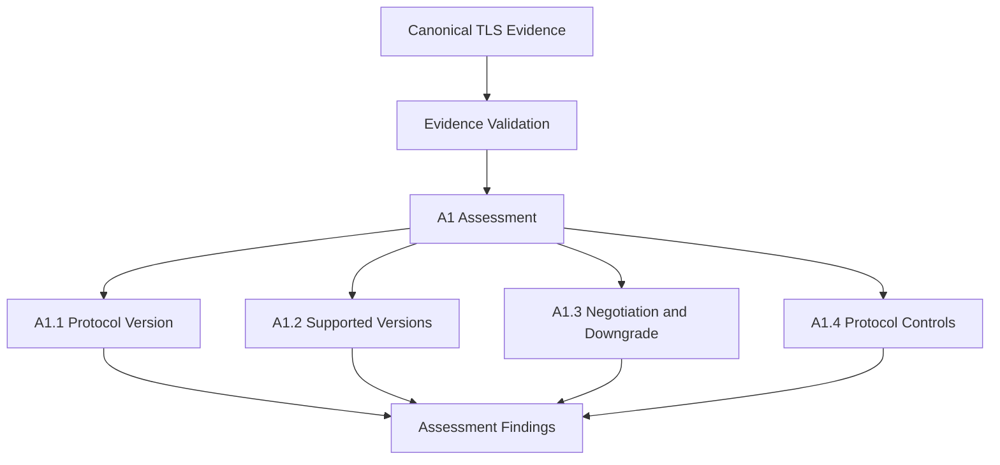

# A1 — TLS Protocol Configuration Assessment

**Version:** 0.1.0

**Status:** Proposed

## 1. Objective

Assess whether a TLS endpoint's protocol versions, negotiation behaviour and protocol-level configuration conform to an established secure deployment baseline.

A1 identifies deprecated protocol versions, inappropriate negotiation behaviour, downgrade weaknesses and protocol configuration issues.

It does not provide an overall security rating of the endpoint.

## 2. Scope

A1 evaluates:

- Negotiated TLS protocol versions.
- Supported TLS protocol versions.
- Version negotiation behaviour.
- Downgrade and fallback protection.
- Applicable TLS protocol-level controls.

The initial scope covers TLS over TCP. DTLS and QUIC are outside the initial implementation.

## 3. Assessment Rules

| Rule | Name | Assessment responsibility |
|---|---|---|
| A1.1 | Negotiated Protocol Version | Classify the observed TLS version. |
| A1.2 | Supported Protocol Versions | Identify deprecated or non-preferred versions accepted by the endpoint. |
| A1.3 | Negotiation and Downgrade Protection | Evaluate version negotiation, fallback and downgrade behaviour. |
| A1.4 | Protocol Security Controls | Evaluate applicable protocol-level configuration requirements. |

### A1.1 Classification

| Observed protocol | Classification |
|---|---|
| TLS 1.3 | `acceptable` |
| TLS 1.2 | `acceptable_with_review` |
| TLS 1.1 and TLS 1.0 | `unacceptable` |
| SSLv3 and SSLv2 | `unacceptable` |
| Missing or unrecognized | `unknown` |

TLS 1.2 requires additional review against the applicable configuration baseline. It is not inherently insecure when appropriately configured.

These classifications are project-specific assessment decisions informed by applicable standards.

## 4. Evidence Requirements

A1 requires the following evidence where applicable:

- Target hostname or IP address and port.
- Collection timestamp and provenance.
- TLS client and cryptographic library versions.
- Negotiated protocol version.
- Client-offered and server-selected versions.
- Supported versions established through controlled probes.
- Negotiation and downgrade observations.
- Relevant protocol extensions and configuration observations.
- Probe outcomes, diagnostics and collection limitations.

Primary handshake observations and independent capability probes must remain distinguishable.

Every negotiated property must reference its originating handshake.

## 5. Assessment Workflow

A1 evaluates canonical evidence collected from TLS endpoints.

Each finding records its classification, rationale, originating rule version and supporting evidence references.

## 6. Assessment Limitations

A successful handshake establishes only the configuration observed during that connection.

It does not establish every protocol version supported by the endpoint.

Supported-version claims require appropriate controlled probes and sufficient test coverage.

An unsuccessful probe caused by client limitations must not be interpreted as evidence that the endpoint lacks the tested capability.

Observed behaviour may vary with hostname, network path, server configuration and client capabilities.

## 7. Standards References

The primary standards basis includes:

- RFC 9846 — The Transport Layer Security (TLS) Protocol Version 1.3.
- RFC 8996 — Deprecating TLS 1.0 and TLS 1.1.
- RFC 9325 — Recommendations for Secure Use of TLS and DTLS, as updated by RFC 9852 and RFC 10015.
- RFC 9852 — New Protocols Using TLS Must Require TLS 1.3.
- RFC 6176 — Prohibiting SSL Version 2.0.
- RFC 7568 — Deprecating SSL Version 3.0.
- NIST SP 800-52 Rev. 2 — Guidelines for the Selection, Configuration, and Use of TLS Implementations.

NIST SP 800-52 Rev. 2 is under review.

Applicable standards provisions must be mapped to individual rules through the standards registry.

## 8. Versioning

Each assessment preserves the policy version, rule versions, applicable standards editions, evidence references and assessment timestamp.

Changes to assessment criteria require a new policy or rule version.

Historical findings must remain reproducible.

**Guiding principle:** Assess TLS protocol configuration using verifiable evidence, explicit rules and applicable standards.
