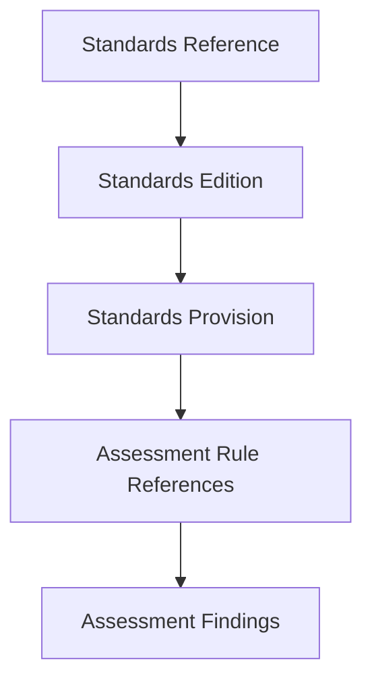
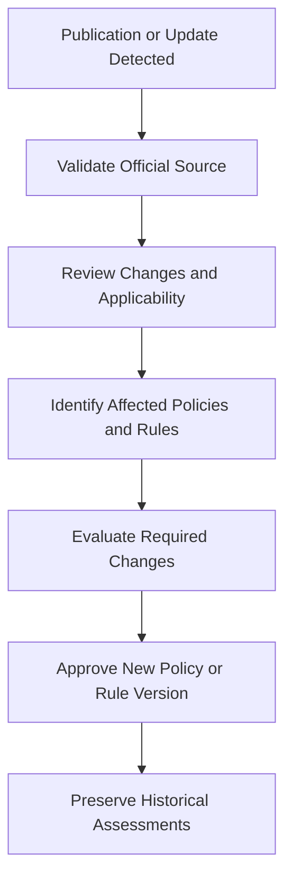

# Standards Reference Catalogue

**Project:** Cryptographic Inventory, Security Assurance and Modernization Framework

**Version:** 0.1.0

**Status:** Proposed

**Research baseline:** November 9, 2026

## 1. Purpose

This document identifies the authoritative standards, technical specifications and guidance publications informing the framework's collection and assessment activities.

It establishes the initial standards reference catalogue for policies A1–A9.

The catalogue is maintained independently of assessment rules so that publication revisions, errata and supersession can be tracked without silently changing historical assessments.

## 2. Standards Categories

The framework prioritizes five reference categories:

| Category | Primary sources |
|---|---|
| TLS and secure communications | IETF RFCs and NIST TLS guidance |
| Cryptographic algorithms | NIST FIPS and SP publications |
| Key management and randomness | NIST SP 800-56, 800-57 and 800-90 series |
| PQC transition and agility | NIST PQC publications and Canadian Cyber Centre guidance |
| Cryptographic inventory | CycloneDX and ECMA standards |

## 3. Initial Reference Catalogue

### 3.1 TLS and Secure Communications

| Reference | Subject | Assessment relevance |
|---|---|---|
| RFC 9846 | TLS 1.3 protocol specification | A1, A4 |
| RFC 8996 | Deprecation of TLS 1.0 and 1.1 | A1 |
| RFC 9325 | Secure use of TLS and DTLS | A1 |
| RFC 9852 | New protocols requiring TLS 1.3 | A1 |
| RFC 10024 | Hybrid PQ/T key agreement for TLS 1.3 | A4 |
| RFC 9954 | Hybrid key exchange framework for TLS 1.3 | A4 |
| RFC 9525 | Service identity verification in TLS | A2 |
| NIST SP 800-52 Rev. 2 | TLS implementation configuration guidance | A1, A2, A3 |

RFC 9846 supersedes RFC 8446 as the TLS 1.3 specification. RFC 9852 updates RFC 9325, while RFC 10024 specifies hybrid groups including X25519MLKEM768.

NIST SP 800-52 Rev. 2 remains a published reference but is under review. Its current publication status and future revision must be monitored.

### 3.2 Cryptographic Algorithms and PQC

| Reference | Subject | Assessment relevance |
|---|---|---|
| FIPS 203 | ML-KEM | A3, A4, A9 |
| FIPS 204 | ML-DSA | A2, A3, A9 |
| FIPS 205 | SLH-DSA | A2, A3, A9 |
| NIST SP 800-227 | Recommendations for Key-Encapsulation Mechanisms | A4 |
| NIST SP 800-131A Rev. 2 | Transitioning Cryptographic Algorithms and Key Lengths | A3, A9 |

FIPS 203, 204 and 205 establish the initial NIST PQC algorithm standards.

NIST has published potential errata for FIPS 203 and FIPS 204. The framework must track these notices and applicable corrections rather than assuming the original publications remain unchanged.

### 3.3 Key Management and Randomness

| Reference | Subject | Assessment relevance |
|---|---|---|
| NIST SP 800-56A | Pair-Wise Key-Establishment Schemes Using Discrete Logarithm Cryptography | A4 |
| NIST SP 800-56B | Pair-Wise Key-Establishment Schemes Using Integer Factorization Cryptography | A4 |
| NIST SP 800-56C Rev. 2 | Key-Derivation Methods in Key-Establishment Schemes | A4 |
| NIST SP 800-57 Part 1 Rev. 5 | General Key Management Guidance | A5 |
| NIST SP 800-90A Rev. 1 | Deterministic Random Bit Generator Mechanisms | A6 |
| NIST SP 800-90B | Entropy Source Requirements and Validation | A6 |
| NIST SP 800-90C | Random Bit Generator Constructions | A6 |

SP 800-90A addresses DRBG mechanisms, SP 800-90B addresses entropy sources, and SP 800-90C addresses complete random bit generator constructions.

SP 800-57 Part 1 Revision 6 is an initial public draft, not a final replacement for Revision 5 at this research baseline.

### 3.4 Cryptographic Transition and Agility

| Reference | Subject | Assessment relevance |
|---|---|---|
| NIST IR 8547 | Transition to Post-Quantum Cryptography Standards | A8, A9 |
| NIST CSWP 39upd1 | Considerations for Achieving Crypto Agility | A8 |
| Canadian ITSP.40.111 Version 5 | Recommended cryptographic algorithms and phase-out guidance | A3, A4, A6, A9 |

NIST IR 8547 was finalized on October 27, 2026.

Canadian ITSP.40.111 Version 5 took effect on May 29, 2026. It includes phase-out dates for quantum-vulnerable key-establishment and digital-signature mechanisms.

These publications are particularly important for organizational PQC transition planning.

### 3.5 Cryptographic Inventory and Interoperability

| Reference | Subject | Assessment relevance |
|---|---|---|
| CycloneDX 1.7 | Cryptographic Bill of Materials and component inventory | A7 |
| ECMA-424, Second Edition | CycloneDX BOM specification | A7 |

CycloneDX 1.7 provides standardized representations for components, dependencies, cryptographic artefacts and supporting evidence.

The framework will use CycloneDX as an external interoperability format rather than its internal domain model.

## 4. Standards-to-Policy Mapping

The following mapping identifies the principal reference areas for each assessment policy.

| Policy | Primary reference areas |
|---|---|
| A1 | TLS protocol specifications and deployment guidance |
| A2 | PKI, X.509 and service identity standards |
| A3 | Cryptographic algorithm and module standards |
| A4 | Key-establishment and KEM standards |
| A5 | Cryptographic key management |
| A6 | Entropy and random bit generation |
| A7 | CycloneDX and cryptographic inventory |
| A8 | Cryptographic agility and interoperability |
| A9 | PQC transition and quantum-risk guidance |

This mapping is indicative. Individual assessment rules must reference specific applicable provisions.

## 5. Standards Registry Model

The standards registry maintains three levels of information:

Each entry should maintain:

- Publication identifier and publisher.
- Title and official URL.
- Edition or revision.
- Publication and effective dates.
- Publication status.
- Errata and revision notices.
- Supersession relationships.
- Applicable assessment policies.

Standards provisions must identify their originating edition.

## 6. Publication Lifecycle

The framework must distinguish:

| Status | Meaning |
|---|---|
| Draft | Published for review; not a final standard |
| Final | Officially published edition |
| Under review | Existing publication undergoing revision review |
| Superseded | Replaced by another edition |
| Withdrawn | Formally withdrawn |
| Historic | Retained for historical reference |

A draft may inform research but must not automatically be treated as an established final requirement.

An erratum or potential-update notice must also be distinguishable from a formally published replacement edition.

## 7. Standards Change Management

Standards changes must follow a controlled review process:

Publication changes must not silently modify existing assessment classifications.

Every resulting policy change must preserve its rationale, effective date and supporting publication references.

## 8. Authoritative Sources

The initial registry will prioritize these official sources:

| Publisher | Source |
|---|---|
| IETF | RFC Editor |
| NIST | Computer Security Resource Center |
| Canadian Cyber Centre | cyber.gc.ca |
| Ecma International | ecma-international.org |
| CycloneDX | cyclonedx.org |

Publication status, errata and supersession must be checked against the issuing authority.

**Guiding principle:** Standards provide authoritative technical requirements and guidance; assessment rules interpret applicable provisions within a documented scope and methodology.
